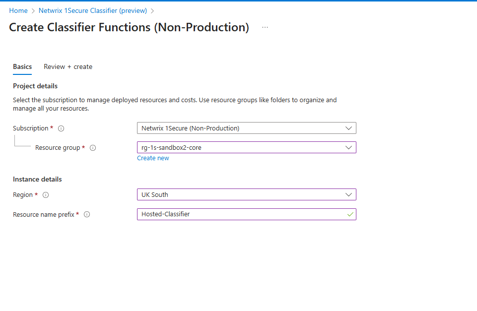
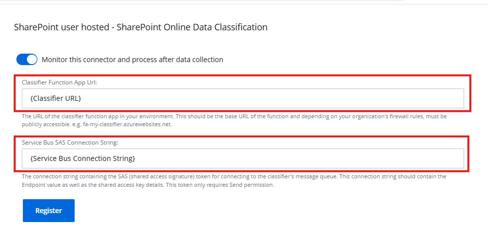
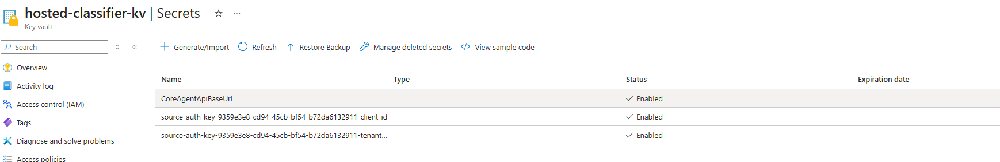
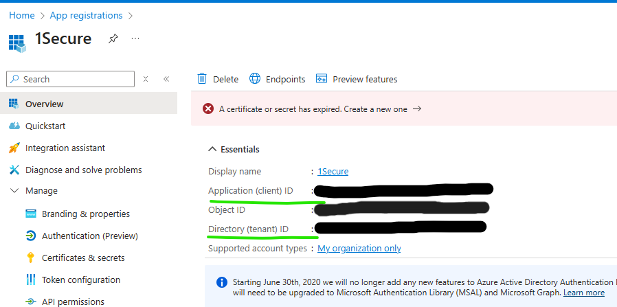
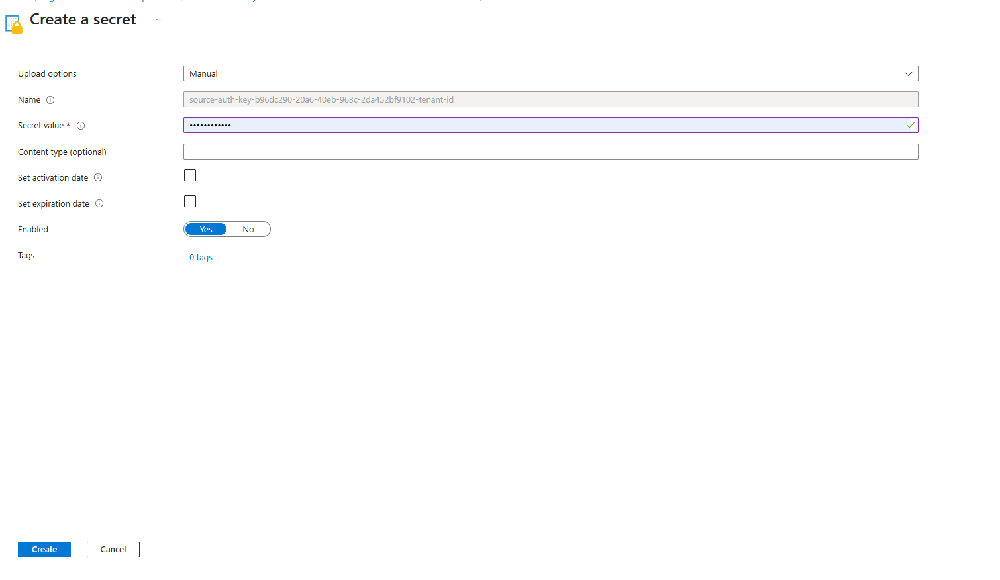
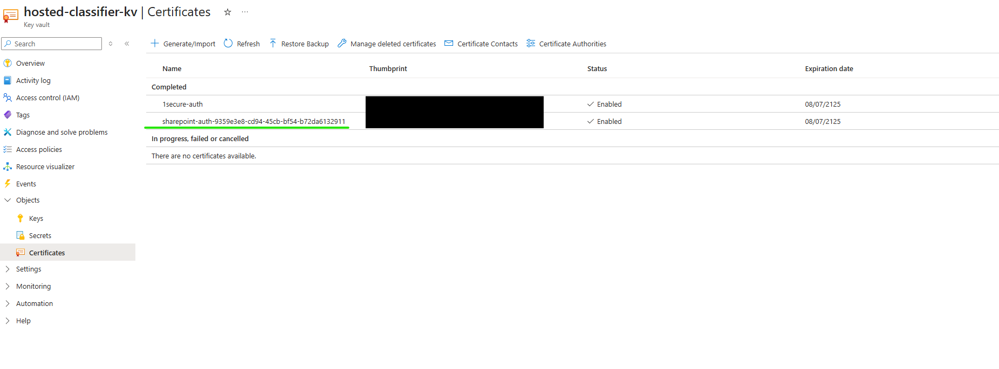
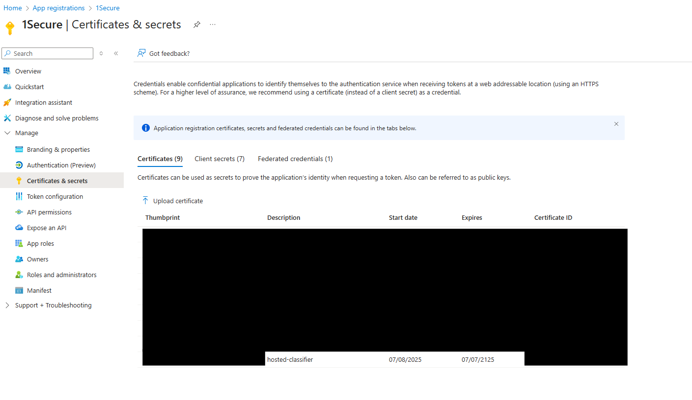

# Configure SharePoint Online Classification App

## Create 1Secure SPO Data Classification Connector

* Log in to 1Secure
* Go to Configuration
* Go to Managed organizations
* Select the child tenant you're working within
* Select the SharePoint Online source's Connectors
* Add/Edit SharePoint Online Data Classification

The connector has these settings: **Classifier Function App Url**, **Service Bus SAS Connection String**, **Run OCR to improve classification of images (increases processing time)**, and **Sensitive Data Types to Classify**. You must register the classifier before you save the connector. You complete the URL and connection string in [Register the Classifier in 1Secure](#register-the-classifier-in-1secure).

:::note
The new web UI can't edit this connector type. It shows "Editing this connector type is not supported in the new UI yet. Please use the classic UI to make changes."
:::

## Deploy and Configure the Classifier in Azure

* Create new resource group
* Give the current user at least Contributor and Role Based Access Control Administrator within the resource group. The deployment assigns Key Vault Administrator to the deploying user and Key Vault roles to the classifier function app, so the deploying user must be able to create role assignments.
* Add "Netwrix 1Secure Classifier" from marketplace

  \
  
* Set Region
* Set Resource name `<prefix>` (8 to 21 characters), e.g. CompanyName-1Secure
* Optionally set the text extraction API key. The default is a random GUID. The deployment sets it as `TextExtraction__ApiKey` on both the classifier and text extraction function apps, so you don't copy a key by hand.
* After creation go to resource group

The deployment creates these resources, named from `<prefix>`:

* `<prefix>`-classifier and `<prefix>`-textextraction (function apps)
* `<prefix>`-ai (Application Insights)
* `<prefix>`-kv (Key Vault)
* `<prefix>`-sb-core (Service Bus), with a queue named `state-classification`
* `<prefix>`-workspace

The deployment also creates a Service Bus shared access policy named `1Secure-AccessKey` that has only the Send right.

## Register the Classifier in 1Secure

* In the Azure deployment, go to the outputs
* Copy the `ClassifierFunctionAppUrl` output (`https://<prefix>-classifier.azurewebsites.net`)
* In 1Secure, paste it as "Classifier Function App Url". The URL must be a valid absolute HTTPS URL and, depending on your organization's firewall rules, must be publicly accessible.
* Copy the `ServiceBusSasConnectionString` output, which is the primary connection string of the `1Secure-AccessKey` policy
* Swap to 1Secure tab and paste as "Service Bus SAS Connection String"

 

* Press Register
* After success, save, and swap back to Azure Portal (tab 1)

Registration needs the source group to have at least one source. 1Secure sends the request to the classifier and waits up to 5 minutes, to allow for certificate generation in Key Vault. It then checks up to 30 times, at 10-second intervals, for the classifier public key. A classifier counts as registered when 1Secure stores its public key. On success, 1Secure shows "Classifier has been registered successfully."

If you change the URL or connection string after you register, 1Secure shows "You've made changes to the classifier settings. Please re-register the classifier before saving." If you save without registering, it shows "Please register the classifier before saving your changes."

## Set Up Classifier Link to SPO

**On Azure Portal (tab 1):**

The classifier reads the SharePoint app registration from its Key Vault. The secrets `source-auth-key-<source GUID>-client-id` and `source-auth-key-<source GUID>-tenant-id` must contain valid GUIDs, and the certificate is `sharepoint-auth-<source GUID>`.

* Go to `<prefix>`-kv
* Open Objects folder and go to Secrets
* Swap to Azure Portal (tab 2)

**On Azure Portal (tab 2):**

* Open your SharePoint App Registration

 

* Copy App Registration tenant ID
* Swap to Azure Portal (tab 1)
  * Click the secret with the name "source-auth-key-\{Guid\}-__tenant-id__"
  * Click "+New Version"
  * Paste the tenant ID as the secret value
  * Click Create\n
* Copy App Registration client ID
* Swap to Azure Portal (tab 1)
  * Click the secret with the name "source-auth-key-\{Guid\}-__client-id__"
  * Click "+New Version"
  * Paste the client ID as the secret value
  * Click Create

**On Azure Portal (tab 1):**

 

* Go to Certificates
* Click "sharepoint-auth-\{Guid\}"
* Click the current version
* Click "Download in CER format"
* Swap to Azure Portal (tab 2)

**On Azure Portal (tab 2):**

* Open Manage folder in App Registration and click Certificates & Secrets
* Go to Certificates
* Click "Upload certificate"
* Upload the downloaded certificate and give it a name

 

## Troubleshooting

### General Errors

**Classification connector successfully registers but shows status 'New' even after a successful state crawl**

* There could be errors in the classifier app - check the Application Insights resource (in the classifier resource group, resource ending in `-ai`) for more detailed errors - see the [Application Insights Errors](#application-insights-errors) section for further troubleshooting steps

### Registration Errors

**The classifier function app URL must be a valid absolute HTTPS URL.**

* Enter the full HTTPS URL of the classifier function app.

**Registration times out**

* The error advises you to check the classifier function app logs and Key Vault permissions.

**Failed to register the user-hosted classifier. The classifier app did not return a public key.**

* The classifier didn't return a public key within 30 checks at 10-second intervals. Check the classifier function app logs.

**Failed to register the user-hosted classifier. The request to the provided URL did not succeed.**

* Check the URL. For a 400 response, 1Secure also shows the reason the classifier returned.

### Application Insights Errors

**No ClientId was specified**

*(Full error: Microsoft.Graph.ServiceException: Code: generalException Message: An error occurred sending the request. ---> MSAL.NetCore.4.70.2.0.MsalClientException: ErrorCode: no_client_id……)*

* Check that the client ID and tenant ID secrets are set in the KeyVault instance

* Populate the client ID and tenant ID secrets in the classifier Key Vault with valid GUIDs

**invalid_client or unauthorized_client**

* The classifier treats these Entra token errors as app registration configuration errors. For example, the signing certificate might not be registered on the app registration.

**The maximum entity size has been reached or exceeded for queue**

* The classifier has been unable to process service bus messages and the queue is now full, the queue can be emptied. The classifications should be processed successfully on the next crawl.
  * In the classifier resource group, find the service bus namespace resource (named `<classifier-name>`**-sb-core**)
  * Open the **state-classification** queue, and click **Service Bus Explorer** in the left-hand side bar
  * Click **Peek Mode** and change it to **Receive Mode**, then click **Purge messages**

**Name or service not known**

*(Example error: Microsoft.Graph.ServiceException: Code: generalException*\n*Message: An error occurred sending the request.*\n *---> System.AggregateException: Retry failed after 4 tries. Retry settings can be adjusted in ClientOptions.Retry or by configuring a custom retry policy in ClientOptions.RetryPolicy. (Name or service not known (*`<classifier-name>`*-kv:443))*

* One of the environment variables may be incorrect in the classifier or text extraction app. Ensure that URLs in the variables are valid (for example variables `FileDownload__ClientCredentialsKeyVaultUrl` and `TextExtraction__ApiBaseUrl`)