# Appliance

## Server Information

From this section you can view general information about the Server, the System Fail/Over status,
information on Disk Space usage and Database, and the Server Uptime.

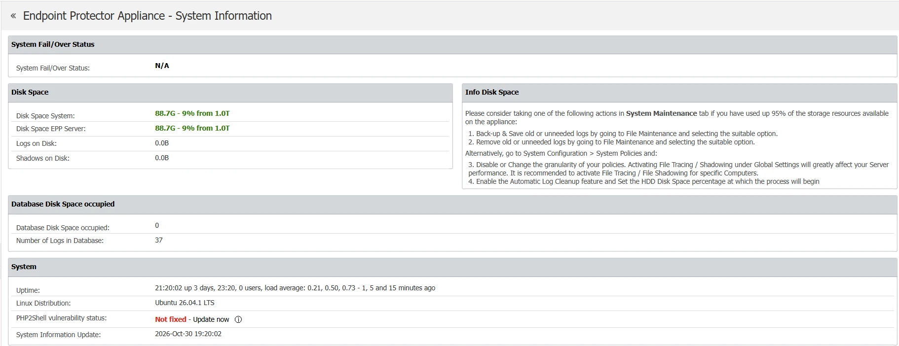

The page has these sections:

- **System Fail/Over Status**
- **Disk Space**—the disk space of the system and of the EPP Server, and the space that logs and shadows use. The **Info Disk Space** box lists the actions to take if you use up 95 percent of the storage.
- **Database Disk Space occupied**—the database disk space and the number of logs in the database
- **System**—the uptime, the Linux distribution, the **PHP2Shell vulnerability status**, and the time of the last system information update

**Verify the PHP security fix**

The **PHP2Shell vulnerability status** field shows whether the appliance has the PHP security fix: **Fixed** or **Not fixed**. If the status is **Not fixed**, click **Update now** to open **Security Updates** in System Configuration and apply the update. See [Security Updates](/docs/endpointprotector/admin/systemconfiguration/overview.md#security-updates). The status field is available starting with version 2611.


## Server Maintenance

In this section, you can set up a preferential time zone and NTP synchronization server, configure
the IP and DNS, register the client certificate, set up a self-signing certificate, perform routine
operations and manage the SSH access.

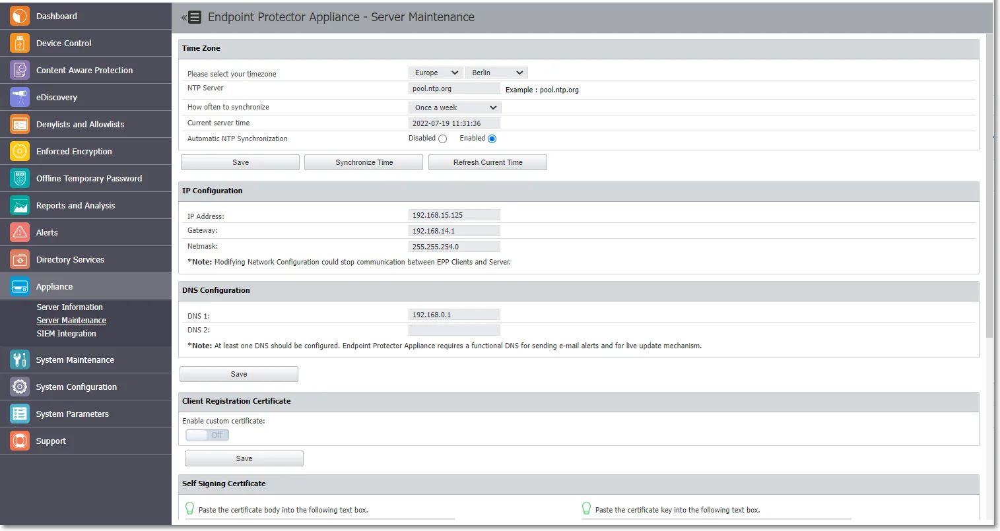

### Time Zone

In this section you can set a preferential time zone and/or sync the appliance to an NTP source.

- Time zone – select the zone and location from the dropdown lists
- NTP Server – enter the server or keep the default entry
- How often to synchronize – select a synchronization interval from the dropdown or keep the
  default selection

:::note
By default, the appliances sync once a week with pool.ntp.org.
:::


- Current server time – the field displays the current server time
- Automatic NTP Synchronization – opt in or out to trigger the NTP synchronization automatically
- Click Save to keep all modifications without triggering the synchronization process
- Click Synchronize Time to trigger the synchronization, which occurs within 5 minutes.
  Endpoint Protector reports the Alerts and Logs after the 5 minutes in a format of your choice
- Click Refresh Current Time to update the Current server time field

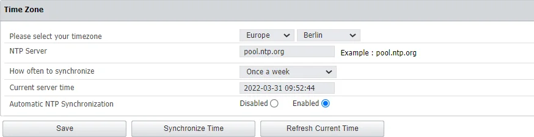

### IP Configuration

In this section you can change the network settings for the appliance to communicate correctly in
your network.

:::note
Starting with the 2509 Endpoint Protector (EPP) Server release, the EPP Server no longer supports the DHCP client option, so administrators must assign a fixed IP address to the EPP Server.
:::

:::note
After you change the IP address, close the Internet browser and open it again, then access
the Endpoint Protector Administration and Reporting Tool with the new IP address.
:::

:::warning
Changing the server IP address affects every client and integration that uses the IP address to reach the server, including single sign-on (SSO) response URLs. Address the server by a fully qualified domain name (FQDN) instead, so that you update one DNS record rather than reconfigure each client and integration. See [Use an FQDN Instead of an IP Address](/docs/endpointprotector/install/overview#use-an-fqdn-instead-of-an-ip-address).
:::

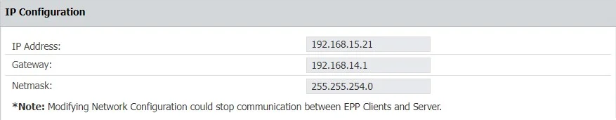

Starting with version 2512, you can switch to IPV6 exclusively by turning on the IPV6 option.
Doing so will disable the IPV4 option and vice versa.
Always click Save after changing from one IP version to another to apply the configuration.

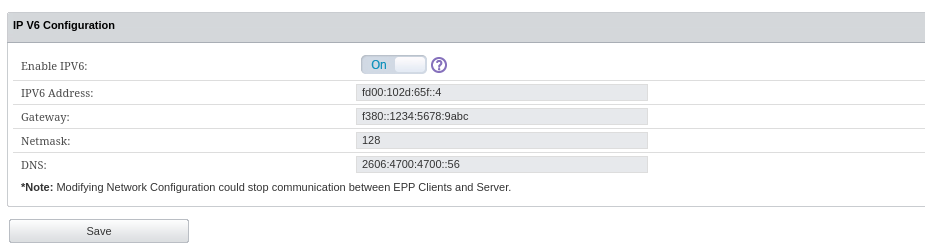

:::note
For appliances hosted on the following types of images, IP change options are available only in the command line, not in the UI: AWS AZURE, GCP. If you are hosting EPP on one of these image types, use command line option to enter the Setup wizard and change the IP address from there.
:::

:::note
When transitioning from IPv4 to IPv6 or vice versa, you might need to change the Nginx configuration:
- If you are using IPv4 and transitioning to IPv6, update the Nginx configuration to listen on the IPv6 address.
- If you are using IPv6 and transitioning to IPv4, update the Nginx configuration to listen on the IPv4 address.
For customers using the standard Nginx configuration (most users), Endpoint Protector applies these adjustments automatically. Always click Save after changing from one IP version to another to apply the configuration.

For customers with custom Nginx configurations (such as those using a different port for client communication), these changes might impact the communication between the agent and server.

In such scenarios, the documentation doesn't officially support custom configurations. However, the Netwrix support team can help with manual configuration adjustments.
:::

### DNS Configuration

In this section you can modify or add a DNS server address and then Save your changes.

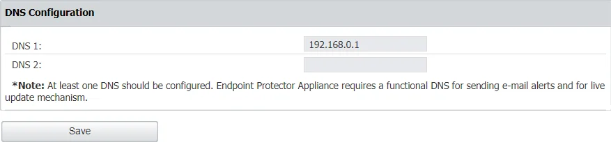

### Communication Security

By default, Endpoint Protector encrypts all communication between Endpoint Protector Clients and the Endpoint Protector Server using mutual TLS (mTLS). Both sides present certificates during the TLS handshake, which protects data in transit against interception.

To further harden the registration and communication process, Endpoint Protector provides two additional, optional security features that build on this foundation: **Client Registration Certificate** and **Server Certificate Validation**. When enabled, these options introduce certificate pinning into the client lifecycle — verifying that communication is encrypted and
that both endpoints are who they claim to be.

:::warning
The Client Registration Certificate feature isn't available for Linux.
:::

### Client Registration Certificate

The Client Registration Certificate feature adds a certificate verification component to the client registration process: the Endpoint Protector Server validates the client's certificate during the registration phase, so only clients presenting a cryptographic identity signed by a trusted CA can register.
As a result, only authorized, managed devices can register with the EPP Server, even when they operate on shared or untrusted networks.

**Configuration**

**Step 1 –** Enable the custom certificate setting and then upload the certificate chain, Root CA and
Intermediate;

When the custom certificate is **enabled** then:

- Endpoint Protector Server will validate the client certificate at the registration phase
- Endpoint Protector Client will not validate the server certificate

When the custom certificate is **disabled** then:

- Endpoint Protector Server will not validate the client certificate at the registration phase
- Endpoint Protector Client will not validate the server certificate

**Step 2 –** Enable the test certificate setting and then upload a **certificate signed by root CA**
just for testing the signature (for example the Endpoint Protector Client certificate)

**Step 3 –** Click **Save** and allow 2 minutes for Endpoint Protector to validate the information.
A success message confirms that Endpoint Protector added the custom certificate
and that the test certificate is valid.

**Requirements**

:::note
The same CA must issue the client registration authentication certificate and the Endpoint
Protector server certificate.
:::


For this feature to work, you must deploy cryptographic identities signed by the root CA on the
endpoints.

- On macOS, add these identities to the System Keychain in the "My Certificates" section
- On Windows, place them in the Certificate Manager's Local Computer\Certificates\Personal
  section

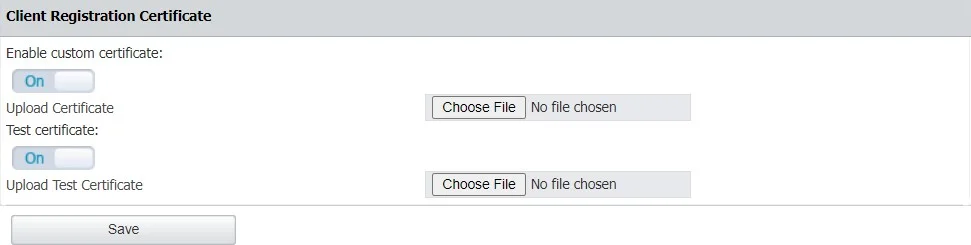

### Server Certificate Validation

While Client Registration Certificate secures the registration phase, Server Certificate Validation extends certificate verification to all ongoing communication. When you enable it, the Endpoint Protector Client validates the server's SSL certificate on every outbound request — ensuring that clients only communicate with a trusted, legitimate Endpoint Protector Server and that attackers can't redirect them to a rogue or impersonated instance.
The EPP Client verifies three key properties:
- **Certificate trust** — a Certificate Authority that the endpoint trusts must issue the server certificate.
- **Expiration date** — the server certificate must be valid and not expired.
- **Hostname matching** — the server certificate's Common Name (CN) or Subject Alternative Name (SAN) must match the hostname the client is connecting to.


:::note
Starting with version 5.9.0.0, enabling this option activates Endpoint Protector Server Certificate Validation for all Endpoint Protector Client communication, so all communication must use trusted and valid certificates.
:::

**Configuration**

From this section, you can configure Server Certificate Validation, which ensures that Endpoint Protector Clients validate the certificates used for all communication requests.

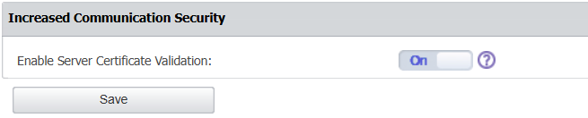

Before you enable it, verify that:
- The EPP Server certificate is valid and not expired.
- A CA that all managed endpoints trust issued the EPP Server certificate.
- The EPP Server hostname matches the certificate's CN or SAN exactly.

**Client-Side Configuration**
The server-side configuration alone isn't sufficient — you must also prepare the EPP Client to participate in certificate-based registration. You do this at installation time.
When you install the Endpoint Protector Client on Windows or macOS, the installer wizard includes an **Increased Communication Security** checkbox. Enabling this option instructs the EPP Client to use the certificate-based authentication flow during registration and all subsequent communication with the EPP Server. For detailed installation steps and a walkthrough of the installer wizard, refer to the [Agent Installation](/docs/endpointprotector/admin/agent.md#increased-communication-security) section.

:::warning
use this feature responsibly. Improper certificate configuration combined with enabled certificate validation may disrupt Endpoint Protector Client to Endpoint Protector Server communication.
**For a successful connection, you must enable both server and client certificate validation.**
:::

:::note
The Endpoint Protector Client reports all certificate validation statuses to the Endpoint
Protector Server and stores them in the Endpoint Protector Client logs for debugging.
:::

### Appliance Operations

In this section you can perform appliance operations such as Reboot or Shutdown.

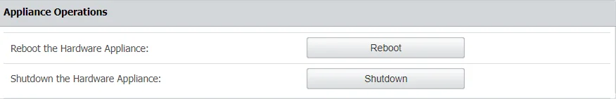

### SSH Server

In this section you can manage user access to the Appliance through the SSH protocol.

:::info
Set this option to **Enable** before requesting Support access.
:::


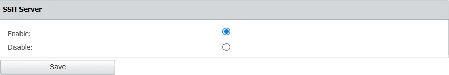

## SIEM Integration

Security information and event management (SIEM) tools are third-party tools that log and
analyze the logs generated by network devices and software. The integration with SIEM technology
enables Endpoint Protector to transfer activity events to a SIEM server for analysis and reporting.

In this section, you can add, edit, or delete an existing SIEM Server integration. To edit or delete
a SIEM Server, select an available SIEM server integration.

:::warning
You can configure a maximum of four SIEM Server integrations.
:::


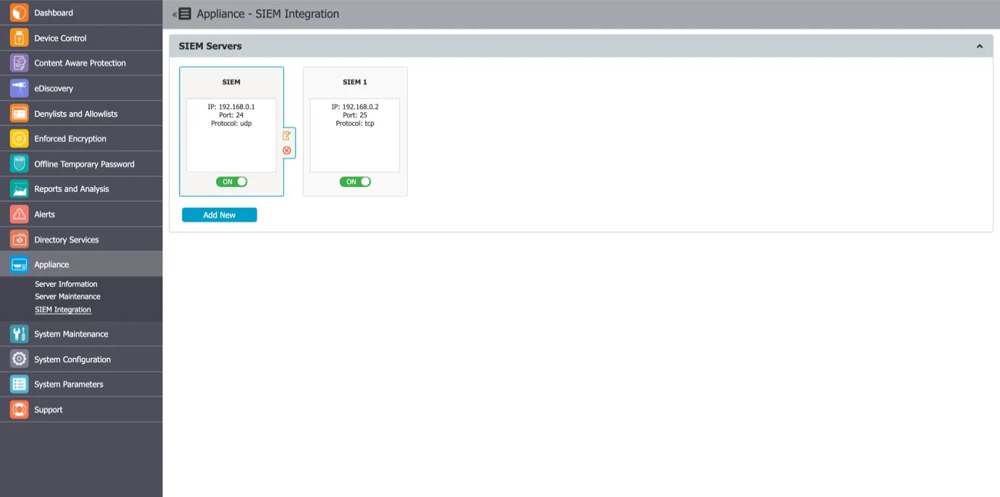

To create a SIEM Server, click **Add New** and provide the following information:

- SIEM Status – toggle switch to enable/disable the SIEM server
- Disable Logging – toggle switch to enable/disable logging

    :::note
    If you disable logging, Endpoint Protector stores logs on the Endpoint Protector server or
    on the SIEM server when you install SIEM.
    :::


- Server Name – add a server name
- Server Description – add a description
- Server IP or DNS – add the IP or DNS
- Security Token – optional. Endpoint Protector uses the token only when you enable [SIEM Encryption](#siem-encryption).
- Server Protocol – select the UDP or TCP server protocol

    :::note
    Depending on the protocol you select, you can enable [SIEM Encryption](#siem-encryption).
    :::


- Server Port – add a port
- Exclude Headers - toggle switch to enable/disable log headers

    :::note
    If you disable log headers, you will only export data to SIEM.
    :::


- Log Types – select the logs to send to the SIEM Server from the available options. The options are
  grouped in Device Control, Content Aware Protection, eDiscovery, and Other SIEM Logs. Other SIEM Logs include
  AD Synchronization, Admin Actions, APNS certificate, Client Info Update, Client Integrity Fail, Client Integrity
  OK, Client Uninstall, Content Aware - Logs Amount, Delete, Device Control - Logs Amount, and Endpoint Licenses.

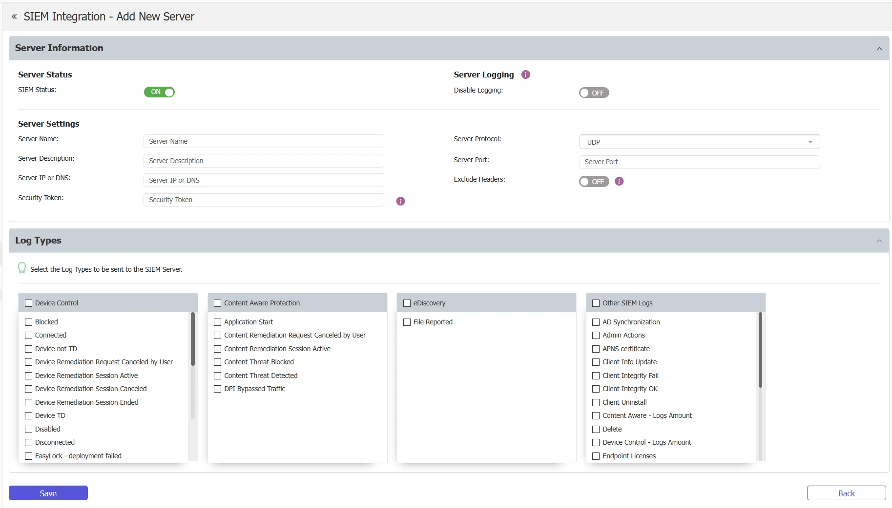

### SIEM Encryption

When using the TCP protocol, you can encrypt communication to each SIEM server. To do so, enable
the Encryption setting and then Upload the root CA used to sign the server certificate for the SIEM
server in .pem format.

:::warning
The same CA must sign both the certificate used on the SIEM server and the one
uploaded to the Endpoint Protector Server.
:::


The **Security Token** field is optional. Endpoint Protector uses the token only when you enable Encryption. Use it for SIEM
services that expect a token in each message, such as Splunk HTTP Event Collector or Sumo Logic. The
token can have up to 512 characters: letters, numbers, and the characters `. _ ~ + - = / @`. When you
enter a token, Endpoint Protector sends each message as `<PRI> [token] <message>`, without the other
syslog header fields.

Endpoint Protector will check the following:

- The CA signed the SIEM certificate, and the CN or SAN matches the name for the SIEM machine
- The Root CA has the Basic Constraint CA set to true

When Endpoint Protector validates a certificate, the entire certificate chain must be valid,
including the CA certificate; if any certificate in the chain is invalid, Endpoint Protector
rejects the connection.

ensure you update the certificate files when they expire.

:::note
If you applied the latest patch using the option, and can't view the SIEM encryption
setting, contact Customer Support.
:::


### SIEM Export log formats

Endpoint Protector sends each log entry to the SIEM server as one syslog message.

#### Transport and syslog format

- **Facility:** the messages use the syslog facility `local0`. The syslog severity depends on the log type.
- **Protocols:** UDP or TCP. For TCP, you can turn on TLS encryption. See [SIEM Encryption](#siem-encryption).
- **Standard:** the Endpoint Protector Server forwards messages with the `syslog()` driver of syslog-ng, which uses the IETF syslog format (RFC 5424). The transport follows RFC 5426 for UDP, RFC 6587 for TCP, and RFC 5425 for TLS. The syslog header timestamp is in ISO 8601 format with a time zone offset, as RFC 5424 defines. The syslog-ng service on the appliance writes it. The messages for a destination that uses a **Security Token** have no timestamp and no host name in the header. Every message body has its own date and time fields.
- **Application name:** the application name in the syslog header is `EPP-<server-ip>`, where `<server-ip>` is the destination that you configured.


#### Message structure

The message text has this structure:

```text
EPP IP - <server> - <section> - <log name>: [Log ID] <id> | [field name] value | [field name] value | ...
```

- `<server>` is the host name or IP address that the Client used to reach the Endpoint Protector Server.
- `<section>` is Device Control, Content Aware Protection, eDiscovery, or System Logs.
- `<log name>` is the event name that you select in **Log Types**, for example `Blocked`.
- `[Log ID]` is always the first field. Endpoint Protector generates a 32-character identifier for each message.
- Each field is `[field name] value`, and a vertical bar with spaces separates the fields. An empty value leaves the space after the field name empty.
- The message can have up to 10,000 characters. Endpoint Protector truncates longer messages.

If you turn on **Exclude Headers**, the message has no `EPP IP` and section labels and no field names. It contains the values only, in the field order of the log: `<host> - <section> - <log name>: <value> | <value> | ...`. The first value is the Log ID.

The date and time fields use these formats:

- **Date/Time(Server)** and **Date/Time(Client)**—`YYYY-MM-DD hh:mm:ss`
- **Date/Time(Server UTC)**, **Date/Time(Client UTC)**, and **Date/Time(UTC)**—`YYYY-MM-DDThh:mm:ssZ`

The **Severity** field of Content Aware Protection and eDiscovery logs shows the severity name: Informative, Low, Medium, High, or Critical. It shows "Not Set" for events without a severity.

:::note
Endpoint Protector version 2608 sent the database field names as keys, such as `machine_name` and `destination_type`. Version 2611 again sends the readable field names that this page lists, in the same order as before version 2608.
:::

### SIEM Export Log Fields

This section lists the fields for each log in the order that Endpoint Protector sends them. The examples show the message text with sample values. The syslog header isn't part of the examples.

#### Device Control

The Device Control format applies to the events in the **Device Control** log types. It also applies to the Enforced Encryption events (file encrypt and decrypt, and EasyLock deployment), Print, Transfer Limit Reached, External Repository Upload, External Repository Upload Fail, Uninstall Attempt, and Forced Uninstall Attempt. These events use the Device Control label in the message. **Log Types** lists Transfer Limit Reached, Client Info Update, and the External Repository Upload events under **Other SIEM Logs**. For Uninstall Attempt and Forced Uninstall Attempt, the log name is the event name and the message uses the Device Control fields.

Header line (field order):

```text
[Log ID] | [Event Name] | [Client Computer] | [IP Address] | [MAC Address] | [Serial Number] | [OS] | [Client User] | [Device Type] | [Device] | [Device VID] | [Device PID] | [Device Serial] | [EPP Client Version] | [File Name] | [File Hash] | [File Type] | [File Size] | [File Shadow] | [Repository Type] | [Justification] | [Time Interval] | [Date/Time(Server)] | [Date/Time(Client)] | [Date/Time(Server UTC)] | [Date/Time(Client UTC)] | [Department Name]
```

Example:

```text
EPP IP - 192.0.2.10 - Device Control - Blocked: [Log ID] 9f86d081884c7d659a2feaa0c55ad015 | [Event Name] Blocked | [Client Computer] WS-014 | [IP Address] 192.0.2.45 | [MAC Address] 00:00:5E:00:53:01 | [Serial Number] SN-FAKE-014 | [OS] Windows 11 | [Client User] jsmith | [Device Type] USB Storage Device | [Device] Fake USB Drive | [Device VID] 0000 | [Device PID] 0001 | [Device Serial] FAKE0001 | [EPP Client Version] 0.0.0.0 | [File Name] | [File Hash] | [File Type] | [File Size] | [File Shadow] NO | [Repository Type] | [Justification] | [Time Interval] | [Date/Time(Server)] 2026-10-30 09:15:02 | [Date/Time(Client)] 2026-10-30 09:15:01 | [Date/Time(Server UTC)] 2026-10-30T07:15:02Z | [Date/Time(Client UTC)] 2026-10-30T09:15:01Z | [Department Name] Default Department
```


The **File Shadow** field shows `YES` or `NO`. **Repository Type** is empty unless a File Shadow exists.

#### Content Aware Protection

Endpoint Protector sends one message for each matched item. **Content Policy**, **Content Policy Type**, **Matched Item**, and **Item Details** come from the matched item.

Header line (field order):

```text
[Log ID] | [Client Computer] | [IP Address] | [MAC Address] | [Serial Number] | [OS] | [Client User] | [Content Policy] | [Content Policy Type] | [Destination Type] | [Destination] | [Destination Details] | [Email Sender] | [Email Subject] | [Justification] | [Device VID] | [Device PID] | [Device Serial] | [File Name] | [File Hash] | [File Size] | [File Shadow] | [Repository Type] | [Matched Item] | [Item Details] | [Date/Time(Server)] | [Date/Time(Client)] | [Date/Time(Server UTC)] | [Date/Time(Client UTC)] | [Certificate State] | [Department Name] | [EPP Client Version] | [Severity]
```

Example:

```text
EPP IP - 192.0.2.10 - Content Aware Protection - Content Threat Blocked: [Log ID] 3b5d5c3712955042212316173ccf37be | [Client Computer] WS-014 | [IP Address] 192.0.2.45 | [MAC Address] 00:00:5E:00:53:01 | [Serial Number] SN-FAKE-014 | [OS] Windows 11 | [Client User] jsmith | [Content Policy] Fake PII Policy | [Content Policy Type] Predefined | [Destination Type] Web | [Destination] example.com | [Destination Details] | [Email Sender] | [Email Subject] | [Device VID] | [Device PID] | [Device Serial] | [File Name] report.docx | [File Hash] | [File Size] 1024 | [File Shadow] NO | [Repository Type] | [Matched Item] 000-00-0000 | [Item Details] | [Date/Time(Server)] 2026-10-30 09:20:00 | [Date/Time(Client)] 2026-10-30 09:19:59 | [Date/Time(Server UTC)] 2026-10-30T07:20:00Z | [Date/Time(Client UTC)] 2026-10-30T07:19:59Z | [Certificate State] | [Department Name] Default Department | [EPP Client Version] 0.0.0.0 | [Severity] High
```

Endpoint Protector includes the **Justification** field only for the **Content Remediation Session Active** and **DPI Bypassed Traffic** events. For other events, the field is not in the message. The Content Aware Protection format has no **Event Name** field.

When you use Reporting V1, fields associated with Reporting V2 content, such as **Destination Details**, **Email Sender**, and **Email Subject**, remain blank.

#### E-Discovery

Endpoint Protector sends this message for each file that an eDiscovery policy reports. **Matched type** holds the item details, and **Path** holds the file path.

Header line (field order):

```text
[Log ID] | [Computer] | [IP Address] | [MAC Address] | [Serial Number] | [OS] | [Policy] | [Matched type] | [Matched Item] | [Path] | [Discovered at] | [Discovered at (UTC)] | [Severity]
```

Example:

```text
EPP IP - 192.0.2.10 - eDiscovery - File Reported: [Log ID] 2c26b46b68ffc68ff99b453c1d304134 | [Computer] WS-014 | [IP Address] 192.0.2.45 | [MAC Address] 00:00:5E:00:53:01 | [Serial Number] SN-FAKE-014 | [OS] Windows 11 | [Policy] Fake PII Scan | [Matched type] Social Security Number | [Matched Item] 000-00-0000 | [Path] C:\Users\jsmith\Documents\report.docx | [Discovered at] 2026-10-30 09:30:00 | [Discovered at (UTC)] 2026-10-30T07:30:00Z | [Severity] Medium
```

#### User Login, User Logout, Client Integrity OK, and Client Integrity Fail

These logs use the System Logs section and the same fields.

Header line (field order):

```text
[Log ID] | [Client Computer] | [IP Address] | [MAC Address] | [Serial Number] | [OS] | [EPP Client Version] | [Client User] | [File Name] | [File Type] | [Date/Time(Server)] | [Date/Time(Client)] | [Date/Time(Server UTC)] | [Date/Time(Client UTC)]
```

Example:

```text
EPP IP - 192.0.2.10 - System Logs - User Login: [Log ID] fcde2b2edba56bf408601fb721fe9b5c | [Client Computer] WS-014 | [IP Address] 192.0.2.45 | [MAC Address] 00:00:5E:00:53:01 | [Serial Number] SN-FAKE-014 | [OS] Windows 11 | [EPP Client Version] 0.0.0.0 | [Client User] jsmith | [File Name] | [File Type] | [Date/Time(Server)] 2026-10-30 08:00:00 | [Date/Time(Client)] 2026-10-30 07:59:58 | [Date/Time(Server UTC)] 2026-10-30T06:00:00Z | [Date/Time(Client UTC)] 2026-10-30T07:59:58Z
```

#### User Information Updated

The **Client Info Update** log type in **Log Types** sends the User Information Updated event. The message has the Device Control header, and its **Event Name** field shows "User Information Updated". It carries the standard Device Control fields, in the same order. The device and file fields are empty. Endpoint Protector doesn't send the new user details, such as the employee ID, phone number, e-mail address, and team.

#### Policies Received

Header line (field order):

```text
[Log ID] | [Event Name] | [Client Computer] | [Department] | [IP Address] | [Client User] | [OS] | [EPP Client Version] | [Date/Time(Server)] | [Date/Time(Client)] | [Date/Time(Server UTC)] | [Date/Time(Client UTC)]
```

Example:

```text
EPP IP - 192.0.2.10 - System Logs - Policies Received: [Log ID] 6b86b273ff34fce19d6b804eff5a3f57 | [Event Name] Policies Received | [Client Computer] WS-014 | [Department] Default Department | [IP Address] 192.0.2.45 | [Client User] jsmith | [OS] Windows 11 | [EPP Client Version] 0.0.0.0 | [Date/Time(Server)] 2026-10-30 08:05:00 | [Date/Time(Client)] 2026-10-30 08:04:59 | [Date/Time(Server UTC)] 2026-10-30T06:05:00Z | [Date/Time(Client UTC)] 2026-10-30T08:04:59Z
```

#### Admin Action

The **Administrator** field shows the name of the API client when the action comes from the REST API.

Header line (field order):

```text
[Log ID] | [Administrator] | [Section] | [Action Type] | [Before] | [After] | [Date/Time(UTC)]
```

Example:

```text
EPP IP - 192.0.2.10 - System Logs - Admin Actions: [Log ID] d4735e3a265e16eee03f59718b9b5d03 | [Administrator] jsmith | [Section] Device Control | [Action Type] Edit | [Before] ... | [After] ... | [Date/Time(UTC)] 2026-10-30T07:00:00Z
```

#### Client Uninstall

The **Department** field in this log holds the numeric department ID.

Header line (field order):

```text
[Log ID] | [Client Computer] | [Ip Address] | [MAC Address] | [Serial Number] | [Department] | [EPP Client Version] | [Last Time Online]
```

Example:

```text
EPP IP - 192.0.2.10 - System Logs - Client Uninstall: [Log ID] 4e07408562bedb8b60ce05c1decfe3ad | [Client Computer] WS-014 | [Ip Address] 192.0.2.45 | [MAC Address] 00:00:5E:00:53:01 | [Serial Number] SN-FAKE-014 | [Department] 1 | [EPP Client Version] 0.0.0.0 | [Last Time Online] 2026-10-30 08:10:00
```

#### System alerts

Endpoint Protector sends these logs when the number of Device Control logs or Content Aware Protection logs, the server disk space, or the license count reaches a threshold. In **Log Types**, they appear as **Device Control - Logs Amount**, **Content Aware - Logs Amount**, and **Endpoint Licenses**. The thresholds are 1,000,000 logs, 80 percent of the licenses, and 90 percent of the disk space.

Header line (field order):

```text
[Log ID] | [Date/Time(UTC)] | [Message]
```

Example:

```text
EPP IP - 192.0.2.10 - System Logs - Server Disk Space: [Log ID] ef2d127de37b942baad06145e54b0c61 | [Date/Time(UTC)] 2026-10-30T07:00:00Z | [Message] This is an alert notification that you are running out of space for your Endpoint Protector Appliance!
```

