# Policy Configuration and Application

Content Aware Policies are sets of rules for sensitive content detection that enforce file transfers
management on selected entities (users, computers, groups, departments).

From this section, you can:

- Create a new policy
- Edit or delete an existing policy
- Create and apply a predefined policy

For example; Content Aware Policy can be set to only block Credit Cards AND Email Addresses. In this
case, a file that contains a Credit Card AND an email address will be blocked, but a file that only
contains Credit Cards will not be blocked.

Each company can define its sensitive content data lists as Custom Content Dictionaries corresponding
to their specific domain of activity, targeted industry, and roles.

The Content Aware Protection module includes a Predefined Content Dictionary that covers the most
used sets of confidential terms and expressions.

For example; a policy can be set up for the Financial Department of the company to block Excel
reports sent via E-mail or to report all transfers of files containing personally identifiable and
financial information (e.g., credit card numbers, E-mail, phone numbers, social security numbers
etc.).

:::note
Content Aware Policies also apply to the File Allowlist. As a result, all files that were
previously allowed will now be inspected for sensitive content and, depending on the policy
configuration, either reported, blocked, or allowed.
:::


Similar to Device Control policies, Content Aware policies remain enforced on a computer even after
the computer disconnects from the company network.

On shared computers, the Client caches the policies for each user who has logged on, so a user who logs on to an offline computer gets the latest cached policies. See [Per-User Policy Caching](/docs/endpointprotector/admin/agent.md#per-user-policy-caching).

One or more Content Aware Policy can be enforced on the same computer, user, group, or department.
To avoid any conflicts between the applied rules, a prioritization of policies is performed through a
left-to-right ordering. The leftmost policy has the highest priority (Priority 1), while the
rightmost policy has the lowest priority. To change the priority of one or more policies, click the
left arrow for higher priority or the right arrow for lower priority.

To manage Content Aware Protection policies, you can:

- Switch views between Grid or Widget mode using the controls in the top-right corner
- Edit policy priority by double-clicking on a policy listed in the Priority column

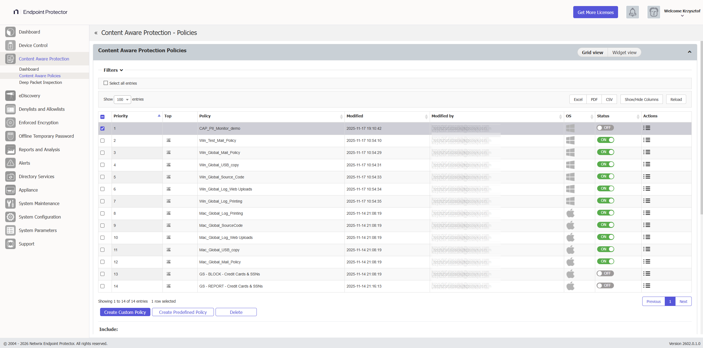

## Policy processing order

When multiple Content Aware Protection policies apply to the same transfer event, the EPP Server evaluates them using a two-level hierarchy: entity level first, then priority number within that level.

**Entity level hierarchy**

The entity level assigned to a policy determines its precedence over policies at other levels:

| Entity level | Precedence |
|---|---|
| Computer / User | Highest |
| Group | Medium |
| Department | Lowest |

A policy assigned directly to a computer or user always takes precedence over a policy assigned to the group or department that entity belongs to.

**Priority within the same entity level**

When two or more policies are assigned at the same entity level, the **Priority** value on the Policies list page determines the order. Priority 1 is the highest; higher numbers indicate lower priority. You can adjust the priority of a policy by clicking the left or right arrow on the Policies list page, or by double-clicking the value in the **Priority** column.

**Policy action doesn't affect processing order**

The policy action — Block & Report, Report Only, Block Only, or Block and Remediate — doesn't influence the processing order. Policies are always evaluated by entity level and priority number, regardless of the action configured.

:::note
You can configure the entity-level evaluation behavior in **System Configuration → System Settings**.
:::

## Policy Information

You can create up to 300 Content Aware Protection policies. When you reach the limit, Endpoint Protector shows the message "Could not create a new policy as the maximum number of 300 policies has been reached."

To create a Content Aware Policy, provide the following information:

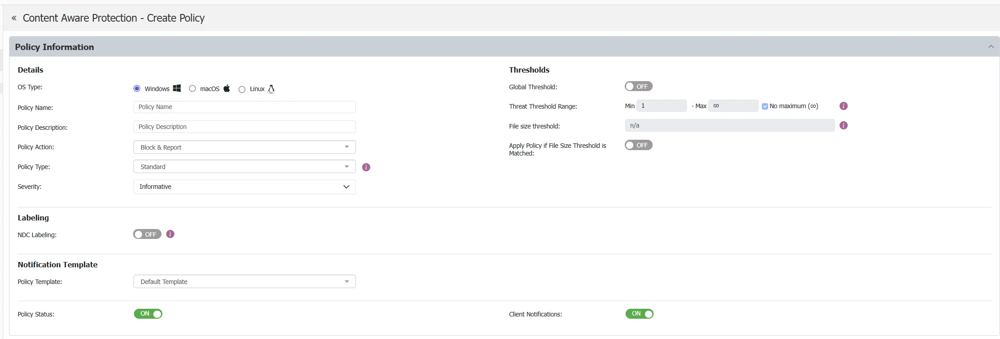

:::note
Depending on the specific application and OS, some limitations may apply.
:::

- **OS Type**—select the operating system to which the policy applies: Windows, macOS, or Linux. Endpoint Protector disables an operating system that has no active Content Aware Protection license. When you edit a policy, only its operating system is available.
- **Policy Name**—enter a name for the policy. The name can have up to 50 characters, must be unique, and can't contain a pipe (`|`).
- **Policy Description**—enter a description for the policy. The description can have up to 50 characters.
- **Policy Action**—select the type of action you want the policy to perform. The default is **Block & Report**.

    - **Block & Report**—this policy will deny all transfers of data that include sensitive content
      and report the action
    - **Report only**—this policy will allow all transfers of data that include sensitive content and
      will only report the action
    - **Block only**—this policy will deny all transfers of data that include sensitive content but
      not report the action
    - **Block and Remediate**—this policy will deny all transfers of data that include sensitive
      content but allow the user to remediate the action by using a justification

:::note
Initially, Netwrix recommends using the Report only action to gain a better view of data use
across your network and not interrupt your activity.
:::

- **Policy Type**—select **Standard** (default), **Outside Network**, or **Outside Hours**.

:::note
To enforce the Outside Hours and Outside Network options, after you save the policy,
enable the setting on the specific device from Device Control, Global settings, Group, or Computers.
:::

- **Severity**—select the severity of the events that the policy produces. The default is **Informative**. See [Threshold ranges and severity](#threshold-ranges-and-severity).
- **Global Threshold**—turn on to set a threshold for the whole policy, with the **Threat Threshold Range** and **File size threshold** fields. If you turn it off, the threshold is a Regular Threshold. You can't turn on **Global Threshold** when the policy uses individual thresholds in the Content Detection Rule. The console then shows "Global Threshold can not be set if Individual Threshold is enabled."
- **Threat Threshold Range**—enter the lowest and highest number of content violations that the policy applies to for a file transfer. See [Threshold ranges and severity](#threshold-ranges-and-severity).

:::note
Threshold ranges and severity are new in version 2611 and are backward compatible. Clients earlier than 2611 ignore the new values, and a 2611 Client behaves the old way with a server earlier than 2611. See [Threshold ranges and severity](#threshold-ranges-and-severity).
:::

- **File size threshold**—enter the file size, in MB, starting from which the file transfer is either blocked or reported. The value must be greater than 0. The field shows "n/a" until you turn on **Global Threshold**.

:::note
If a File Size Threshold is set, it will be applied to the whole policy, regardless of
what file types or custom contents are checked inside the policy. Endpoint Protector compares the size of a transfer with the File Size Threshold of the policy that has the highest priority.
:::

- **Apply Policy if File Size Threshold is Matched**—turn on to apply the policy in
  combination with the threshold. The content selected from the Denylist will be blocked taking into
  consideration the threshold. You can turn on this setting only after you enter a file size threshold.

:::note
This setting doesn't apply for File Name and File Location.
:::

- **Labeling**—apply one or more Netwrix Data Classification (NDC) labels to the files that trigger the policy. Turn on **NDC Labeling** and select the labels in **NDC Label(s)**. The list shows only the NDC entries of the denylists that have **Look for** set to **Both NDC name property + label value** or to **Keywords**. See [Apply NDC labels](#apply-ndc-labels).
- **Policy Template**—select a custom notification from the dropdown list, or create one from System
  Parameters, Device Types and Notification,
  [Custom Content Aware Protection Notifications](/docs/endpointprotector/admin/systempar.md)
  section. The default is **Default Template**.
- **Policy Status**—turn on to activate the policy. The default is on.
- **Client Notifications**—turn on to send notifications to clients. The default is on.

:::note
The Threshold option applies only to multiple filters, including Predefined Content, Custom
Content, and Regular Expressions. Place Block & Report policies that use the Threshold at higher priority than
Report Only policies.
:::

### Regular and Global Threshold Use Cases

This section allows Block & Report policies to handle Social Security Numbers (SSN) and phone
numbers, emphasizing the distinctions between Regular and Global Thresholds.

1. Block & Report Policy for Social Security Numbers (SSN) in Multiple Browsers:

    - Set a policy to block transfers of SSNs across various internet browsers
    - Regular Threshold: Blocks transfers with four or more individual SSN instances
    - Global Threshold: Blocks four or more threats of different types combined

1. Block & Report Policy for SSN and Phone Numbers:

    - Set a policy to block transfers of both SSNs and phone numbers
    - Regular Threshold: Doesn't block two threats (SSN + phone number)
    - Global Threshold: Blocks two SSNs or any combination of two threats

### Threshold ranges and severity

Threshold ranges and severity are new in version 2611. A policy can apply to a range of detections instead of a single number, and every policy has a severity. You can handle a file with one detection and a file with a thousand detections differently.

The feature is backward compatible:

- Clients earlier than 2611 ignore the new range and severity values when they receive policies from a 2611 server. They keep working as before.
- A 2611 Client that connects to a server earlier than 2611 behaves the old way. It uses the single threshold, because the server doesn't send a range or a severity.
- The range and severity apply only when both the server and the Client are version 2611 or later.

The policy has the following fields, shown in the **Policy Information** section:

- **Severity** – in the **Details** section, the severity that Endpoint Protector assigns to every event the policy produces. Select **Informative**, **Low**, **Medium**, **High**, or **Critical**. The default is **Informative**.
- **Threat Threshold Range** – in the **Thresholds** section, enter the lowest number of detections in **Min** and the highest in **Max**. The policy applies when the number of content violations in a file transfer is between the two values, inclusive.
- **No maximum (∞)** – select this checkbox to leave the range open at the top. The **Max** field shows the infinity symbol and is disabled. The checkbox is selected by default.

The Windows, macOS, and Linux Clients apply the range the same way in Content Aware Protection and eDiscovery policies, instead of a single ceiling.

The range works for the policy-level threshold, which applies to the whole policy, and for the individual threshold of each content type inside a Content Detection Rule.

**Maximum value rules**

- The **Max** value must be greater than the **Min** value.
- If **Ignore Thresholds** is on in System Settings, the **Max** value must be lower than **Maximum number of reported threats**. Endpoint Protector doesn't save the policy or turn it on until you fix the value.
- If **Ignore Thresholds** is off, the **Max** value can't exceed 100,000.
- You can't set **Maximum number of reported threats** lower than the highest **Max** value that a Content Aware Protection policy uses.

:::warning
If you define a **Max** value, turn off **Limit Reporting Content Aware Protection** in Global Settings. With that setting on, the Client can stop counting after the policy is satisfied, so it might not evaluate the **Max** value as you defined it.
:::

:::note
When you upgrade the server, every existing policy keeps its current threshold as the minimum and gets no maximum. Existing policies behave as before until you define a range.
:::

**Example**

To report low, medium, and high volumes of Social Security Numbers (SSNs) differently, create three Report only policies for the same entity:

| Policy | Min | Max | Severity |
|---|---|---|---|
| SSN volume low | 1 | 5 | Low |
| SSN volume medium | 6 | 50 | Medium |
| SSN volume high | 51 | No maximum (∞) | High |

A file with 3 SSNs produces a low severity event. A file with 200 SSNs produces a high severity event.

Each event in the Content Aware reports and logs shows the severity of the policy that produced it. Use the **Severity** filter to show **Any**, **Not Set**, **Informative**, **Low**, **Medium**, **High**, or **Critical** events. Events logged before the upgrade have no severity and match **Not Set**. The Client keeps the severity when it is offline and uploads it with the logs later. The exports and the SIEM export include the severity. You can also alert on severity. See [Log alerts](/docs/endpointprotector/admin/alerts.md#log-alerts).

In the SIEM export of Content Aware Protection and eDiscovery logs, the **Severity** field holds the severity name, or "Not Set" for events without a severity. See [SIEM Export Log Fields](/docs/endpointprotector/admin/appliance.md#siem-export-log-fields).

## Apply NDC labels

A Content Aware Protection policy can apply a Netwrix Data Classification (NDC) label to a file when the policy triggers. The label stays with the file. Netwrix Data Classification and other tools that rely on the label recognize the file wherever it goes.

The Endpoint Protector Client applies the label with the NDC SDK. This feature requires Endpoint Protector Client version 2611 or later and works on Windows, macOS, and Linux policies. The endpoint needs the Microsoft .NET 10 Runtime (x64 or Arm64, matching the Client) to apply labels. A newer major version also works. The Client setup doesn't install the runtime. The Windows installer shows a link to the download, and the macOS installer offers an "Install .NET runtime (for NDC functionality)" link. Install the runtime on Linux endpoints before you use labeling.

Before you turn on labeling, define the labels you want to apply under **Denylists** > **NDC Classification**. See [NDC Classification](/docs/endpointprotector/admin/denylistsallowlists/denylists.md#ndc-classification).

The **NDC Label(s)** list shows only the NDC entries that have **Look for** set to **Both NDC name property + label value** or to **Keywords**. An entry that has only the name property or only the label value doesn't appear. Labeling applies a complete label (both the name property and the label value) or a keyword. This keeps the labels compatible with the way other tools read them.

The Client applies the labels to the files that trigger the policy, which are the files that the policy detects and reports or blocks. It labels only the supported file types that this section lists.

To apply labels from a policy:

1. Open the policy and go to the **Labeling** section.
2. Turn on **NDC Labeling**. The setting is off by default.
3. In **NDC Label(s)**, select one or more NDC labels to apply when the policy triggers. The list shows the labels defined under **Denylists** > **NDC Classification**.
4. Click **Save**.

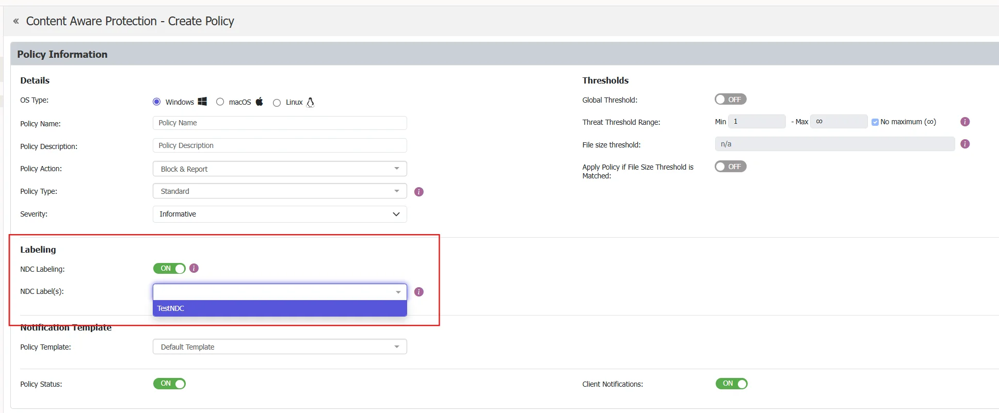

If no NDC labels exist, the console shows the message "No NDC labels are defined. Go to Denylist → NDC Classification to create one before enabling NDC Labeling." You can't save a policy with **NDC Labeling** turned on and no label selected.

The Client labels `.docx`, `.xlsx`, `.pptx`, and `.pdf` files on all platforms. It labels the older `.doc`, `.xls`, and `.ppt` formats on Windows only. The Client doesn't label other file types.

Endpoint Protector logs every label it applies and every label that fails in the **Content Aware Protection Logs**, next to the policy event. If the .NET runtime is missing, the Client logs an "NDC Labeling Failed" event that includes the message "You must install .NET to run this application".

The eDiscovery module has the same section. See [eDiscovery policies and scans](/docs/endpointprotector/admin/ed_module/edpolicies.md#apply-ndc-labels).

## Policy Exit Points

Use Policy Exit Points to monitor and control the transfer of sensitive data across various
platforms and channels. The following exit points are available for monitoring.

### Applications

The **Applications** tab shows the groups of applications that the policy monitors. File transfers through the selected applications are inspected for sensitive content. Depending on the Policy Action, they are reported or reported and blocked. Select a group checkbox to select all applications of the group, and use the **Search** box of a group to find an application.

The tab has these groups. The examples are a selection. Every group has more applications:

- **Web Browser**—Chrome, Edge, Firefox, Safari, Brave, Opera, Vivaldi, DuckDuckGo, Comet, Waterfox, and more
- **E-mail**—Outlook, Thunderbird, Apple Mail, Foxmail, eM Client, Evolution, and more
- **Instant Messaging**—Slack, Discord, Telegram, Signal, WhatsApp, WeChat, KakaoTalk, LINE, Mattermost, Skype for Business, Viber, and more
- **Cloud Services / File Sharing**—OneDrive, OneDrive for Business, Google Drive, Dropbox, iCloud Drive, Box Drive, Microsoft Teams, NextCloud, MEGA, Cyberduck, BitTorrent, and more
- **AI / LLM's**—ChatGPT, Claude App, Claude Code CLI, Cursor, and Microsoft Copilot. This group is available for Windows and macOS policies. Microsoft Copilot is available for Windows only.
- **Social Media / Others**—remote access, file transfer, collaboration, developer, and CD/DVD burning tools, such as AnyDesk, TeamViewer, Zoom, Figma, Notion, FileZilla, WinSCP, curl, wget, AWS CLI, VNC, iTunes, CDBurnerXP, ImgBurn, and InfraRecorder
- **Custom Application**—applications that you add yourself. See [Custom Applications](#custom-applications).

The applications and the groups differ by operating system. For example, Safari and Brave aren't available for Linux, and Linux has no **AI / LLM's** group. Netwrix updates the list with new releases, so the list on your server can differ.

:::note
Select Adobe Flash Player from the Web Browser group to block sites that use Adobe Flash ActiveX. Adobe Flash Player is available for Windows only.
:::

:::note
To distinguish OneDrive for Business from OneDrive, enable Deep Packet Inspection (DPI).
:::

:::warning
If your policy uses **All Applications** and new applications are introduced in a server update,
those applications will appear as selected but won't be enforced until the policy is re-saved.
After upgrading, open any affected Content Aware Protection (CAP) policies and save them to apply
monitoring to newly added applications.
:::

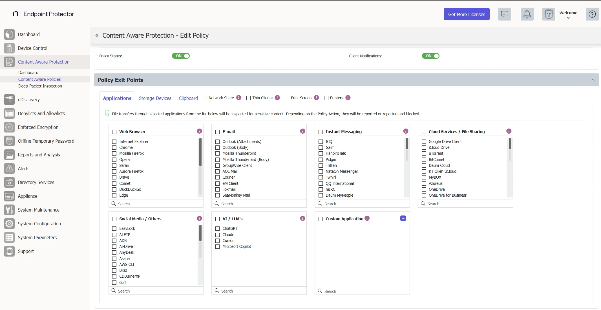

#### Custom Applications

Custom Applications extend Content Aware Protection to the applications that your organization uses and that the predefined list doesn't cover. These applications are often niche, specific to an industry, or hard for Netwrix to define for all customers. Adding the application yourself lets you protect its data transfers without waiting for Netwrix to add it to the list. Content Aware Protection then monitors the files that the application transfers.

Use this feature carefully. Deploy every new Custom Application first to a pilot group of users who are willing to test it. Start with a Report only policy to check that the application is visible and that the events are correct, and then switch to blocking. If the visibility is wrong or you see other issues, you can submit a Feature Request to Netwrix to get proper coverage for the application.

Custom Applications are available for each operating system, in the **Custom Application** group of the **Applications** tab.

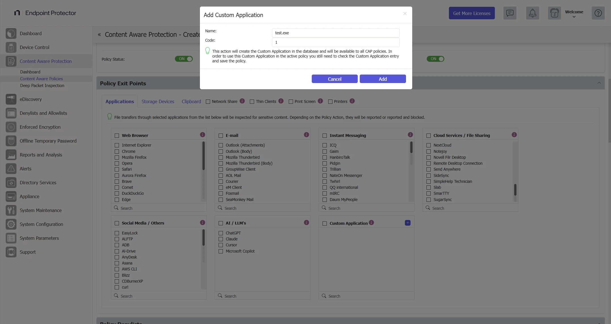

To add a Custom Application:

1. Open a Content Aware Protection policy and go to **Policy Exit Points** > **Applications**.
2. In the **Custom Application** group, click **+**.
3. Enter a **Name** and a **Code**. For example, to monitor Postman on Windows, enter `Postman custom app` as the name and `Postman.exe` as the code.
   - **Name**—the name that the list shows.
   - **Code**—the process name of the application, as the operating system reports it. The Client monitors this process.
4. Click **Add**.

The **Name** and **Code** must each have 1 to 128 characters and can't contain `<`, `>`, `"`, `` ` ``, `\`, `:`, `&`, or control characters.

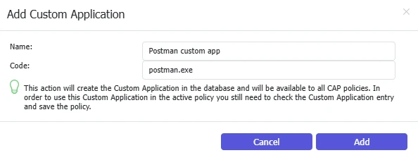

The application is now available to all policies for that operating system. To monitor it, select the application in the policy and save the policy.

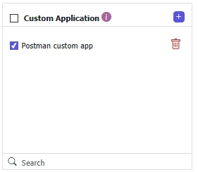

Enter the **Code** in the format used by the operating system the application runs on:

| Operating system | Code format | Example for Obsidian | Example for Postman |
|---|---|---|---|
| Windows | The application ID from the file version information. See [Find the Code on Windows](#find-the-code-on-windows). | `Obsidian.exe` | `Postman.exe` |
| macOS | The process name as it appears in Activity Monitor, without an extension. See [Find the Code on macOS](#find-the-code-on-macos). | `Obsidian` | `Postman` |
| Linux | The file name of the executable. See [Find the Code on Linux](#find-the-code-on-linux). | `obsidian` | `postman` |

If the application isn't monitored, check the Code on a test endpoint by following the steps for its operating system. You can also compare it with the entries in the predefined list.

##### Find the Code on Windows

On Windows, the Endpoint Protector Client identifies an application by the file version information of its executable. The Client reads these fields in this order and uses the first one that isn't empty:

1. `InternalName`
2. `OriginalFilename`
3. `FileDescription`
4. `ProductName`

If none of these fields has a value, the Client uses the name of the executable. Enter this value as the **Code**.

To find the value:

1. Start the application on the test endpoint.
2. Open PowerShell and find the path of the application. For example, for Postman:

   ```powershell
   Get-Process -Name postman | Select-Object -Property ProcessName, Path
   ```

   To list all running applications that have a window, run:

   ```powershell
   Get-Process | Where-Object { $_.MainWindowTitle } | Select-Object -Property ProcessName, Path
   ```

3. Show the four fields of the executable. Replace the path with the path from step 2:

   ```powershell
   (Get-Item "C:\Path\To\Application.exe").VersionInfo | Format-List InternalName, OriginalFilename, FileDescription, ProductName
   ```

4. To get the value that the Client uses, run:

   ```powershell
   $v = (Get-Item "C:\Path\To\Application.exe").VersionInfo
   $v.InternalName, $v.OriginalFilename, $v.FileDescription, $v.ProductName | Where-Object { $_ -and $_.Trim() } | Select-Object -First 1
   ```

If the command prints nothing, use the file name of the executable.

For example, if `InternalName` is empty and `OriginalFilename` is `Postman.exe`, enter `Postman.exe` as the **Code**.

:::note
Some applications share a generic value in `InternalName`. For example, applications built on Chromium can show `chrome_exe`. Check the value before you use it, because it can match other applications.
:::

##### Find the Code on macOS

On macOS, the Code is the process name of the application, as **Activity Monitor** shows it in the **Process Name** column. It has no extension, and macOS shortens it to 16 characters.

1. Start the application on the test endpoint.
2. Open Terminal and list the process by name. For example, for Postman:

   ```bash
   pgrep -il postman
   ```

   The command prints the process ID (PID) and the process name.

3. To confirm the name of a process, run the following command. Replace `PID` with the process ID from step 2:

   ```bash
   ps -p PID -o pid,comm
   ```

   The `comm` column shows the path of the executable. The Code is the last part of the path, for example `Postman`.

##### Find the Code on Linux

On Linux, the Code is the file name of the application's executable. The Code isn't case-sensitive.

1. Start the application on the test endpoint.
2. Open a terminal and list the process by name. For example, for Postman:

   ```bash
   ps -eo pid,comm | grep -i postman
   ```

3. To show the executable, run the following command. Replace `PID` with the process ID from step 2:

   ```bash
   readlink /proc/PID/exe
   ```

   The Code is the last part of the path, for example `Postman`.

You can't add an application in these cases:

- It is an operating system process, such as `svchost` or `lsass`. Endpoint Protector doesn't let you add these processes, to protect system stability.
- The Name or Code already exists for the same operating system, or the application is already in the predefined list.
- You reached the limit of 500 Custom Applications for all operating systems.

In these cases, the console shows the message "Cannot execute command! An error occurred!".

:::warning
A policy with Custom Applications can affect system stability if you misconfigure it. When you save such a policy, Endpoint Protector reminds you to test it on a pilot group before you deploy it to all users.
:::

##### Delete a Custom Application

Click the trash icon next to the application and confirm.

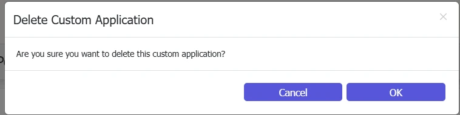

You can't delete an application that a policy uses. Remove it from the policy first. You can't edit a Custom Application in the console. To change one, delete it and add it again.

##### Enable Deep Packet Inspection for a Custom Application

Custom Applications don't use Deep Packet Inspection (DPI) by default. To enable it:

1. Go to **Deep Packet Inspection** in the main menu.
2. In the **Deep Packet Inspection Applications** table, find the application. Its **Status** is **Disabled**.
3. Open the context menu of the row, click **Enable DPI**, and confirm.

To turn DPI off again, click **Disable DPI** in the same menu.

### Storage Devices

From the **Storage Devices** tab, you can select to monitor transfers:

- only to Custom Classes
- for all Storage Devices—turn on **Apply policy to all storage devices** to enforce
  content policies on all storage devices, regardless of Custom Classes.

When you turn the setting on or off, Endpoint Protector asks you to confirm. Turning it off enforces content policies only on Custom Classes, and it affects all other Content Aware Protection policies, whether or not they select Custom Classes.

The **Custom Classes** group lists the Custom Classes with an ON or OFF status. Storage Devices and Custom Classes exclude one another: the list is disabled while **Apply policy to all storage devices** is on. A Custom Class that another policy already uses is greyed out, and Endpoint Protector ignores a Custom Class that is set to OFF.

If the Device Control section for storage devices is disabled, the tab is replaced by a **Storage Device** checkbox. It applies only to controlled storage device types. You can view the list in System Parameters > Device Types > Content Aware Protection.

:::note
For Windows, file transfers will be monitored both to and from removable media.
:::

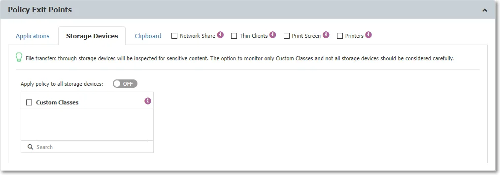

:::note
The **Block CD/DVD Burning** feature is only available for Windows, built-in or
third-party burning features.
:::


To restrict the user from saving sensitive content on a CD or DVD using the built-in Windows
features, follow these steps:

**Step 1 –** Create a **Content Aware Policy**

**Step 2 –** From the Policy Exit Points section, on the Storage Devices tab, enable the **Apply
policy to all storage devices setting**

**Step 3 –** From the Policy Denylist section, select the threats you want the policy to detect

To restrict the user from saving sensitive content on a CD or DVD using third-party applications,
follow these steps:

**Step 1 –** Create a **Content Aware Policy**

**Step 2 –** From the Policy Exit Points section, on the Storage Devices tab, enable the **Apply
policy to all storage devices setting**

**Step 3 –** On the Applications tab, from the Social Media/Others options, select the following:

- **CDBurnerXP**
- **ImgBurn CD/DVD**
- **InfraRecorder CD - DVD**

**Step 4 –** From the Policy Denylist section, select the threats you want the policy to detect

:::note
The feature will apply to CD/DVD burning options Like a USB flash drive and With a CD/DVD
player, using either Drag and Drop or Copy and Paste actions.
:::


### Clipboard

Use the Clipboard functionality to monitor all content captured through Copy & Paste or Cut
& Paste operations.

:::note
The Clipboard functionality runs in the Endpoint Protector Notifier, so it needs a desktop session with the Notifier. On Linux computers without a desktop session, such as command-line (headless) systems, Endpoint Protector can't monitor the clipboard.
:::

:::note
The Clipboard functionality applies only to confidential content that is defined inside the
Policy Denylists section for the Source Code tab, Predefined Content, Custom Content, or Regular
Expressions.
:::


The Clipboard functionality provides a certain degree of granularity and can be enabled:

- Clipboard – enable this setting to monitor all content from a computer, regardless of the defined
  exit points.

    :::note
    This setting only applies to Copy operations.
    :::


When performing a Copy operation, the Endpoint Protector Client will inspect the clipboard content
and if confidential information is detected, the content will be deleted. As such, the Paste
operation will not work because the clipboard content was deleted.

- **Detect Source Code**—enable this setting to detect the source code defined in the policy.

    :::note
    This setting applies to Copy or Paste operations.
    :::


The Endpoint Protector Client will inspect the clipboard content for source codes and if source code
is detected and monitored in a Content Aware policy (e.g., C++ is selected in a Content Aware
policy, and the detected clipboard content is C++) the content will be blocked on a Copy or Paste
operation (depending if the Apply Paste restrictions to all monitored applications settings is
enabled)

- **Detect Images**—enable this setting to detect copying images to clipboard. Endpoint Protector doesn't use OCR for these images. The following image
  types will be targeted:

    1. print screen type images - the content is automatically blocked
    2. image files copied with CTRL+C shortcut and pasted to clipboard (this will paste the file URL
       to clipboard)

    :::note
    If multiple files are copied and the content contains at least one image, the file
    content will be blocked.
    :::


Similar to code source detection, the Detect images setting applies if the file type is blocked in
Content Aware Protection policy (if the user will copy a PNG file, the file will be blocked if the PNG
file type is checked in the Content Aware Protection policy).

The Endpoint Protector Notifier saves the content of an image in a temporary location, which will
be moved if shadow is enabled or deleted if not after scan.

- To inspect certain applications and set Paste restrictions, enable the **Apply Paste restrictions
  to all monitored applications** setting

    :::note
    This setting restricts the Paste operations for the defined Policy Exit Points.
    :::


When performing a Copy operation, the Endpoint Protector Client will inspect the clipboard content
and if confidential information is detected, the content will be allowed, instead, it will block a
Paste operation if the application is monitored in a Content Aware policy.

:::warning
The Paste operation is allowed when the user changes the window to other applications.
:::


For example; in a Content Aware policy, Firefox is monitored, Chrome isn't monitored and the Apply
Paste restrictions to all monitored applications setting is enabled. The user performs a Copy
operation from Notepad which contains confidential information, then the Paste operation on Firefox
is blocked, and the Paste operation on Chrome is allowed

- To inspect extended applications and set Paste restrictions, enable the **Extend Paste
  restrictions to below applications** setting

    :::note
    This setting restricts the Paste operation for the defined applications.
    :::


Use this setting to extend the applications not listed in a Content Aware policy and block the Paste
operations.

For example; Microsoft Word isn't listed in a Content Aware policy, but you can select the
application from the list to monitor the Paste operation on the Microsoft Word app.

On-demand, Endpoint Protector can add other applications.

:::warning
On certain Linux environments, like those using Wayland protocol by default, paste
control is limited due to Wayland's lack of support for detecting the focused window. To ensure
security, content blocking occurs during the copy operation.
:::


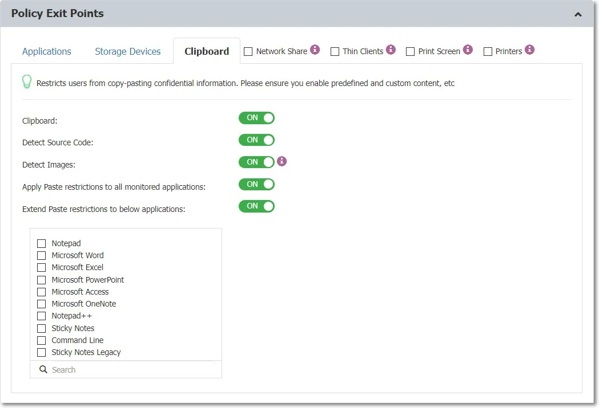

Newer Linux Ubuntu versions have 'snap'-based applications installed by default, affecting Endpoint
Protector Client functionality. This may result in missing file-related events in Content Aware
Protection scans. 'Snap'-based applications also affect file-related web browser
activities, which worsens this limitation. Consider non-'snap'-based applications (where possible) as
alternative configurations for optimal functionality.

The following are additional settings found under Policy Exit Points:

1. **Network Share**—applies to file transfers from network shared drives. On Windows, it applies to file transfers to and from network shared drives. On Linux, monitoring applies only to NFS-mounted drives and doesn't cover SMB/CIFS shares. Endpoint Protector will report all the events for Report Only policies for
   macOS. For Block & Report policies the transfer from a Local Share towards the Local Disk,
   Controlled Storage Device Types, and Controlled Applications are blocked.
2. **Thin Clients**—applies to file transfers to thin clients drives. Available for Windows only.
3. **Print Screen**—prevents users from making print screens. Available for Windows and macOS. On Windows, third-party applications might still work, because the feature covers mainly native Windows capabilities.
4. **Printers**—applies to documents that contain confidential information and that users send to local and network shared printers. It doesn't include file type filters.

:::info
When enabled, it is recommended to enable the **Advanced Printer** and **MTP
Scanning** option in Settings (Global, Groups, Computers, etc.)

:::

## Policy Denylists

Denylists define what the policy detects. Select the items you want the policy to detect. Depending on the Policy Action, the policy then reports or blocks the transfers that match.

The **Policy Denylists** section has one tab for each type of denylist:

- **File Type**—Content Aware Protection recognizes more than 100 file types in six groups. Select the groups or the individual types that you want the policy to detect, or select **Select all file types**.
  - **Graphic Files**: JPEG, PNG, GIF, ICO, BMP, TIFF, DJV, CGM, EPS, CorelDRAW, Corel PHOTO-PAINT, Adobe Illustrator, Adobe InDesign, BPF, HEIC, Maya 3D, PSD, and WebP
  - **Office Files**: Word, Excel, PowerPoint, PDF, encrypted PDF, InfoPath, Outlook, Publisher, CSV, iWork, Office 2003+ with password, and Project
  - **Archive Files**: ZIP, 7Z, RAR, ACE, TAR, XZ, XAR, BZ2, GZ, ASiC containers, and the password-protected ZIP, 7Z, RAR, and ACE archives
  - **Other Files**: text files, XML and DTD, executables and libraries (EXE, SYS, DLL, SO), MSI, PGP, P12, CSR, VMDK, DICOM, ACCDB, DRM files, Fasoo and Nasca DRM files, EPP encrypted files, unidentified files, and others
  - **Media Files**: MOV, MP3, M4A and MP4, WAV, WMA, AVI, AIF, M3U, Matroska, MXF, and WebM
  - **CAD Files**: AutoCAD, Fusion, I-DEAS 3D CAD, IGES, Inventor (IPT), JT, Mastercam, Parasolid, Pro/E, Revit, SolidWorks, Solid Edge, CATIA, STL, WRL, and others

  Many files, such as programming files, are plain text, so select **Text Files** carefully.

  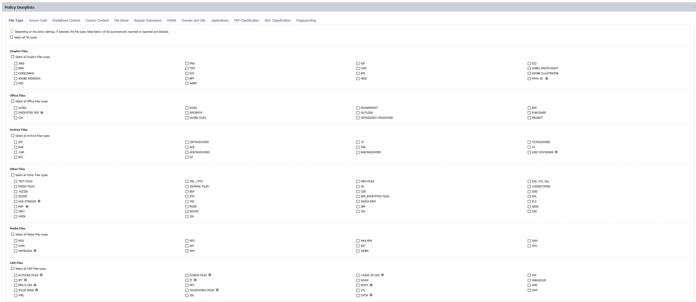

- **Source Code**—protect your intellectual property. Content Aware Protection detects source code written in more than 30 programming and scripting languages: Assembly, Batch File, C, C#, C++, CSS, Fortran, Go, Haskell, HTML, Java, JavaScript, Lisp, Lua, MATLAB, Objective-C, OCaml, Pascal, Perl, PHP, PowerShell, Python, R, Ruby, Scala, Shell Script, SQL, Swift, TeX, and Visual Basic Script. It also detects makefiles, C/C++ header files, and Android and iOS application packages. Select the languages that you want to protect.

  :::note
  Some programming languages are similar to each other, so a small code snippet can match more than one language. When you troubleshoot source code detection, use larger sample files, because small snippets can fit several languages. Select the languages for detection carefully, and select only the languages that you need.
  :::

- **Predefined Content**—ready-made patterns for Personally Identifiable Information (PII) and other sensitive data, with no regular expressions to write. The patterns help you meet regulations such as the Payment Card Industry Data Security Standard (PCI DSS), the General Data Protection Regulation (GDPR), and the Health Insurance Portability and Accountability Act (HIPAA). Select the patterns that you want the policy to detect. The patterns are grouped by category:
  - **Credit Cards**: Visa, Mastercard, Amex, Discover, Diners, JCB, Maestro, China UnionPay, MIR, and others
  - **Personal Identifiable Information**: IBAN, date, e-mail, ISBN, ZIP+4, NPI, UK Electoral Number, and VIN
  - **Address**, **SSN**, **ID**, **Passport**, **Phone Number**, **Tax ID**, **VAT ID**, **Driving License**, and **Health Insurance Number**, by country, and for driving licenses also by U.S. state and Canadian province
  - **Bank Account**: Canada, United Kingdom, United States, ABA Routing Number, and SWIFT
  - **Internet Protocol Addresses**: IPv4 and IPv6

  The patterns cover these countries and regions, and the available pattern types, such as SSN, passport, or driving license, vary by country: Albania, Argentina, Australia, Austria, Belgium, Bosnia and Herzegovina, Brazil, Bulgaria, Canada, Chile, China Mainland, Colombia, Croatia, Cyprus, Czech Republic, Denmark, Ecuador, Estonia, Finland, France, Germany, Greece, Hong Kong, Hungary, Iceland, India, Indonesia, Ireland, Israel, Italy, Japan, Kazakhstan, Korea, Latvia, Lithuania, Luxembourg, Macao, Malaysia, Mexico, Montenegro, Netherlands, North Macedonia, Norway, Peru, Poland, Portugal, Romania, Russia, Serbia, Singapore, Slovenia, South Africa, Spain, Sweden, Switzerland, Taiwan, Thailand, Turkey, Ukraine, United Arab Emirates, United Kingdom, United States, and Venezuela. The list can differ in your version, because Netwrix keeps extending and updating the patterns.

  Where possible, a pattern includes a validator that reduces false positives. For example, Endpoint Protector checks credit card numbers with the Luhn algorithm, validates IBAN numbers, and validates the checksum of a Polish PESEL number. A match must pass the validator before Endpoint Protector reports it.

  A pattern with an information icon, or marked with `*`, can generate false positives, and no pattern can guarantee 100 percent accuracy. To reduce false positives, combine patterns with Context Detection Rules.

  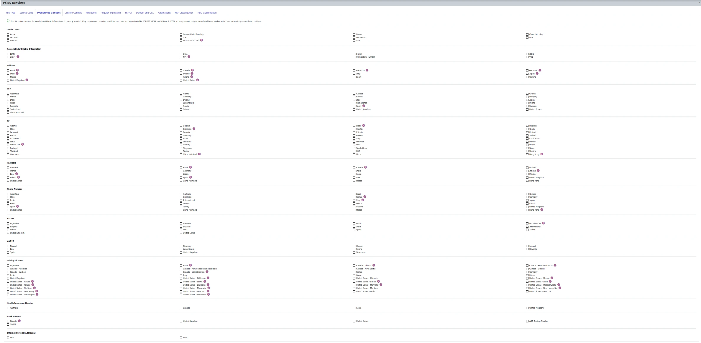

- **Custom Content**, **File Name**, **Regular Expression**, **HIPAA**, and **Domain and URL**—select the lists that you created in **Denylists and Allowlists**.
- **Applications**, **MIP Classification**, and **NDC Classification**—select the application, Microsoft Purview Information Protection (MIP) label, or Netwrix Data Classification (NDC) label entries that you created in **Denylists and Allowlists**.
- **Fingerprinting**—select Fingerprint dictionaries. See [File Fingerprinting](/docs/endpointprotector/admin/denylistsallowlists/fingerprinting.md).

For the denylist types and how to create the lists, see [Denylists and Allowlists](/docs/endpointprotector/admin/denylistsallowlists/overview.md) and [Policy Denylists](/docs/endpointprotector/admin/cap_module/contentdetection.md#policy-denylists).

## Content Detection Summary

The **Content Detection Summary** shows the predefined content, custom content, regular expressions, and HIPAA items that you selected in the policy. Use the **Content Detection Rule** to combine them with the **AND** and **OR** operators, and to refine what counts as a detection.

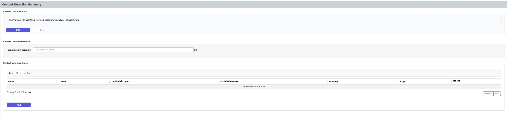

- **Content Detection Rule**—click **Edit** to define the operation. Select **AND** or **OR**, add items or groups, and change the order with the arrows or by dragging. Turn on **Threshold** to set a number of matches for each entry. Click **Reset** to remove your changes.
- **Restrict Content Detection**—select the file types to which the rule applies. If you select none, Endpoint Protector searches all file types that the policy doesn't block.
- **Context Detection Rules**—reduce false positives by requiring or excluding context around a detected item. Click **Add**, and enter a **Name**, the identifiers in **Apply Contextual for Identifiers**, the **Proximity**, and the **Included Context** and **Excluded Context**. Select **AND** or **OR** for each context list. In **Apply context rule for**, select the items that the rule covers. You can create Context Detection Rules only if the Content Detection Rule uses the **OR** operator.

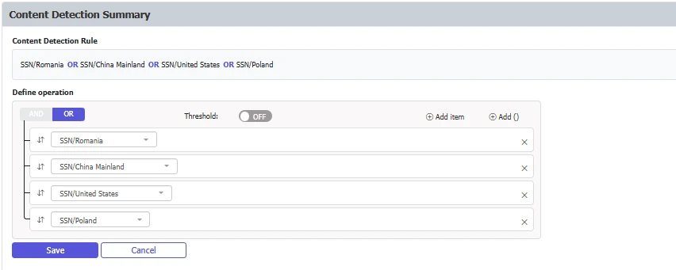

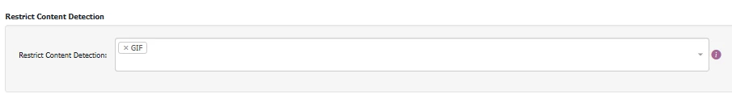

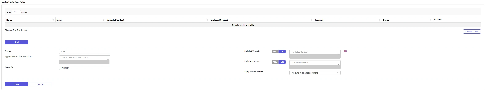

For the field details, see [Content Detection Summary](/docs/endpointprotector/admin/cap_module/contentdetection.md#content-detection-summary).

## Policy Allowlists

Allowlists define what the policy ignores. The **Policy Allowlists** section has these tabs:

- **MIME Type**—the file types that the policy excludes from scanning

  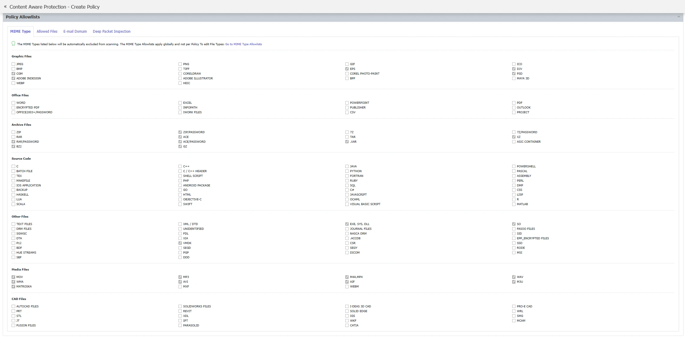

- **Allowed Files**—individual files that the policy allows
- **E-mail Domain**—e-mail domains that the policy allows
- **Deep Packet Inspection**—Deep Packet Inspection (DPI) exceptions, for example to allow a specific domain

The MIME Type allowlist applies globally, not per policy. To change it, click **Go to MIME Type Allowlists** in the tab.

:::warning
Starting with version 2608.0.1.x, archive file types in the global MIME Type Allowlist are unchecked
by default on new instances. Existing instances with defined policies retain their current
configuration. After upgrading, review the MIME Type Allowlist and enable archive types if your
policies require them.
:::

For all allowlist types, see [Denylists and Allowlists](/docs/endpointprotector/admin/denylistsallowlists/overview.md) and [Policy Allowlists](/docs/endpointprotector/admin/cap_module/contentdetection.md#policy-allowlists).

## DPI Monitored URL Categories

Use this section to limit Deep Packet Inspection to specific URL categories. DPI filters only the content that users upload to URLs in the **Monitored Categories** list. If the list is empty, DPI filters content that users upload to any URL.

To monitor a category, select it in **Categories** and click the right arrow. To remove it, select it in **Monitored Categories** and click the left arrow. To add, edit, or delete categories, click **Go to URL Categories**.

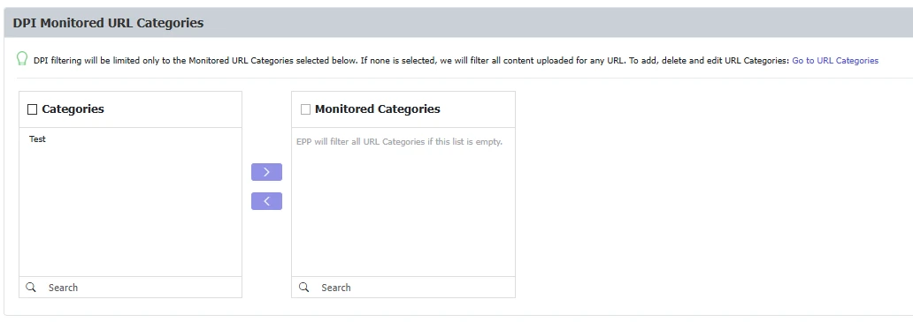

For more information, see [DPI Monitored URL Categories](/docs/endpointprotector/admin/cap_module/contentdetection.md#dpi-monitored-url-categories).

## Policy Entities

The last step in creating a policy is to select the entities that the policy applies to. Use the **Include** and **Exclude** sections. Each section has the same four lists: **Departments**, **Groups**, **Computers**, and **Users**. Use the search box under a list to find an entity.

- **Include**—select the entities that the policy applies to. For example, select the groups **HR** and **Marketing** to apply the policy to every member of those groups. You can add individual computers or users to the same policy.
- **Exclude**—select the entities that the policy doesn't apply to. An excluded entity stays outside the policy even if it is also part of an included entity. For example, if the policy includes the **HR** group and you exclude the user `rpatel`, the policy applies to the other members of the group, but not to `rpatel`.
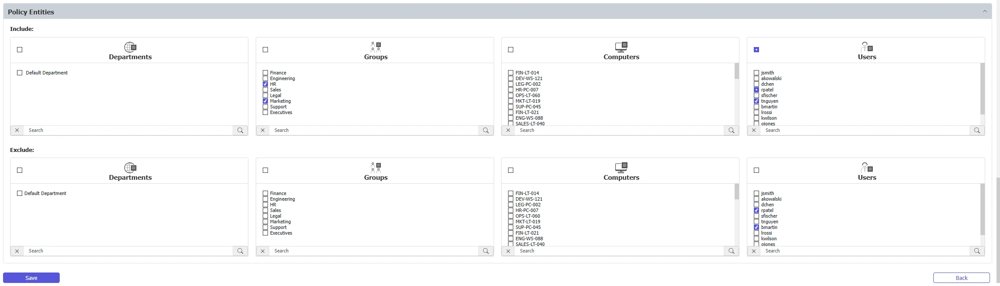

When a policy is already enforced on a computer, user, group, or department, selecting that entity highlights the related entities that the policy applies to. See [Policy Entities](/docs/endpointprotector/admin/cap_module/contentdetection.md#policy-entities) and [Policy processing order](#policy-processing-order).
