# Users and Groups

## Users

From this section, you can manage all the users in the system. Users are the end-users who
log on to a computer that has the Endpoint Protector Client software installed. Endpoint Protector
automatically adds any new user to the database, so you can manage them.

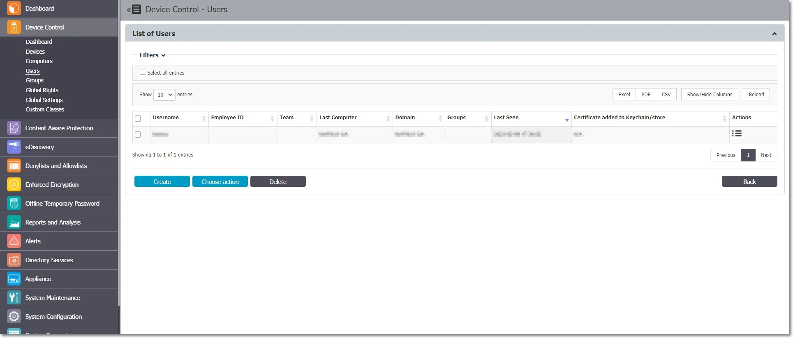

Endpoint Protector identifies a user by information like Name (Username, First Name, Last Name),
Department, Contact Details (Phone, E-mail), and others, and automatically assigns the user to a
computer.

The Administrator can manually create a new user at any time by providing the user’s parameters and
information. You can also import users into Endpoint Protector from Active Directory.

For detailed information on Active Directory, refer to the
[Directory Services](/docs/endpointprotector/admin/directoryservices/directoryservices.md) chapter.

The Endpoint Protector installation creates two users by default:

- noUser is the user linked to all events performed while no user was logged into the computer.
  Endpoint Protector doesn't log the names of remote users who log into the computer and stores
  their events as events of noUser. noUser events also occur when an automated script/software
  accesses a device while no user is logged in to the specific computer.
- autorunUser indicates that Windows launched an installer from a specific device. It is
  the user attached to all events generated by the programs launched from the specific device when
  Autoplay is enabled in the Operating System.

:::warning
Depending on the OS, additional system users can appear:
:::

- \_mbsetupuser (for macOS, during updates)
- 65535, 62624, etc. (for Linux, during locked screens)

The Actions column offers multiple options related to user management like Edit, Manage Rights,
History, and Delete.

### User Rights

To access User Rights, go to the Actions column for the specific user and select Manage Rights.

This section focuses on the users and lets the Administrator specify which Device Types and
Specific Devices are accessible.

The Standard device control rights includes the Device Types and Already Existing Devices sections.
Most deployments use only these device rights.

In addition to the Standard device control rights, if they're enabled in the Global Settings, the
administrator can create fallback policies for Outside Network and Outside Hours circumstances.

:::note
Use the Restore Global Rights button to revert to a lower level of rights. When you click this button, all rights on that level reset to preserve global settings and the system uses the next level of rights.
:::

Endpoint Protector deletes all Existing Devices added on that level when you use the restore.

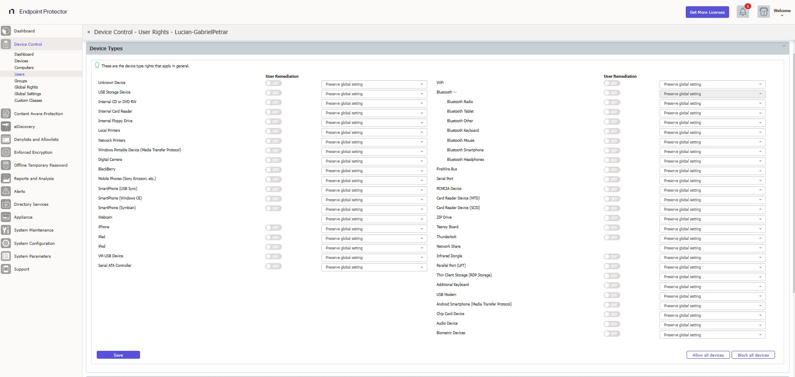

### User Settings

From this section, you can edit the settings for each user.

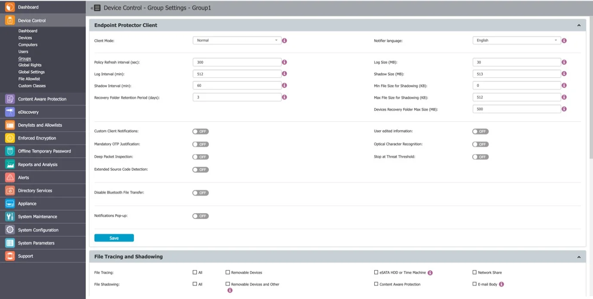

You don't need to define custom settings for each user—users function correctly with inherited
settings from their group or, if none exist, the global settings, which come with default values.

### User History

From this section, you can view the user history by selecting the View User History action.
Endpoint Protector then displays the Logs Report page filtered for the respective user.

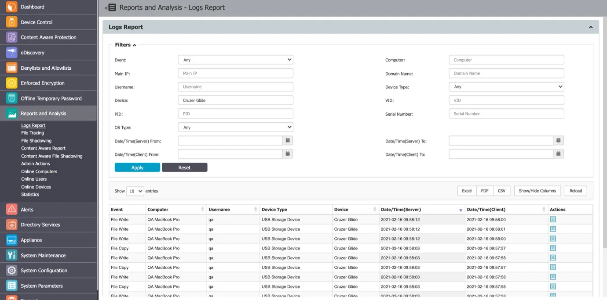

## Groups

From this section, you can manage all the groups in the system. Grouping computers and users
helps the Administrator manage rights or settings for these entities more efficiently.

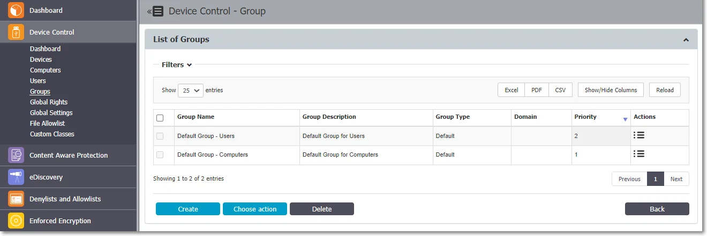

Endpoint Protector identifies a group by information like Name and Description, and by its entities
(Computers and Users).

You can manually create a new group at any time by providing the group information.
You can also import groups into Endpoint Protector from Active Directory.

:::note
For detailed information on Active Directory, refer to the
[Directory Services](/docs/endpointprotector/admin/directoryservices/directoryservices.md) topic.
:::

The Actions column offers multiple options related to the group’s management like Edit, Manage
Rights, Manage Settings, History, and Delete.

### Group Types

#### Regular Groups

Regular Groups are the groups that the Administrator creates or imports from AD without a
rule. From this section you can add or remove Computers or Users.

#### Smart Groups

Smart Groups are a dynamic category of computers and user groups whose membership you can define
based on element name patterns.

To use Smart Groups, follow these steps:

**Step 1 –** Enable Smart Groups from System Configuration, System Settings, on the Smart Groups
section, scroll to the bottom of the page and click **Save**.

:::note
After you enable the Smart Group feature, Endpoint Protector doesn't automatically assign Computers and Users to the Default Group unless you create a Smart Group.
:::

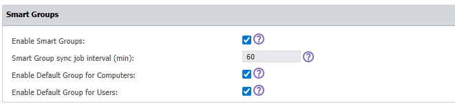

**Step 2 –** Create a Smart Groups from Device Control, Groups section. Click **Create**, provide
the following and then click **Save**:

- Group name, description, and Department
- Enable the Smart Group setting
- Select the Entity, Computers, or Users
- Set rules for the Computers or Users by adding conditions for their selected properties.

These entities support similar, but slightly different properties that you can use in filtering, as follows:

  | Computer   | Users     |
  |-------------------------------------- |---------------------------------------|
  | Computer ID   | First Name   |
  | Username   | Last Name   |
  | Main IP   | Employee ID   |
  | Main MAC Address   | Phone   |
  | Serial Number   | e-mail   |
  | Domain   | Team   |
  | Workgroup   | Last Computer   |
  | Department   | Domain   |
  | Groups   | Department   |
  | OS   | Groups   |
  | Last Seen   | Last Seen   |
  | Location   | Certificate added to Keychain/store   |
  | Client Version   | |
  | Terminal Server   | |
  | Certificate added to Keychain/store   | |

- Define the rules by adding a property, an operator and a value for that operator like: XYZ*, *XYZ*,*XYZ. You can add multiple rules using different or the same property.

:::warning
The values set are key-sensitive.

- After defining the rules, validate the expressions used in the conditions by clicking the Validate button. If the conditions are correct, the top ten matching results appear after validation.

:::note
After you create the group, you can manage its priority by drag and drop actions.
:::

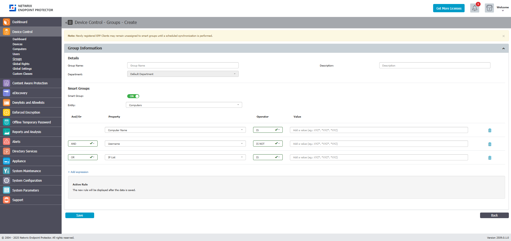

**Step 3 –** Synchronize entities to the Smart Groups.

The Smart Groups rule will not remove items from the regular groups to assign them to smart groups.
The synchronization process adds entities to the Smart group. After you create the
Smart Group, click **Sync** to start the synchronization at a given interval every 1 minute.

:::note
The Synchronization process will not change settings for the regular groups.
:::

If a new Computer registers and matches one of the rules, Endpoint Protector automatically assigns
the Computer to that Group.

If the new Computer doesn't match the rule, Endpoint Protector adds it to the Default Group, if
Default Groups are enabled from System Configuration, System Settings, and the Smart Groups section.

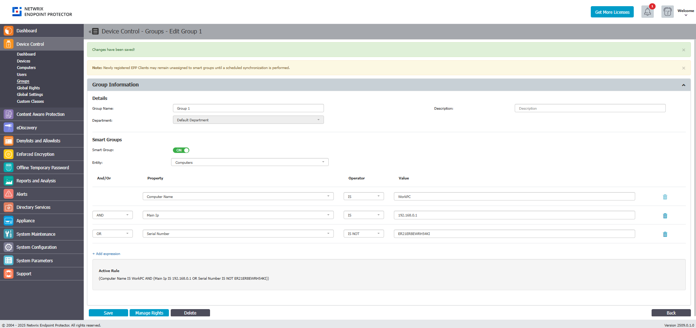

**Step 4 –** Delete a Smart Group from the Actions column or select the group from the list and then
click **Delete**.

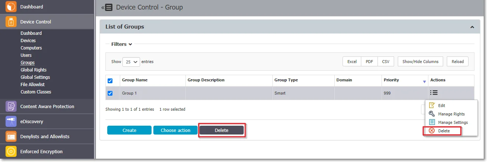

Smart Groups have the following limitations:

- Smart Groups don't display assigned computers or users
- You can't manually add an entity to a Smart Group
- Smart Groups are part of the Default Department but don't use Departments

If you disable Smart Group from System Settings, Endpoint Protector converts the Smart Group into a Regular
Group. The group keeps its settings, rights, and other settings but loses its entities, and
Endpoint Protector removes the Default Group for Computers and the Default Group for Users.

Because of how the Endpoint Protector Client relays user information, Endpoint Protector assigns
user entities to Smart Groups only after the synchronization process, not when a computer registers.

When a Computer registers, Endpoint Protector only receives information on computers; the Endpoint
Protector Client relays User information through events (logs) or regular pings/reprovision requests. User information
is volatile: it can change between requests (different users can log in or log out on the same
computer; log out events/sleep can also result in default hard coded user entities being marked as
active/online).

#### Default Groups

Default Groups are groups of Computers and Users that don't belong to Smart Groups. These are
Computers and Users that don't follow the name pattern set for Smart Groups.

:::note
Default Groups are available only if Smart Groups are enabled. To use Default Groups,
follow these steps:
:::

**Step 1 –** Enable Default Groups for Computers and Users from System Configuration > System
Settings > on the Smart Groups section, scroll to the bottom of the page and click **Save**.

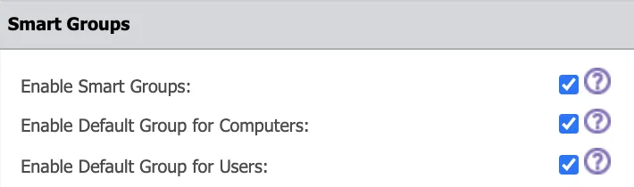

:::warning
You aren't required to manually create Default Groups – when you enable them, Endpoint
Protector automatically creates the Default Groups for Users and Computers.
:::

**Step 2 –** Synchronize entities to the Default Groups. To assign Computers and Users to the
Default Groups, navigate to the Device Control section and locate the Groups section. In the List of
Groups section, find the Actions column, select **Edit**, and then click **Sync**.

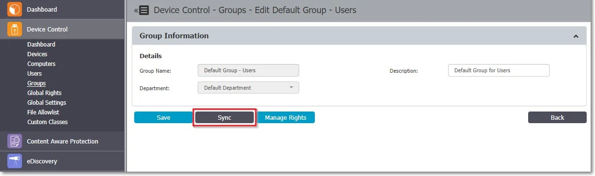

Default Groups have the following limitations:

- You can only edit Default Groups description, not the Default Groups name
- You can't delete the Default Groups, but you can disable them from System Configuration, System
  Settings, on the Smart Groups section
- If you disable Default Groups, Endpoint Protector deletes them with all their dependencies

#### Allowlists on Computer Groups

You can set File Location, Network Share Allowlists, and File Location Denylist for groups of
Computers.

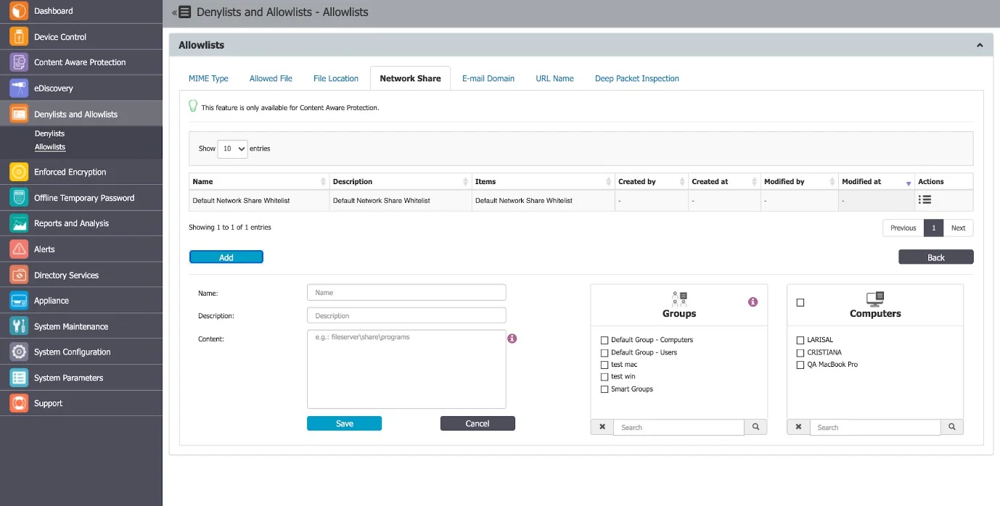

The Groups select section displays all groups.

For a selected group the allowlist/denylist rule will apply only to computers from that group. If
the group contains no computer, the rule won’t apply to anything. The Administrator can select
additional computers from the select box.

Smart groups are always in sync with all the contained computers for denylists, just like they apply
to a policy. Endpoint Protector synchronizes groups selected on allowlists or denylists every 15 minutes.

### Group Rights

To access Group Rights, go to the Actions column for the specific group and select Manage Rights.

This section focuses on the group and lets you specify which Device Types and Specific Devices are
accessible.

This section is similar to the Computer Rights section, the difference being that it applies to all
the computers that are part of the group simultaneously.

The Standard device control rights include the Device Types and Already Existing Devices sections.
Most deployments use only these device rights.

In addition to the Standard device control rights, if you enable them in the Global Settings, you can
create fallback policies for Outside Network and Outside Hours circumstances.

For detailed information on Device Types and Specific Devices (Standard, Outside Network, and Outside
Hours), refer to the Users and Groups topic.

:::note
Use Restore Global Rights to revert to a lower level of rights. After you enable it, Endpoint
Protector sets all rights on that level to preserve global settings and uses the next level of
rights.
:::

:::note
Endpoint Protector deletes all Existing Devices added on that level when you use the restore.
:::

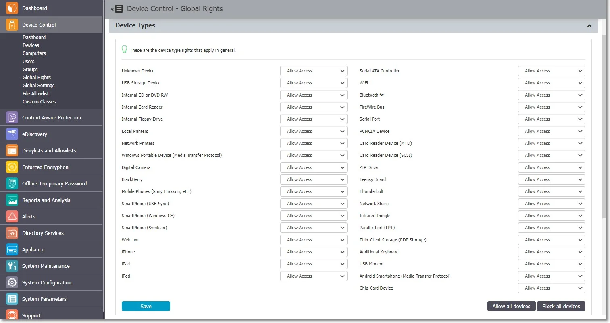

### Group Settings

From this section, you can edit the settings for each group.

Grouping computers and users makes editing settings easier and more logical. You don't need to define custom settings for each group—computers function correctly with inherited
settings from their group or, if none exist, the global settings, which come with default values.
