# Denylists

## Custom Content

Custom Content denylists are custom-defined lists of terms and expressions detected as sensitive
content by Endpoint Protector, available for both Content Aware Protection and eDiscovery modules.

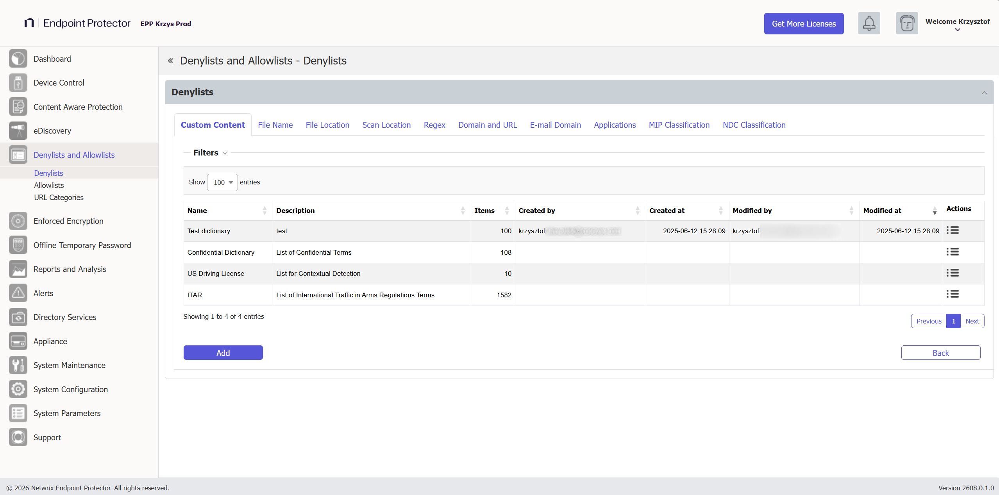

From this section, you can view and add e-mail custom content denylists and from the Actions column,
you can edit, delete, or export an existing denylist.

To create a new denylist, under the list of available denylists, click **Add**, provide a **name**
and **description** and then type or paste items at least three characters separated by a new line,
comma, or semicolon. You can import content using the sample file provided on the form and then
select the option based on the number of uploaded items. You can type or paste up to 100 items in a list. To add more items, import them from an `.xls` file.

:::note
You can edit dictionaries of under 100 items, but you must upload larger dictionaries
again.
:::

After you create the denylist, it appears on the Custom Content list and is available
when creating or editing a Content Aware Protection or eDiscovery policy.

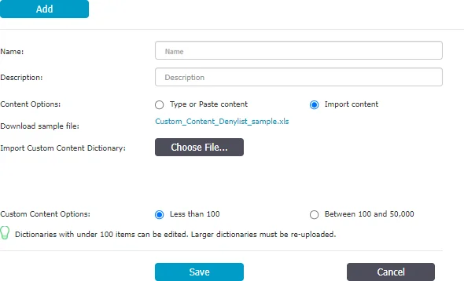

### Detecting Custom Document Classification Labels

Many third-party classification and labeling tools (such as Titus, Boldon James, Microsoft Purview
Information Protection, or a custom in-house tool) write their classification labels as custom
document properties in Office files (Word, Excel, PowerPoint). You can create a Custom Content
dictionary that matches these labels, so Content Aware Protection detects and controls files based
on their classification, even without native integration with the labeling tool.

**To find the custom property value:**

1. In the Office application, open the file, go to **File** → **Info** → **Properties** →
   **Advanced Properties**, and select the **Custom** tab. Note the property **Name** and **Value**
   you want to detect.

   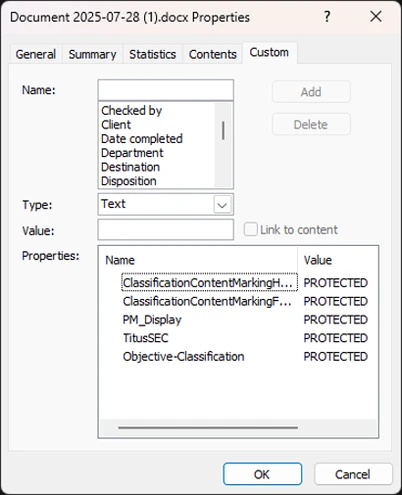

2. Alternatively, for a more detailed view, copy the file, rename its extension to `.zip`, extract
   it, and open `docProps/custom.xml`. The properties and their values appear as `<property>`
   entries.

   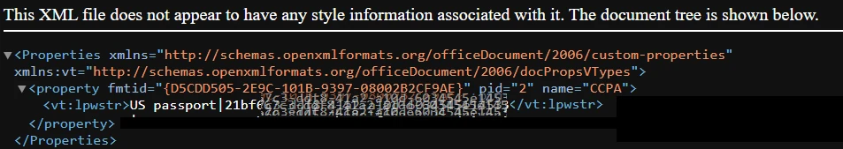

**To create the Custom Content dictionary:**

1. Navigate to **Denylists** → **Custom Content**.
2. Click **Add**, provide a **name** and **description**, and enter the property value you
   identified (for example, the classification label text) as a dictionary entry.
3. Save the dictionary and assign it to your Content Aware Protection policy.

:::note
This method matches the classification label as plain text content. For structured, native
classification support, see [Microsoft Information Protection](#microsoft-information-protection)
or [NDC Classification](#ndc-classification), which match specific document property fields
directly.
:::

## File Name

File Name Denylists are custom-defined lists of file names detected by Endpoint Protector, available
for both Content Aware Protection and eDiscovery modules.

From this section, you can view and add filename denylists and from the Actions column, you can edit,
delete, or export an existing denylist.

To create a new denylist, under the list of available denylists, click Add, provide a name and
description and then type or paste the file names separated by a new line, comma, or semicolon. You
can import content using the sample file provided on the form.

You can define the content by adding the filename and extension, or just the extension.

Examples: Matching and Non-Matching for File Names like “example.pdf”:

- Matching – example.pdf, my_example.pdf
- Non-Matching – example.txt, myexample.txt, test.pdf, example.pdf.txt, test_example.pdf_test.zip

Examples: Matching and Non-Matching for File Extensions like “.epp”:

- Matching – test.epp, mail.epp, 123.epp
- Non-Matching – 123.epp.zip, mail.epp.txt

After you create the denylist, it appears on the File Name list and is available when
creating or editing a Content Aware Protection or eDiscovery policy.

:::warning
For Content Aware Protection, the File Name Denylists work only for Block & Report type
Policies. The Case Sensitive and Whole Words Only features don't apply.
:::

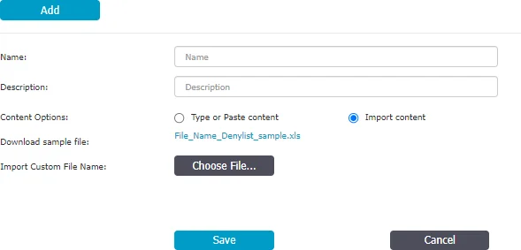

## File Location

File Location Denylists are custom-defined lists of locations identified by Endpoint Protector. File
transfers within this location are automatically blocked, regardless of the content inspection rules
or permissions defined in various Policies.

File Location Denylists are available for both Content Aware Protection and eDiscovery modules.

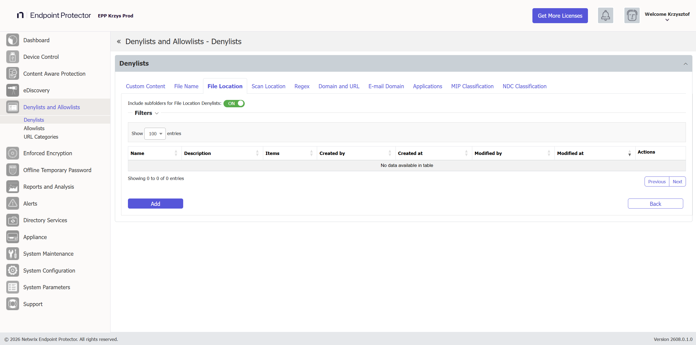

The **Include subfolders** option applies to all File Location Denylists. It is off by default. When you turn it on, the denylists apply to the specified folder and to the files in its subfolders. The File Location Allowlists have their own **Include subfolders** option.

:::note
To use File Location Denylists, also select the browser or application for file transfers from within the Content Aware Protection Policy.
:::

From this section, you can view and add file location denylists and from the Actions column, you can
edit or delete an existing denylist.

To create a new denylist, under the list of available denylists, click **Add**, provide a **name**
and **description**, add the items separated by a new line, comma, or semicolon and then select the
**groups** and **computers**.

:::note
File Location Denylist will not apply to groups of users, only to groups of computers.
File Location Denylist will only apply for the selected computer groups after 15 minutes.
:::

:::note
**Known limitation:** Location-based denylists and allowlists aren't reliable when Deep Packet Inspection (DPI) is active. DPI operates at the network level and identifies files by matching transferred data hashes against files on the local machine. If the same file exists in multiple locations, Endpoint Protector can't determine which copy was transferred, and location-based rules can't be applied.
:::

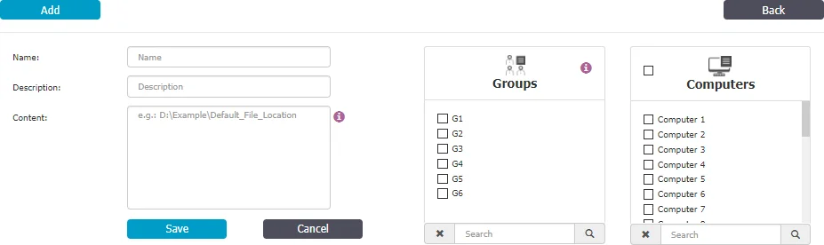

You can use wildcard patterns in the File Location Denylists to specify wildcard matching. To match
a desktop folder on Windows, use the pattern "?:\Users\\\*\Desktop\".

**Wildcards Usage Examples for File Location**

| Wildcards Type | File Location  | Results matched                                        | Results not matched                                            |
| -------------- | -------------- | ------------------------------------------------------ | -------------------------------------------------------------- |
| Implicit       | C:\temp        | C:\temp\file.txt C:\temp\test\file2.txt C:\tempfile.txt   | C:\temp1\file.txt C:\Windows\file.txt                            |
| Explicit       | C:\Windows\\\* | C:\Windows\regedit.exe C:\Windows\system32\notepad.exe | C:\Windows.old\regedit.exe C:\Windows.old\system32\notepad.exe |

## Scan Location

Scan Location Denylists are custom-defined lists of locations identified by the eDiscovery module.
The eDiscovery module automatically inspects data at rest within this location for content,
depending on the rules defined in various Policies.

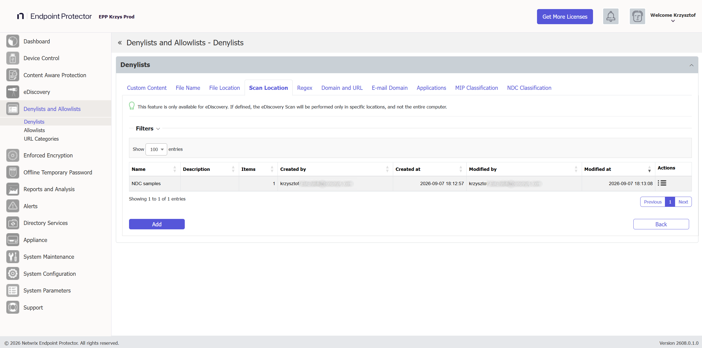

From this section, you can view and add scan location denylists and from the Actions column, you can
edit or delete an existing denylist.

To create a new denylist, under the list of available denylists, click **Add**, provide a **name**
and **description**, add the scan locations separated by a new line, comma, or semicolon or select
from the **Predefined Scan Locations** and then **Add to Content**.

When defining a Scan Location, use these special characters to define the path:

- \* - to replace any word
- ? - to replace any character

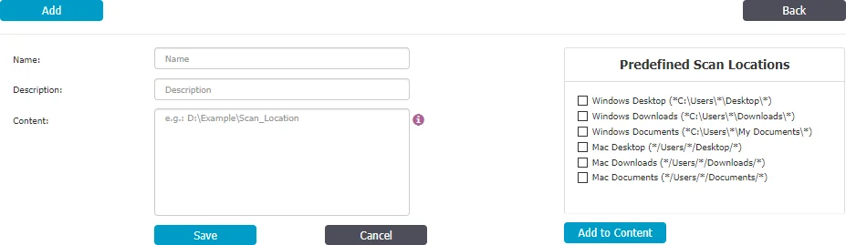

## Regex

Regular Expressions are sequences of characters that form a search pattern, mainly for use in
pattern matching with strings.

You can create a regular expression to find a certain recurrence in the data transferred
across the protected network. Regex Denylists are available for both the Content Aware Protection
and eDiscovery modules.

:::warning
Avoid Regular Expressions when possible—their complexity increases resource usage and CPU load. Improper regex patterns can have negative effects.
:::

From this section, you can view and add regex expressions and from the Actions column, you can edit
or delete an existing denylist.

To create a new denylist, under the list of available denylists, click **Add**, provide a **name**
and **description** and then add the regex expression.

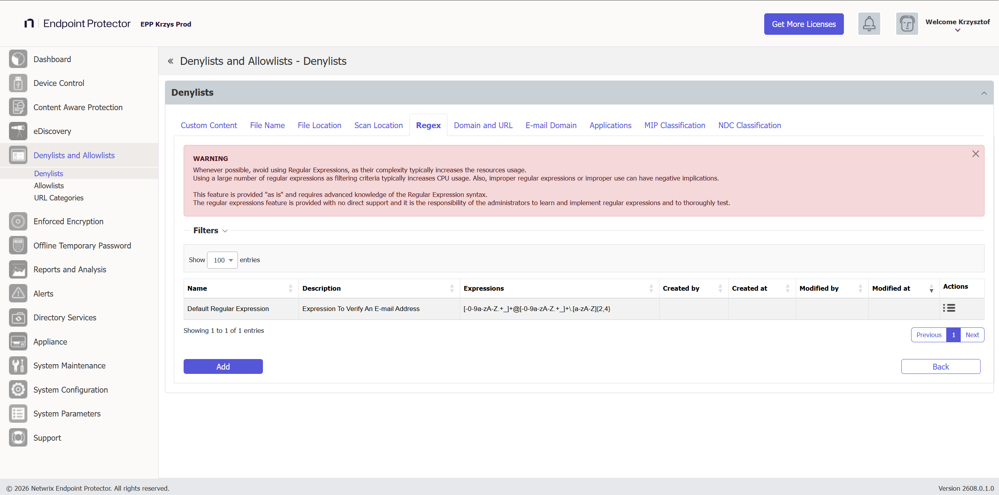

You can test a regular expression for accuracy using the right-side option. Add the content and then
click Test. If the Regular Expression has no errors, then the same content should appear in the
Matched content box:

- To match an E-mail – `[-0-9a-zA-Z.+_]+@[-0-9a-zA-Z.+_]+\.[a-zA-Z]{2,4}`
- To match an IP –
  `(25[0-5]|2[0-4][0-9]|[01]?[0-9][0-9]?)(\.(25[0-5]|2[0-4][0-9]|[01]?[0-9][0-9]?)){3}`

:::note
Netwrix provides this feature “as is”, and it requires advanced knowledge of the Regular
Expression syntax. Netwrix offers no direct support, and customers are responsible for learning,
implementing, and thoroughly testing regular expressions.
:::

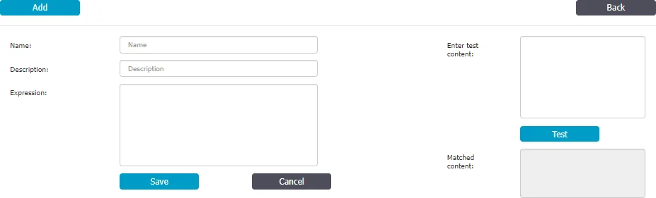

### Regex Supported Formats

Endpoint Protector supports both standard Regex syntax and **Perl-Compatible Regular Expression (PCRE)** extensions and modifiers. For example, you can use the (?i) modifier at the beginning of a regex pattern to make it case-insensitive during matching.

**Case Sensitivity Options in Regular Expressions**

Regular expressions let you control how text matching handles letter casing. Depending on your requirements, you can use case-sensitive, case-insensitive, or partially case-insensitive matching.

**1. Case-Sensitive Matching (Default)**

By default, Regex matching is case-sensitive.
This means Endpoint Protector matches only text with the exact same casing.

**Example:** 
**Pattern:** `test@example\\.com` 
**Matches:** `test@example.com` 
Doesn't **match:** `TEST@EXAMPLE.COM` or `Test@Example.Com`

**2. Case-Insensitive Matching**
To make a Regex pattern case-insensitive, use the (?i) flag.
This enables matching regardless of the case of letters in the input text.

**Example:** 
**Pattern:** `(?i)test@example\\.com` 
**Matches:** `test@example.com`, `TEST@EXAMPLE.COM`, `Test@Example.Com`

In the following example, the pattern '(?i)test' will match “test,” “Test,” “TEST,” and other variations, regardless of letter case, as follows:

1. Define the Regex pattern, add it to the dictionary, and save it. Ensure the CAP Policy also includes it for proper application. 
   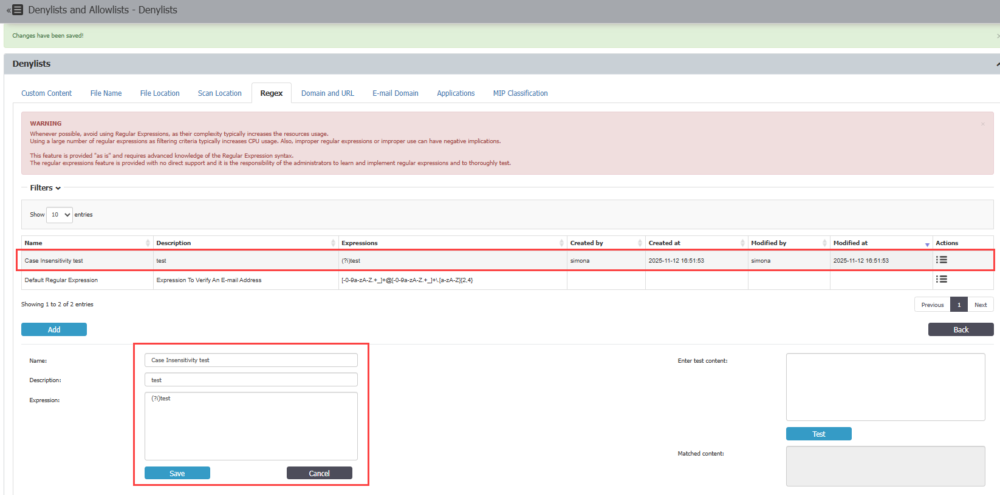
2. The Content Aware Report confirms that the test has completed successfully and that case-insensitive matching is functioning as expected. 
   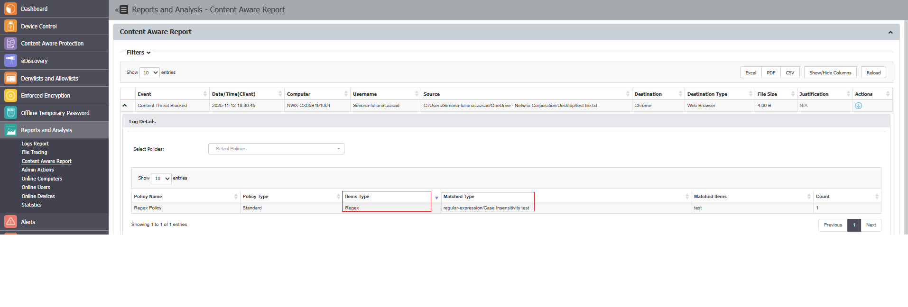

**3. Partial Case-Insensitive Matching**
Regex also lets you apply case-insensitive matching only to specific parts of your pattern.
 You can enable and disable this mode using the following flags:

-   `(?i)` — enables case-insensitive mode
-   `(?-i)` — disables case-insensitive mode

**Example:** 
**Pattern:** `(?i)confidential(?-i) document` 
**Matches:** `"CONFIDENTIAL document"`, `"Confidential document"` 
Doesn't **match:** `"CONFIDENTIAL DOCUMENT"`

**Regex Operators**

| **Character** | **Description**                                                         | **Example**                                                          |
|---------------|-------------------------------------------------------------------------|----------------------------------------------------------------------|
| &circ;            | Matches the start of a string or line.                                  | \^abc matches “abc” only if it appears at the beginning of the line. |
| \$            | Matches the end of a string or line.                                    | abc\$ matches “abc” only if it’s at the end of the line.             |
| .             | Matches any single character except newline (\\n).                      | a.c matches “abc”, “axc”, etc.                                       |
| \*            | Matches 0 or more occurrences of the preceding character or group.      | bo\* matches “b”, “bo”, “boo”, “booo”, etc.                          |
| []            | Defines a character class, matching any one of the enclosed characters. | [abc] matches “a”, “b”, or “c”.                                      |
| [abc]         | Any single character of a, b, or c                                      | [abc] matches “a”, “b”, or “c”.                                      |
| [&circ;abc]       | Any single character expect a, b, or c                                  | It will match any single charact expect “a”, “b”, or “c”.            |
| [a-z]         | A character in range a-z                                                | It will match single character in range of a – z.                    |
| [a-zA-Z]      | A character in range a-z & A-Z                                          | It will match single character in range of a – z & A - Z             |
| \\d           | Any digit character                                                     | \\d will match any digit 0-9                                         |
| \|            | Groups expressions together or captures them for backreferences.        | (abc)+ matches one or more repetitions of “abc”.                     |
| ()            | Groups expressions together or captures them for backreferences.        | (abc)+ matches one or more repetitions of “abc”.                     |
| \\            | Used to escape special characters or indicate special sequences.        | \\. matches a literal period “.”; \\d matches any digit.             |
| (?i)          | Enables case-insensitive matching.                                      | (?i)abc matches “abc”, “ABC”, “AbC”, etc.                            |
| \\s           | Any whitespace character                                                |                                                                      |
| \\S           | Any non-whitespace character                                            |                                                                      |

## Domain and URL

Domain and URL Denylists are custom-defined lists of web addresses identified by Endpoint Protector.
Endpoint Protector denies access to domains and URLs from these lists.

:::note
Domain and URL Denylists are available only for the Content Aware Protection module.
:::

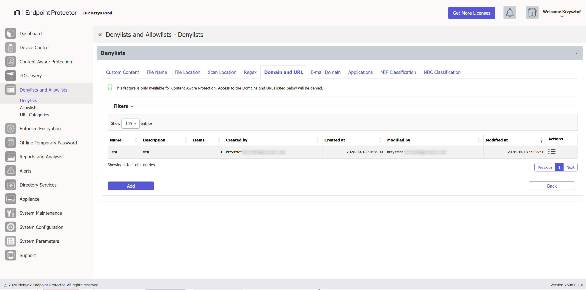

From this section, you can view and add domain and URL denylists and from the Actions column, you
can edit, delete, or export an existing denylist.

To create a new denylist, under the list of available denylists, click **Add**, provide a **name**
and **description** and then **type or paste** items separated by a new line, comma, or semicolon.
You can import content using the sample file provided on the form.

You can create or import up to 1,000 lists of dictionaries, each dictionary comprising up to 50,000 web domains.

:::note
You can edit dictionaries comprising up to 100 web domains, but you must import more
extensive dictionaries again.
:::

You can define the content by adding domains or URLs, for example `example.endpointprotector.com`, `*example.com`, `*example*example`, or `https://website.com`. The `*` represents any word.

After you create the denylist, it appears on the Domain and URL list and is available
when creating or editing a Content Aware Protection policy.

## E-mail Domain

E-mail Domain Denylists are custom-defined e-mail addresses and domains applicable to groups and
computers that block the user from sending emails.

:::warning
This feature blocks the user from sending emails regardless of content and type. As the
denylist applies to the computer, not the policy, it blocks emails sent from the applications you
select that have Report Only or Block and Remediate policies with no remediation possible.
:::

:::note
This feature is only available for Content Aware Protection when Deep Packet Inspection is
enabled and only impacts applications that retrieve the email recipients and are selected on Content
Aware Protection Policy.
:::

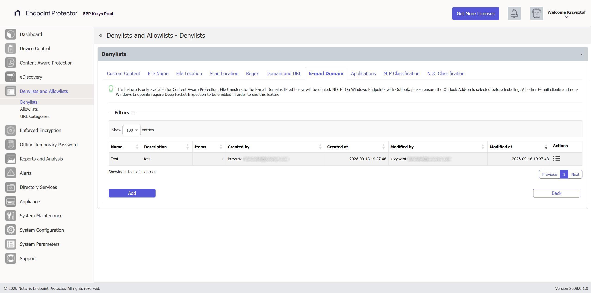

From this section, you can view and add e-mail domain denylists and from the Actions column, you can
edit, delete, or export an existing e-mail domain denylist.

To create a new denylist, under the list of available denylists, click **Add**, provide a **name**
and **description**, add the items separated by a new line, comma, or semicolon and then select the
**groups** and **computers**. You can import content using the sample file provided on the form.

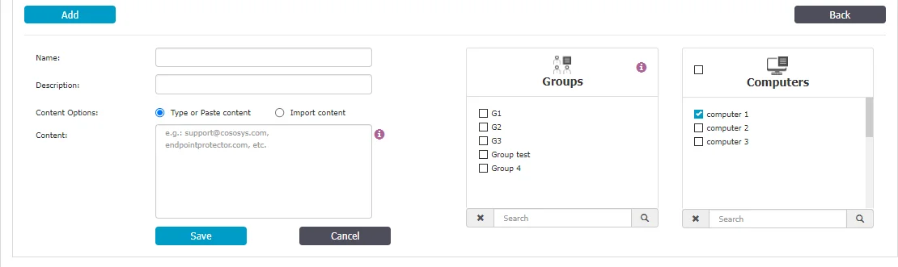

## Applications

This section introduces the documentation related to CLI (Command Line Interface) commands denylists
usage. CLI commands denylists give customers greater control over application start events
and let them scrutinize the command line arguments used to launch specific applications.
This functionality enhances the precision of CAP (Content Aware Protection) policies, enabling users
to gain visibility and control over the usage of particular applications.

Example: Consider controlling the startup mode of an application, as illustrated by
the following example for Google Chrome:

**chrome.exe --incognito**

With CLI commands denylists, you can define criteria for command line arguments that match specific
application behaviors. This lets you create CAP policies tailored to your organization's needs,
so that the launch and behavior of applications align with your security and compliance
requirements.

:::note
CAP visibility may not capture certain native command line utilities such as `ls`, `md`, and
`cd`, which are embedded in the Operating System Core. These commands are integral to the
functioning of the operating system, typically fall outside CAP policies, and aren't an
egress channel.
:::

To define CLI command denylist policies:

**Step 1 –** Navigate to **Denylists** > **Application** tab in the Endpoint Protector Console.

**Step 2 –** Define your criteria based on the command line arguments used by the applications you
want to control.

**Step 3 –** Incorporate these criteria into your CAP policies as arguments to ensure precise
control and monitoring of application usage.

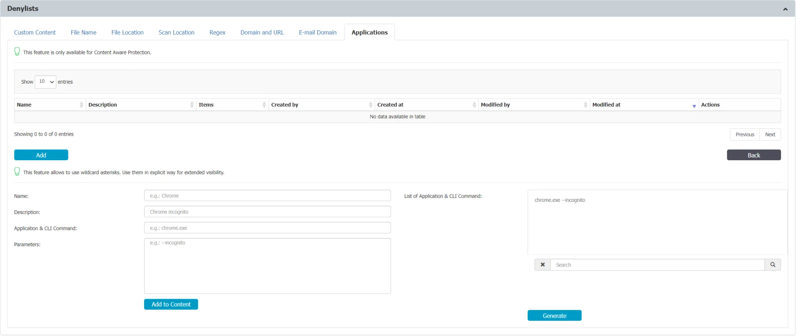

Follow these steps and use CLI commands denylists to enhance your organization's security
posture and ensure applications comply with your policies and regulations.

:::note
The Endpoint Protector Client has limited visibility into activity within PowerShell and
PowerShell ISE environments, as well as basic command-line operations on macOS and Linux systems
(actions like `touch`, `cp`, `cd`, `mv`, and `mkdir`). To ensure Denylists entries match processes
with default parameters, use the wildcard character `*` in the **Parameters** field next to the **Application & CLI Command** field (for example, command `notepad.exe` and parameter `*`).

:::

## Microsoft Information Protection

This section covers the use of Microsoft Purview Information Protection (MPIP) (formerly known as
Microsoft Information Protection (MIP) and Azure Information protection (AIP)), including
classification within Content Aware Protection and eDiscovery policies.

MPIP is a Microsoft toolset enabling organizations to enforce data classification, file encryption,
and Rights Management Services (RMS) on user data.

Define MIP labels directly on the **MIP Classification** tab, for Content Aware Protection and eDiscovery policies.

Use the **Look For** options to define a MIP label:

- **MIP Name**—match the label by its name. Enter the **MIP Label Name**. The name must have at least 5 characters and can't contain `/`, `//`, `<`, `>`, `%`, `&`, `:`, `;`, `?`, `+`, or `|`. A short label name can cause false positives, so use the GUID instead.
- **MIP Guid**—match the label by its unique identifier. Enter the **MIP Guid** in the Microsoft GUID format, for example `defa0070-0d00-0005-0005-bc11223344d2`.
- **Both**—match the label name and the GUID, for maximum accuracy. Enter both values.

This flexibility allows administrators to avoid creating custom dictionaries to recognize
MIP-labeled files.

You can use MIP labels along with other CAP conditions, including content-aware and label-aware
data scanning. This enables granular control over data protection based on MPIP classifications.

:::note
While Endpoint Protector can recognize MIP-encrypted files by their GUID (if
they follow the latest MIP format used by office web tools labeling), Endpoint Protector doesn't
yet support content-aware scanning for these files.
:::

:::note
Endpoint Protector Server in Microsoft Entra (formerly Azure AD) applications is
unnecessary. Endpoint Protector relies on information with labeled files. This might change in
future releases.
:::

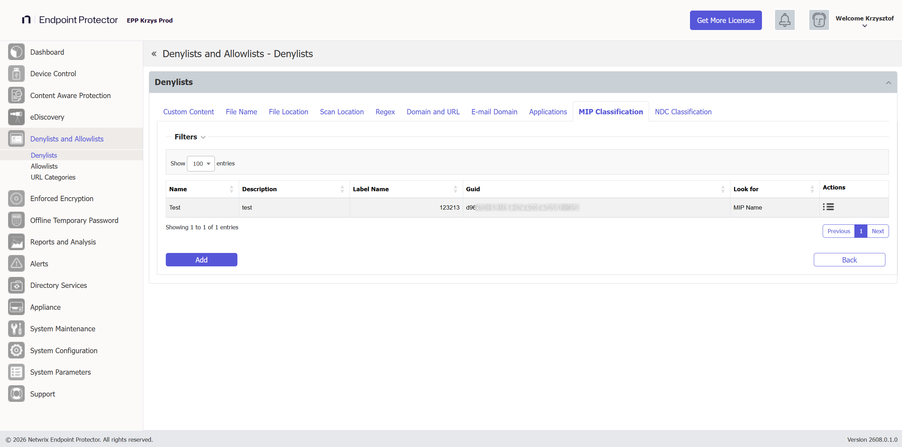

## NDC Classification

This section covers the use of and integration with Netwrix Data Classification (NDC), including classification within Content Aware Protection and eDiscovery policies.

Netwrix Data Classification helps organizations identify, categorize, and tag data based on predefined policies. With NDC, you can understand where sensitive data resides, how it is used, and who has access to it, which supports data security, regulatory compliance, and informed decision-making.

Endpoint Protector allows direct NDC label definition for Content Aware Protection and eDiscovery policies through the Endpoint Protector Server interface, so you don't need to build custom dictionaries to recognize labeled files.

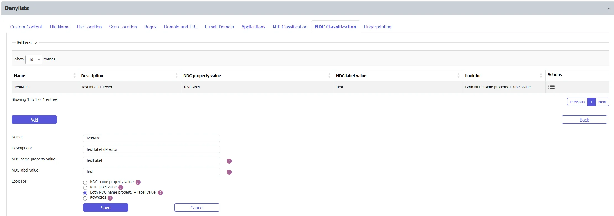

### Configure an NDC label

Each NDC entry in a denylist defines a single classification to match against Office document properties. Configure the following fields:

- **Name** — the name of the denylist entry.
- **Description** — an optional description of the entry.
- **NDC name property value** — the **Field Name** value defined in NDC. NDC stores this as a custom property name in the Office document. Obtain the value from your NDC administrator.
- **NDC label value** — the label value assigned in NDC. NDC stores this as a custom property value in the Office document. Obtain the value from your NDC administrator.
- **Look for** — controls which properties Endpoint Protector scans. See [Look for options](#look-for-options) for the behavior of each choice.

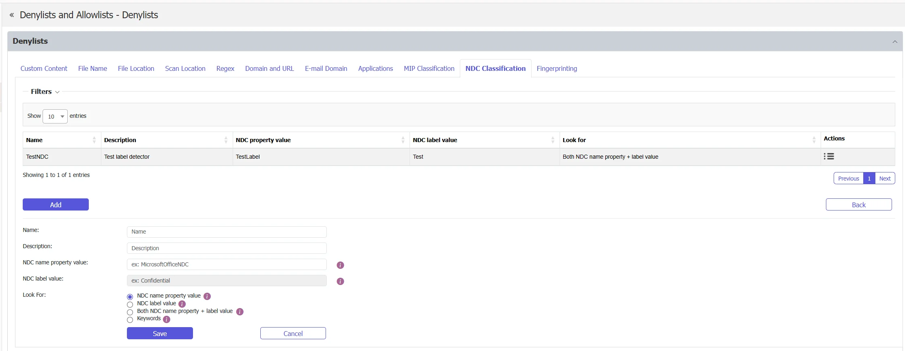

:::note
Each NDC entry must be unique. For **Both**, the combination of **NDC name property value** and **NDC label value** must be unique. For **NDC name property value**, the property value must be unique. For **NDC label value** and **Keywords**, the label value must be unique. The label value is required for **NDC label value**, **Both**, and **Keywords**. The values can have up to 256 characters and can't contain a semicolon (`;`). You can configure multiple entries that share the same property name with different label values — for example, `Sensitivity = Confidential` and `Sensitivity = Restricted`.
:::

### Look for options

Use the **Look for** field to control how Endpoint Protector matches the classification on a scanned document:

- **NDC name property value** — scans only after you define the NDC name property value, and ignores all other properties. You can leave the **NDC label value** field empty.
- **NDC label value** — scans only after you define the NDC label value, and ignores all other properties. You can leave the **NDC name property value** field empty.
- **Both NDC name property + label value** — scans for both the NDC name property and the corresponding label value, as configured.
- **Keywords** — scans only for the NDC label in the **Keywords** document property, which supports alternative NDC label detection.

:::note
Only Endpoint Protector Client version 2605.x.x.x and later support the NDC labeling feature.
:::

Denylist rules that match both the file name and the NDC label also apply to files that Deep Packet Inspection (DPI) inspects.

To apply an entry as a label, set **Look for** to **Both NDC name property + label value** or to **Keywords**. In the **Labeling** section of Content Aware Protection and eDiscovery policies, turn on **NDC Labeling** and select one or more of these entries in **NDC Label(s)**. The policy applies them as NDC labels to files when it triggers. Entries that have only the name property or only the label value remain available for detection, but not for labeling. See [Apply NDC labels](/docs/endpointprotector/admin/cap_module/cappolicies.md#apply-ndc-labels).

## Fingerprinting

Fingerprinting denylists protect whole documents with a Fingerprint dictionary built from the documents themselves. See [File Fingerprinting](/docs/endpointprotector/admin/denylistsallowlists/fingerprinting.md).
