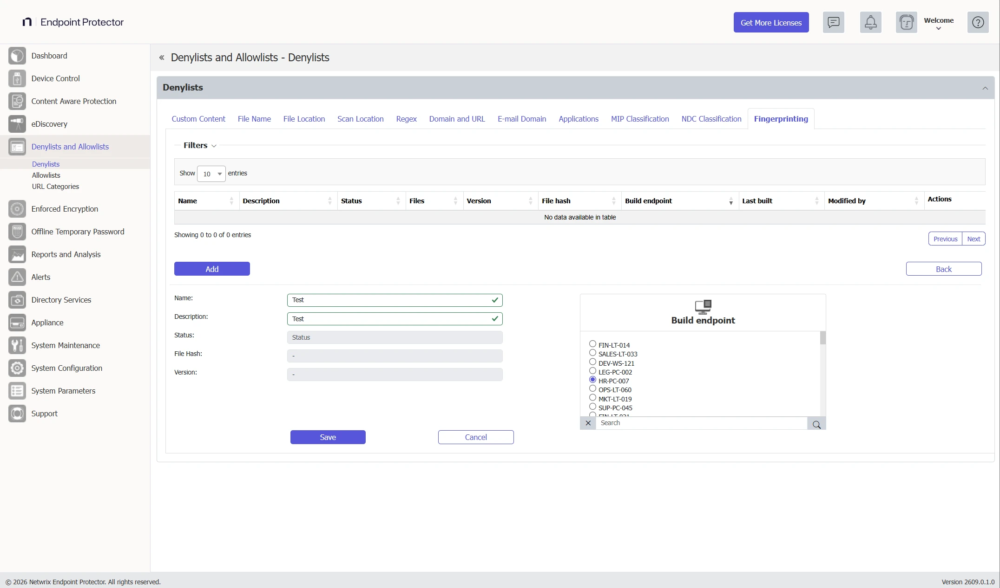
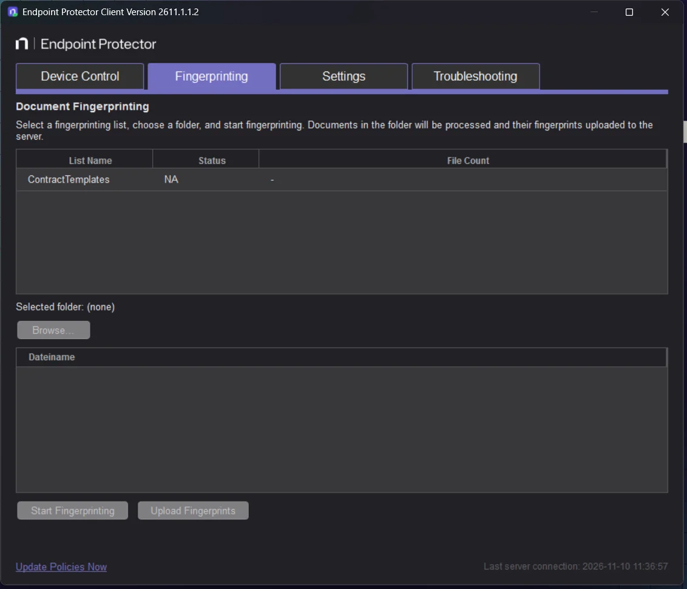
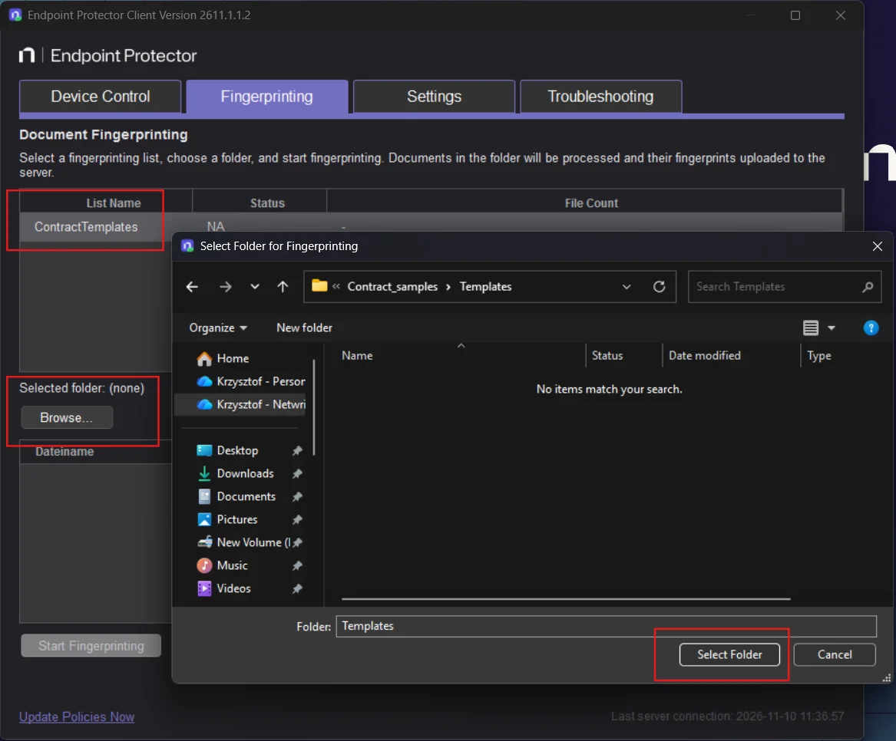
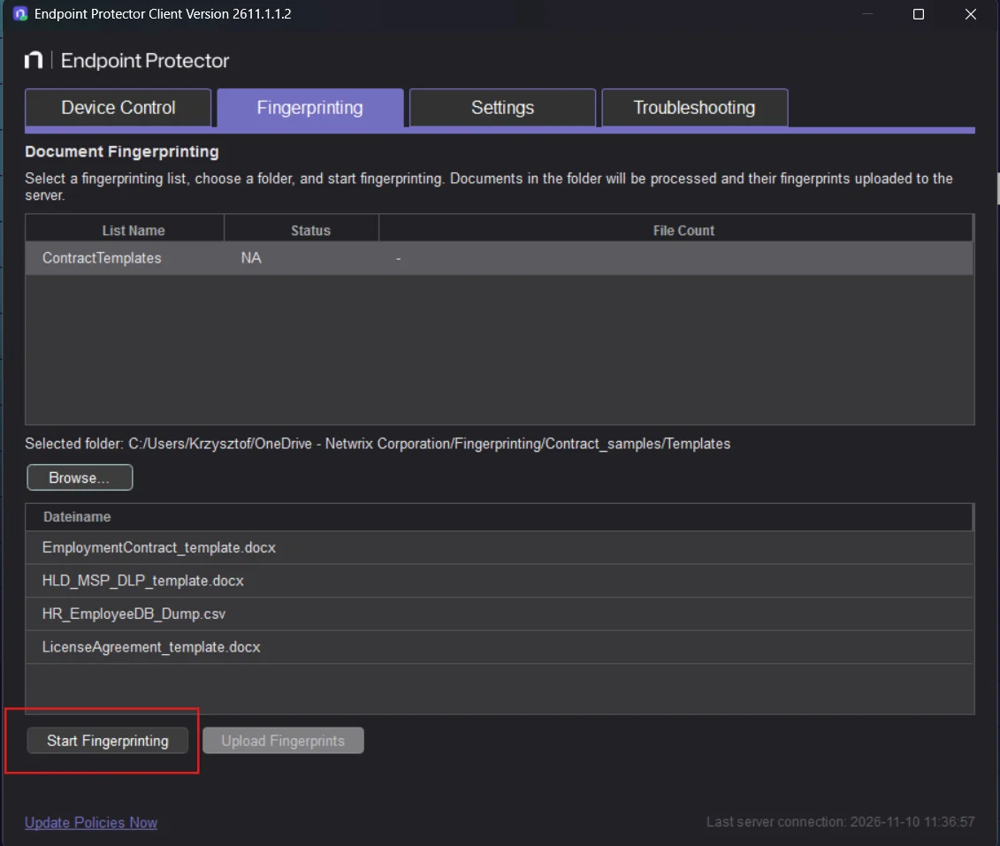
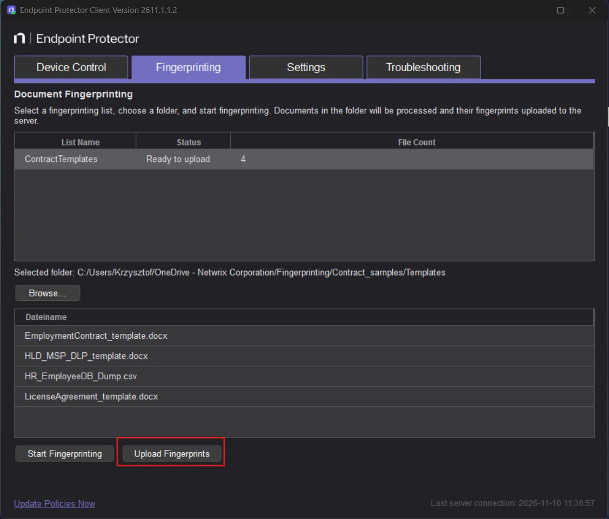
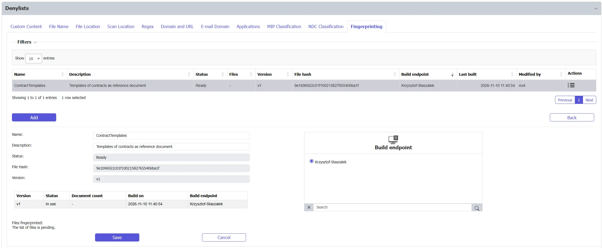
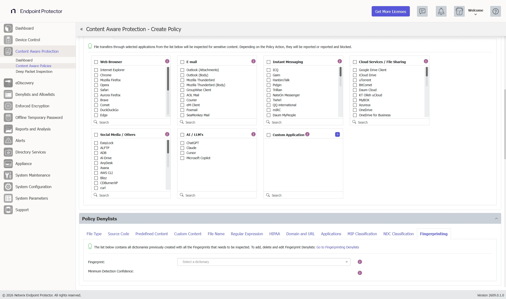
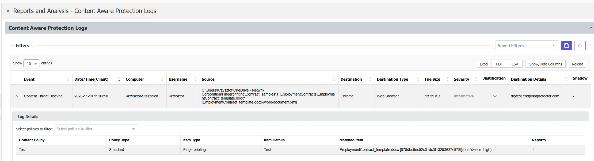

# File Fingerprinting

Some documents are sensitive as a whole. Contracts, designs, source files, and board papers can't be described with keywords, patterns, or custom dictionaries. File Fingerprinting protects them with a **Fingerprint dictionary**: a list of digital fingerprints built from the documents themselves.

You use a Fingerprint dictionary as a denylist condition in Content Aware Protection (CAP) and eDiscovery policies. Protected endpoints then recognize the same content in other files, even when someone copied only part of the original or modified the file. The same fingerprints protect data in motion (CAP) and data at rest (eDiscovery).

File Fingerprinting has the following characteristics:

- **Calculated on the endpoint**—the fingerprint calculations happen on the endpoint, inside the Endpoint Protector application only. This applies when the data owner creates the fingerprints and when protected endpoints compare files against them. Fingerprinting is performed entirely at the endpoint, a unique approach on the market.
- **The server never sees sensitive data**—a dedicated data owner prepares the dictionary on their own endpoint, in the Endpoint Protector Notifier, from the documents they hold. No sensitive content leaves that endpoint. Only the digital fingerprints go to the server, and the server distributes them to the protected endpoints through CAP or eDiscovery policies.
- **Fingerprints can't be reversed**—even if someone decodes a digital fingerprint, they can't restore the original data from it.
- **Updates from the Notifier**—the data owner can update the fingerprints from the Notifier whenever the protected documents change.
- **Adjustable match level**—you select the lowest match level to report with **Minimum Detection Confidence**. Higher levels produce fewer false positives.
- **Confidence in every report**—the log shows the matched confidence level with each event, so reviewers can see how close the copy is to the original.

## When to use fingerprinting

Fingerprinting detects sensitive data in motion or at rest by comparing files against reference documents you provide. It recognizes a large document when it is similar to a reference document, so it works when keywords, patterns, regular expressions, and custom dictionaries can't describe the content.

For example, you fingerprint an employment contract template as the reference. Endpoint Protector then detects:

- An exact copy of the template
- A completed contract that is mostly the same text, with added fields such as an employee's name, address, and other personal data

The match level shows how close the file is to the reference. See [Use a Fingerprint dictionary in a policy](#use-a-fingerprint-dictionary-in-a-policy).

Use fingerprinting to protect content that you can't write as a pattern. The following examples show typical reference documents:

- **Executive**—strategic documents and board papers
- **Human resources**—employment contract templates and other HR documents with personal data
- **Research and development**—design documents and source files
- **Manufacturing**—process-specific documents
- **Chemical industry**—documents with chemical formulas
- **Military and defense**—documents with sensitive data classifications

Fingerprinting is available on Windows, macOS, and Linux endpoints. It requires Netwrix Endpoint Protector Server and Client version 2611 or later.

## How fingerprinting works

Only the data owner needs access to the sensitive documents. The Endpoint Protector Server never receives them, and the Endpoint Protector administrators don't need access to them. The endpoint does all the fingerprint calculations inside the Endpoint Protector application.

1. An Endpoint Protector administrator creates a Fingerprint dictionary on the server and nominates one endpoint to build it. This endpoint is the build endpoint, and it belongs to the data owner.
2. The server sends a build request to the build endpoint. An offline computer receives the request the next time it connects.
3. The data owner uses the Endpoint Protector Notifier on the build endpoint to select the reference documents. The documents stay on that endpoint.
4. The endpoint builds the dictionary and uploads only the digital fingerprints to the server.
5. The dictionary becomes **Ready**. The administrator selects it in CAP and eDiscovery policies, and the server delivers it to the endpoints those policies cover.
6. When the reference documents change, the data owner repeats the steps in the Notifier. The new version replaces the previous version, and the server distributes it to the endpoints covered by the policies that use the dictionary.

**Example**

An Endpoint Protector administrator creates a Fingerprint dictionary for the chief executive officer (CEO) and nominates the CEO's computer as the build endpoint. The administrator then creates a CAP policy that uses the dictionary and applies to all egress channels. The CEO fingerprints the sensitive documents from the Notifier on that computer. From then on, Endpoint Protector protects those documents across the organization and alerts you if someone misuses them. The administrator never sees the documents.

:::note
The build endpoint is the computer that holds the reference documents. Endpoint Protector doesn't move a build to another endpoint automatically.
:::

## Manage Fingerprint dictionaries

To manage dictionaries, go to **Denylists and Allowlists** > **Denylists** and open the **Fingerprinting** tab. The list shows the following columns for each dictionary:

- **Name**
- **Description**
- **Status**
- **Files**—the number of files that went into the dictionary
- **Version**—the version number, which increases by 1 with every rebuild
- **File hash**
- **Build endpoint**
- **Last built**
- **Modified by**
- **Actions**

### Dictionary statuses

| Status | Meaning | Usable in a policy |
|---|---|---|
| **Created** | The dictionary is saved. The server hasn't sent the build request yet. | No |
| **Waiting for endpoint** | The server sent the build request. The endpoint hasn't delivered a dictionary yet. | No |
| **Ready** | The endpoint delivered the fingerprints and the server stored them. | Yes |
| **Waiting for rehash** | You edited a **Ready** dictionary. The previous build stays in use until the endpoint delivers a new one. | Yes, with the previous build |

### Create a Fingerprint dictionary

1. Go to **Denylists and Allowlists** > **Denylists**, open the **Fingerprinting** tab, and click **Add**.
2. Enter a **Name** and a **Description**. For example, enter `Board papers` as the name and `Quarterly board packs` as the description.
3. In the **Build endpoint** list, select the computer where the data owner keeps the reference documents, for example `FIN-LT-014`. Use the **Search** box to find a computer.
4. Click **Save**.

The **Status**, **File Hash**, and **Version** fields are read-only. They show the current values after the endpoint builds the dictionary. Click **Cancel** to close the form without saving.

Selecting a build endpoint is mandatory. The **Name** must have 2 to 128 characters and be unique, and the **Description** can have up to 256 characters. The **Version** column shows the version as `v1`, `v2`, and so on.

The dictionary appears with the **Created** status. The status changes to **Waiting for endpoint** after the server sends the build request, and to **Ready** after the endpoint delivers the fingerprints.

After you save, the data owner creates the fingerprints on the build endpoint. See [Create the fingerprints on the build endpoint](#create-the-fingerprints-on-the-build-endpoint).

The build request reaches endpoints that have a CAP or eDiscovery license.

### Create the fingerprints on the build endpoint

The data owner does this on the build endpoint, after the endpoint receives the build request.

The **Fingerprinting** item appears in the Endpoint Protector Notifier only on the computer that the administrator selected as the build endpoint for at least one dictionary. Other computers, including computers that the policies protect, don't show it. The item disappears when the server no longer sends a dictionary to that computer.

1. Open the Endpoint Protector Notifier and click **Fingerprinting**.

   

2. On the **Document Fingerprinting** page, select the list in the **List Name** table.
3. Click **Browse...**, select the folder that holds the reference documents, and click **Select Folder**. The file list shows the files in the folder.

   

4. Click **Start Fingerprinting**. The **Status** column changes from **Indexing...** to **Ready to upload**, and **File Count** shows the number of indexed files.

   

5. Click **Upload Fingerprints**. The **Status** column shows **Uploading...** and then **Uploaded**.

   

After the upload, the dictionary in the console shows the **Ready** status, its version, and its file hash.

Indexing doesn't upload automatically. You must click **Upload Fingerprints** after the status shows **Ready to upload**.

The Client skips hidden files and folders, Windows shortcut (`.lnk`) files, empty files, files larger than 256 MB, and files with less than 512 bytes of extracted text. If a folder has no files to process, the page shows "No files found in this folder." and you can't start.

If the status shows **Failed**, **Upload failed**, or **Timed out**, run the step again. The Client doesn't retry on its own. The Notifier waits up to 5 minutes for a reply. Choosing a new folder resets the status, and you must start again.

**Rehash the fingerprints**

When the reference documents change, the data owner repeats the same steps on the build endpoint. The data owner can rehash at any time, without an administrator. When the upload finishes, the new version of the dictionary replaces the previous version automatically. The server then refreshes every CAP and eDiscovery policy that uses the dictionary. The covered endpoints receive the new version at their next check-in.

While a rehash is in progress, protected endpoints keep enforcing the last deployed version.

Fingerprinting works with every file type from which Endpoint Protector can extract text, the same file types that Content Aware Protection inspects. It compares the flat text of the file and ignores formatting.

### Edit a Fingerprint dictionary

Click **Edit** in the **Actions** column to change the name, the description, or the build endpoint. The edit form also shows:

- **Used by policies**—each CAP and eDiscovery policy that uses the dictionary, with its **Minimum Detection Confidence**
- A version table with the **Version**, **Status**, **Document count**, **Build on**, and **Build endpoint** of each version. The table shows up to 10 versions. The newest version is **In use**, the previous version is **Kept**, and older versions are **Removed**.
- **Files fingerprinted**—the **Name**, **Hash**, and **Size** of each reference file. The table shows "The list of files is pending." until the build endpoint reports.

If you select a different build endpoint, Endpoint Protector opens the **Change build endpoint** message and asks for confirmation before it saves the change:

"The new build endpoint will be asked to select the reference documents again and rebuild the fingerprint. This creates a new version."

"Your endpoints stay protected. The policies using this fingerprint keep enforcing the current version until the new version is delivered. Nothing is switched off in the meantime."

Click **OK** to save the change, or click **Cancel** to close the message without saving. The message doesn't appear when you create a dictionary or keep the same endpoint.

### Refresh a Fingerprint dictionary

The data owner refreshes a dictionary from the build endpoint. See [Create the fingerprints on the build endpoint](#create-the-fingerprints-on-the-build-endpoint). The console has no refresh button, and the Client has no separate setting for refreshing.

You can also start a rebuild from the console. When you save changes to a dictionary with the **Ready** status, the status changes to **Waiting for rehash** and the build endpoint rebuilds the fingerprints. This happens on every save, not only when you change the endpoint.

Each rebuild creates a new version. The server replaces the stored dictionary only after it receives the new one. You don't need to change any policy after a rebuild.

### Delete a Fingerprint dictionary

Click **Delete** in the **Actions** column to delete a dictionary that no policy uses. Endpoint Protector blocks the deletion if a CAP or eDiscovery policy uses the dictionary. The message says "The item is used in policies and cannot be deleted!" and lists the policies to remove it from first.

Endpoint Protector records create, edit, and delete actions in **Admin Actions** with the before and after values of the name, description, and build endpoint. It also forwards them to your security information and event management (SIEM) system.

## Use a Fingerprint dictionary in a policy

1. Open a CAP or eDiscovery policy and go to the denylists section.
2. Open the **Fingerprinting** tab. To manage dictionaries, click **Go to Fingerprinting Denylists**.
3. In **Fingerprint**, select one or more dictionaries from the **Select a dictionary** list.
4. For each selected dictionary, set the **Minimum Detection Confidence**. Select the lowest match level to report. The policy reports matches at the selected level and above. The default is **High**.
5. Save the policy.

**Minimum Detection Confidence** sets how closely the content must match the selected Fingerprint dictionary before the rule triggers. Lower levels detect smaller or partial matches but increase the risk of false positives. Higher levels require stronger evidence and produce fewer, more reliable detections.

- **Any match**—triggers on any match with the Fingerprint dictionary, however small. For troubleshooting only.
- **Low**—triggers on small or partial matches. May produce false positives.
- **Medium**—triggers on a moderate match. Balances coverage and accuracy.
- **High**—triggers only on a strong match.

The levels are fixed. You can't change them.

:::warning
Use **Any match** only for short-term troubleshooting. It can generate a large volume of logs and false positives. Endpoint Protector shows a warning when you select it. Switch to **Low**, **Medium**, or **High** afterwards.
:::

Each dictionary in a policy has its own level, so two policies can use the same dictionary with different levels.

When a policy detects a fingerprint match, the CAP or eDiscovery log records the following details:

- **Item Type**—Fingerprinting
- **Item Details**—the name of the Fingerprint dictionary
- **Matched Item**—the name and hash of the original reference file, followed by the confidence level

For example: `EmploymentContract_template.docx [676dbc9ec52c01dc0f13293637cff78f](confidence: high)`. The confidence level shows reviewers how close the copy is to the original.

## Manage dictionaries with the REST API

The EPP REST API lets you list, create, update, refresh, and delete Fingerprint dictionaries under `/api/v1/policies/inventory/denylists/fingerprint`. Create and update requests take the `computer_id` of the build endpoint. The API also shows which policies use a dictionary and at what threshold. The API applies the same validation and writes the same audit entries as the console. See [EPP REST API](/docs/endpointprotector/admin/epp_rest_api/eppapi.md).
