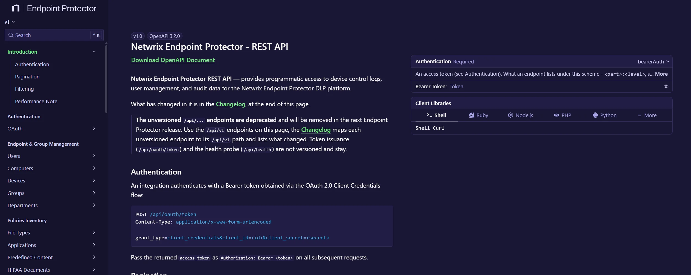

# EPP REST API

The EPP REST API provides programmatic access over HTTPS to the main administration areas of the Endpoint Protector management console. You can automate with the API what you can do in the console, including provisioning, policy management, and monitoring. The API returns responses in JSON and authenticates every request with OAuth 2.0.

The API covers these areas:

| Area | What you can automate |
|---|---|
| Endpoint and group management | Computers, users, groups, departments, and devices, including computer actions such as restart and uninstall |
| Device Control | Settings, rights, group membership, effective rights of a device, custom classes, and Offline Temporary Passwords, including requests for them |
| Content Aware Protection | Policies and the entities they apply to, exit points and custom applications, content and context detection rules, Deep Packet Inspection, denylists, allowlists, URL categories, custom notifications, and advanced scanning exceptions |
| eDiscovery | Policies, scans, automatic scans, and scan results |
| Enforced Encryption | Drives and drive actions, messages, settings and master password, client upload and drive package, alerts, and logs |
| Reporting and exports | Device Control, Content Aware Protection, eDiscovery, Enforced Encryption, System for Cross-domain Identity Management (SCIM), mail server, and admin action logs, and exports |
| Alerts | System, log event, and Enforced Encryption alerts |
| Appliance and system configuration | System administration, administrators, groups, roles, API clients, licensing, single sign-on, System Settings and System Security, shadow repositories, system backups, and client software |
| Integrations | Directory services, SCIM, security information and event management (SIEM), and Enforced Encryption integrations |

Fingerprint dictionaries are under Content Aware Protection, in the policies inventory.

To call the API, you first create an API client in the console. See [API Clients](/docs/endpointprotector/admin/systemconfiguration/apiclients.md).

:::note
The reference built into your server lists every endpoint, parameter, and response. See [Interactive API reference](#interactive-api-reference).
:::

## Availability

Starting with version 2611, every Endpoint Protector Server includes the full API and its reference. You create the API clients that your integrations use in the console. See [API clients](/docs/endpointprotector/admin/systemconfiguration/apiclients.md).

:::note
Upgrade your Endpoint Protector Server to version 2611 or later to use all the API capabilities. Earlier versions offer a smaller API, without the full reference on the server.
:::

The API is enabled by default. You don't need to turn it on or request access.

## Base URL and protocol

- Base URL: `https://<epp-server>/api/v1/`
- Token endpoint: `https://<epp-server>/api/oauth/token`
- HTTPS only (TLS 1.2+)
- Content-Type: `application/json` for request and response bodies (the token request uses `application/x-www-form-urlencoded`)

:::warning
The earlier API paths without `/api/v1`, such as `/api/device-control/computers`, are deprecated and will be removed in the next Endpoint Protector release. Responses from these paths include `Deprecation` and `Link` headers that point to the `/api/v1` path of the same endpoint. Use the `/api/v1` paths. The token endpoint and the health probe (`/api/health`) stay at their paths.
:::

The `/api/v1` endpoints differ from the deprecated paths in the list filters and in the error body. The reference lists the changes in its changelog. Existing integrations keep working on the deprecated paths until Netwrix removes them.

## Interactive API reference

Each Endpoint Protector Server includes the full API reference. Open it in a browser at:

```
https://<epp-server>/api/v1/doc
```

The reference is the authoritative source for every endpoint, parameter, filter, and response schema. It also includes the changelog, and you can send test requests from the browser. The server generates the reference from its own version, so it always matches your server.



The OpenAPI document for tools and code generators is at `https://<epp-server>/api/v1/doc.json`.

## Authentication

The EPP REST API uses the **OAuth 2.0 Client Credentials** grant. Your integration authenticates with a dedicated API client: a client ID and a client secret. A super administrator creates the API client in the console. See [API clients](/docs/endpointprotector/admin/systemconfiguration/apiclients.md).

Request an access token from the token endpoint, then include it as a Bearer token on every subsequent request:

```
Authorization: Bearer <access_token>
```

Access tokens are short-lived and expire after 1 hour. Request a new token when the current one expires.

### Security model

- **Dedicated client credentials**—each integration uses its own API client. The API doesn't accept console administrator credentials.
- **Signed, short-lived tokens**—access tokens are signed JSON Web Tokens (JWT) with a lifetime of 1 hour. The server validates every request before it reaches an endpoint.
- **Access levels on every part of the API**—the API grades access as **hide** (no access), **read**, or **write** on each part. In this release, every API client has write access to the whole API, and the console doesn't offer a way to limit it by area. The API answers a request to a part that the access of the client doesn't reach with a 403 response.
- **Least exposure**—the token endpoint is the only endpoint that doesn't require a token. Every other endpoint rejects requests without a valid, unexpired token with a 401 response.
- **Attributable writes**—create and update operations record the authenticating client in the affected record.
- **Audit trail**—Endpoint Protector records the creation, change, and deletion of API clients in **Admin Actions**.

:::warning
Treat the client secret like a password. Store it in a secret manager and never commit it to source control. If it might be exposed, rotate it in the console.
:::

Existing API clients keep working after the upgrade to version 2611, with the same access as before.

## Quick start

**1) Request an access token**

```bash
TOKEN=$(curl -s -k -X POST \
  -H "Content-Type: application/x-www-form-urlencoded" \
  -d "grant_type=client_credentials&client_id=<client-id>&client_secret=<client-secret>" \
  "https://<epp-server>/api/oauth/token" | python -c "import sys,json; print(json.load(sys.stdin)['access_token'])")
```

:::note
If your Endpoint Protector server uses a self-signed certificate, add `-k` to the curl command to ignore TLS verification. For production environments, use a certificate trusted by your clients instead.
:::

**2) Read data—list recent Device Control logs**

```bash
curl -s -k \
  -H "Authorization: Bearer ${TOKEN}" \
  "https://<epp-server>/api/v1/logs/device-control?per_page=10"
```

**3) Write data—create a computer**

```bash
curl -s -k -X POST \
  -H "Authorization: Bearer ${TOKEN}" \
  -H "Content-Type: application/json" \
  -d '{"name": "WORKSTATION-01", "description": "Finance laptop", "department_id": 3}' \
  "https://<epp-server>/api/v1/device-control/computers"
```

## Conventions

The API follows consistent conventions for pagination, filtering, responses, and errors. The reference describes each endpoint in detail.

### Pagination

All list endpoints accept `page` and `per_page` and return a `meta` object alongside the `data` array.

| Parameter | Type | Default | Notes |
|---|---|---|---|
| `page` | integer | 1 | 1-based |
| `per_page` | integer | 25 | Maximum 200 |

The `meta` object contains `page`, `per_page`, `total`, and `total_pages`. On the high-volume log endpoints, `total` is capped at a server-side maximum for performance. When a query reaches the cap, narrow the query with filters.

### Filtering

Every list filters on the fields that its entries carry. Use `filter[<field>][<operator>]=<value>` once for each condition. Every condition must hold. For example:

```
GET /api/v1/device-control/computers?filter[name][contains]=win&filter[department_id][in]=1,4
```

The operators depend on the type of the field, for example `eq`, `ne`, `contains`, `starts_with`, `in`, `gt`, `gte`, `lt`, `lte`, and `is_empty`. A request can have up to 30 conditions. The API refuses a field, operator, or value that a list doesn't take with a 400 response that names it. On the log endpoints, a date range is a condition on the `timestamp` or `created_at` field, for example `filter[created_at][gte]=2026-01-01`.

### Response envelope

**List responses** return a `data` array and a `meta` object:

```json
{
  "data": [ { "id": 1 }, { "id": 2 } ],
  "meta": { "page": 1, "per_page": 25, "total": 128, "total_pages": 6 }
}
```

### Errors

The `/api/v1` endpoints return errors in this form:

```json
{ "error": { "code": 404, "message": "Computer not found." } }
```

A request-body validation failure also returns an `errors` object that maps field names to messages.

### Creating, updating, and deleting records

- **Create** uses `POST` to the collection.
- **Update** uses `PATCH` to a single resource and is partial. Only the fields present in the body change. Pass a field as `null` to clear an optional value.
- **Delete** uses `DELETE` on a single resource. Many resources use a soft delete: the API flags the record as deleted and retains it for audit.
- **Agent-managed fields**, such as the IP address of a computer, come from the EPP agent. The API doesn't change them.

## HTTP status codes

| Code | Meaning |
|---|---|
| 200 | Success |
| 201 | Resource created |
| 207 | Multi-Status—bulk operation with at least one non-success item |
| 400 | Invalid parameters or validation error |
| 401 | Missing, invalid, or expired access token |
| 403 | The roles of the API client don't reach this part of the API |
| 404 | Resource not found |
| 405 | Method not allowed |
| 500 | Internal error |

## Limits

To protect the server and keep responses fast, the API caps result sizes:

- `per_page` accepts a maximum of 200 records per page.
- A filter accepts up to 30 conditions, and an `in` condition up to 500 values.
- `total` in the `meta` object is capped at a server-side maximum on the high-volume log endpoints. Use pagination and filters to retrieve complete data sets in batches.

Design integrations to page through results and to retry transient failures with backoff.
