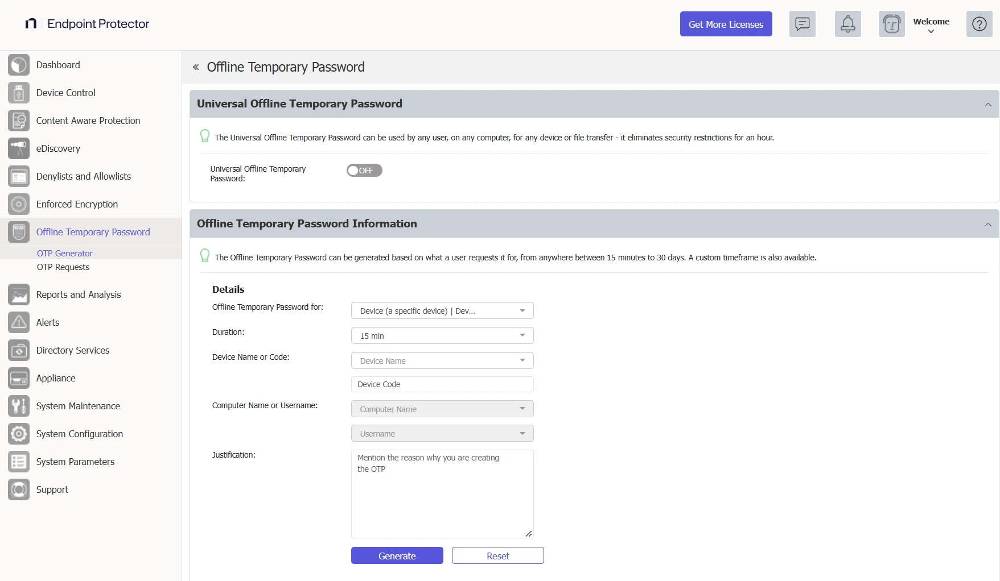
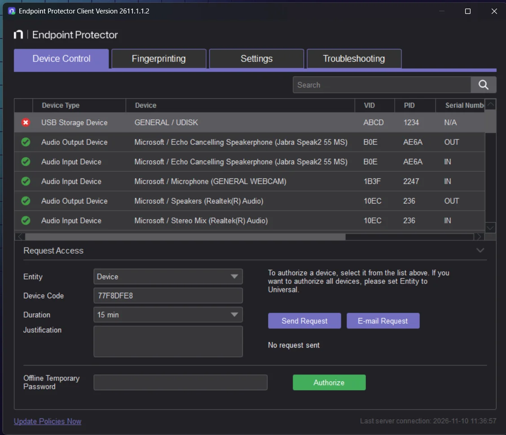
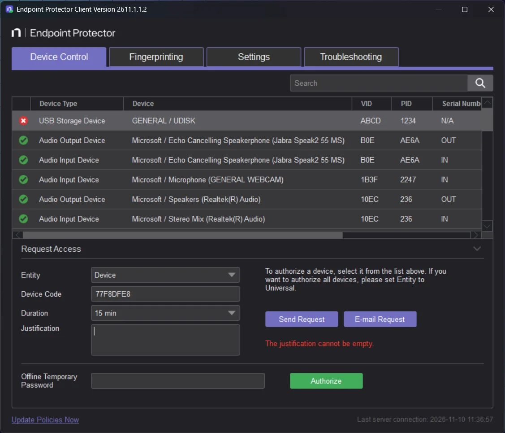
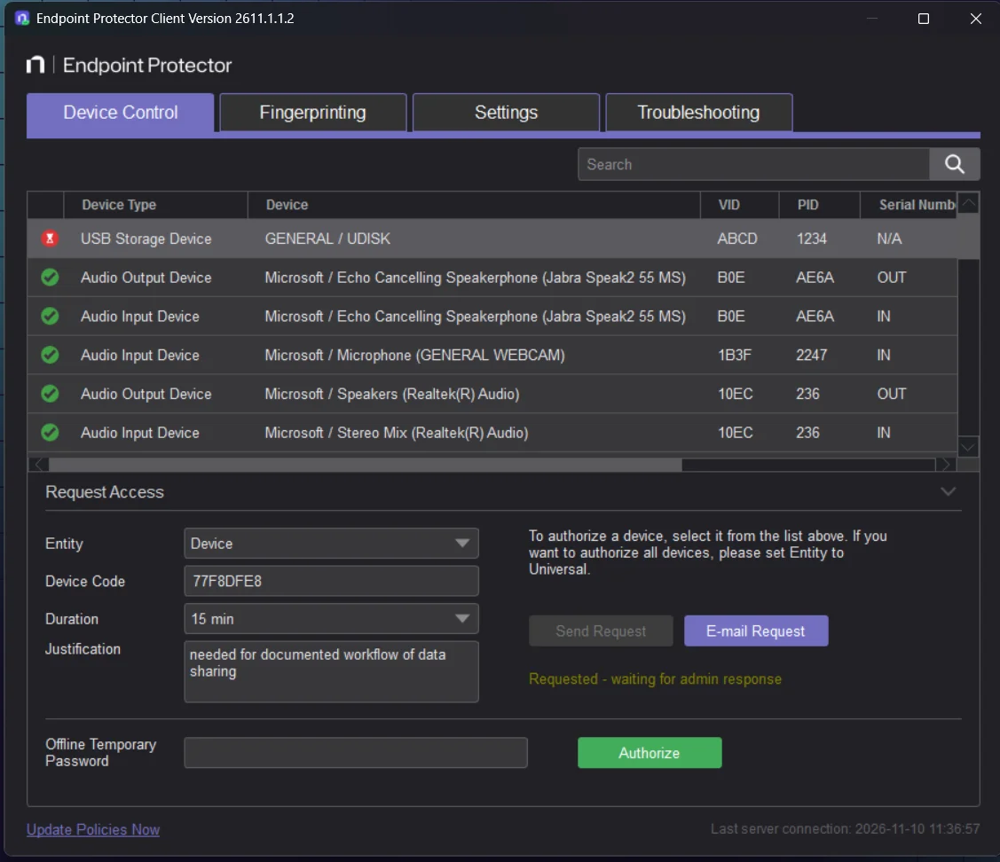
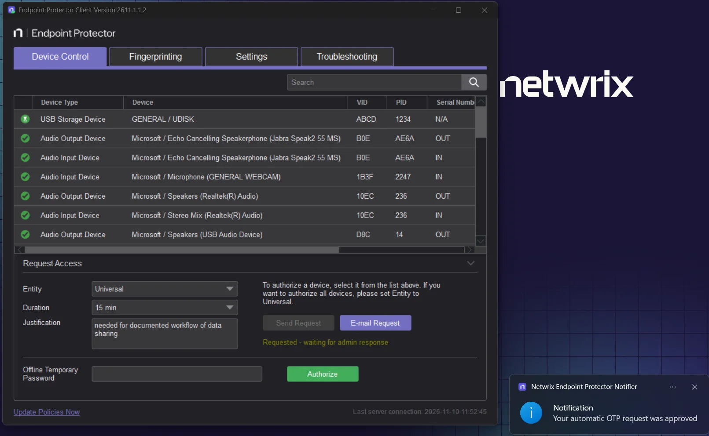
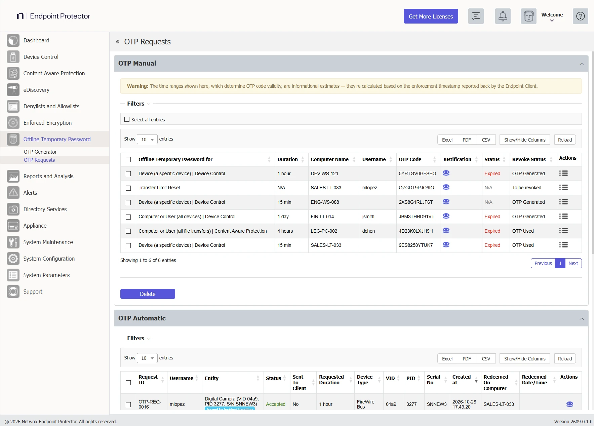
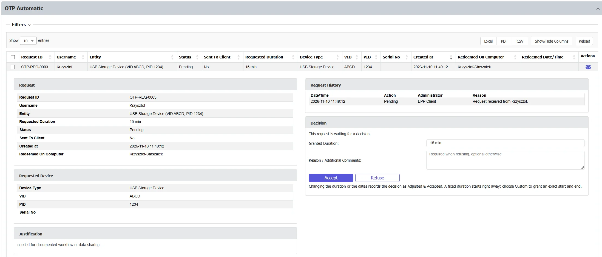
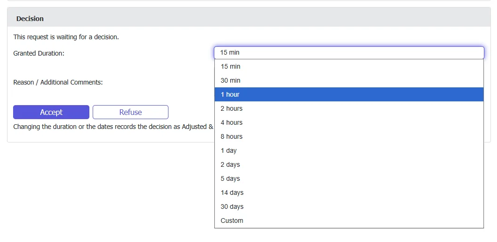
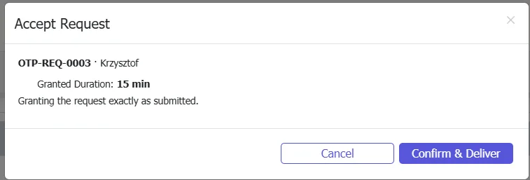

# Offline Temporary Password

In this section, you can generate Offline Temporary Passwords (or OTPs) and grant temporary access
rights. In addition to situations when only temporary access is needed, it can also be used when
there is no network connection between the protected computers and the Endpoint Protector Server.

## Menu changes in version 2611

The **Offline Temporary Password** menu now has two submenu items:

- **OTP Generator**—the page where you generate Offline Temporary Passwords. It replaces the former **Offline Temporary Password** submenu item.
- **OTP Requests**—the page that replaces the former **Offline Temporary Password List**. It covers both manual and automatic requests, in two panels. See [Review OTP requests](#review-otp-requests).

The screenshots on this page show the updated menu.

You can generate the Offline Temporary Password for the following entities:

- Device (a specific device)
- Computer and User (all devices)
- Computer and User (all file transfers)

A password is linked to a time period and is unique for a certain device and computer. This means
the same password can't be used for a different device or computer. It also can't be used twice
(except for Universal Offline Temporary Password).

The time intervals available are 15 minutes, 30 minutes, 1 hour, 2 hours, 4 hours, 8 hours, 1 day, 2
days, 5 days, 14 days, and 30 days or Custom.

The Offline Temporary Password Duration offers a customized option, allowing the generation of
time-based Offline Temporary Password Codes, with a Start Date/Time and an End Date/Time.

For large companies or multinationals that have the Endpoint Protector Server and the protected
endpoints in different time zones, taking into consideration how the Server Time and Client Time
work is essential.

Example: The Endpoint Protector Server is located in Germany, making the Server Time UTC+01:00.

The protected endpoints are located in Romania, making the Client Time UTC+02:00.

When generating an Offline Temporary Password Code that should take effect tomorrow, from 16:00 on
the endpoint time, it should actually be generated for tomorrow, from 15:00 (to adjust for the 1h
difference in the time zone).

For the predefined duration, this adjustment isn't necessary. The Offline Temporary Password
Code will be valid for that specific amount of time, starting with the moment it was redeemed. The
only thing to consider is that the Offline Temporary Password Code needs to be redeemed the same day
it was generated.

:::note
The Universal Offline Temporary Password feature can also be turned on. If enabled, it can
be used by any user, on any computer, for any device or file transfers – it eliminates security
restrictions for one hour. It can be used multiple times, by any user that knows it.
:::

The Universal Offline Temporary Password can be made visible only for Super Administrators. If this setting is enabled, Normal, and Offline Temporary Password Administrators will not be able to see and use it. Enable this setting from System Configuration, System Settings, and Custom settings.

You have the option to add a justification, mentioning the reason why the password was created. This
can later be used for a better overview or various audit purposes.

After an Offline Temporary Password has been authorized, any other rights and settings saved afterwards
on the Endpoint Protector Server will not take immediate effect. The Offline Temporary Password has to
expire and the connection with the Server re-established.

:::note
The Transfer Limit Reset Offline Temporary Password is only available if the feature is
enabled. The main purpose of this type of Offline Temporary Password is to re-establish the
Server-Client communication before the Transfer Limit Reset Time Interval has expired.
:::

## Generating the Offline Temporary Password

Depending on the options selected from the dropdown menus, the Offline Temporary Password (or OTP)
can be generated for an exact device, all devices, or all file transfers.

When generating an Offline Temporary Password for a Device, you can either introduce the Device Code
communicated by the user or search the Endpoint Protector database for an existing device.
Alternatively, you can generate an Offline Temporary Password directly from the Device Control,
Computers section, by selecting the Offline Temporary Password option from the Actions column.

When generating an OTP Code for a device, either the Device Code or the Device Name has to be
entered (one of them will automatically fill in the other field).

You don't need to fill both Computer Name and Username—the OTP Code works with just one. To restrict the code to a specific device, computer, and user, fill all relevant fields.

After the OTP Code has been generated, it will be displayed on the right side of the image above.

As it needs to be provided to the person that made the request, Endpoint Protector offers two quick
ways of doing this, either by sending a direct e-mail or by printing it out.

:::note
You can edit the Administrator contact information that is displayed to a user from System
Configuration, System Settings, as the Main Administrator Contact Details.
:::

Like generating an OTP for a specific device, generating one for all devices or file transfers doesn't require both Computer Name and Username—use just one. To restrict the OTP to a specific computer and user, fill both fields.

## Automatic access requests

With Endpoint Protector Client version 2611 or later, a user blocked by a Device Control or Content Aware Protection policy can request an exception directly from the Endpoint Protector Notifier. The user doesn't write an email or paste a code. The request goes to the Endpoint Protector Server, you review it in the console, and the decision returns to the Client.

The manual flow, where you generate an Offline Temporary Password and send it to the user, doesn't change. Both request methods can be active at the same time.

How the automatic flow works:

1. The user selects a duration, enters a justification, and clicks **Send Request** on the request page of the Notifier. For Device Control, the user also selects the device. The Notifier allows one pending request at a time.
2. The request appears on the **OTP Requests** page with the **Pending** status.
3. You accept, adjust and accept, or refuse the request.
4. The Client receives the decision at its next check-in with the server. When you approve a request, the Client redeems the OTP automatically, and the user doesn't need to copy a code. The Notifier shows a notification for each outcome.

### The request in the Notifier

1. The Notifier lists the devices of the computer. A red icon marks a blocked device. In **Request Access**, the user selects the **Entity**, for example **Device**, the **Duration**, and enters a **Justification**.

   

   If **Mandatory OTP Justification** is on and the justification is empty, the Notifier shows "The justification cannot be empty."

   

2. The user clicks **Send Request**. The icon of the device changes, **Send Request** is disabled, and the status label shows "Requested - waiting for admin response".

   

3. After you accept the request, the Notifier shows the notification "Your automatic OTP request was approved". The Client applies the password itself, and the access starts without further steps.

   

When the user selects **Custom timeframe...** to schedule the access for a start and end time, the request carries these times in Coordinated Universal Time (UTC), together with the time zone information of the endpoint.

The status label in the Notifier shows one of these messages:

- "Requested - waiting for admin response"
- "Access granted from %1 to %2."
- "Rejected by your administrator. You can send a new request."
- "Access was granted but could not be applied."
- "The request could not be sent. Please try again."

A request that becomes **Outdated** on the server appears to the user as a refusal.

### Configure the request methods

You control the manual and automatic request methods independently, and you can turn both on or both off. The settings apply at the Global, Group, Computer, and User levels.

Go to **Device Control** > **Global Settings**, or open the settings of a group, computer, or user, and use these settings in the client settings section:

- **Shows Manual Requests OTP section in EPP Clients**—turn on to let users request a password by email.
- **Shows Automatic Requests OTP section in EPP Client**—turn on to show the **Send Request** button in the Client. This setting is off by default.
- **Mandatory OTP Justification**—turn on to require a justification for every request.
- **Show Authorize section in EPP Client**—the two request settings are disabled while this setting is off.

A **Pending** request becomes **Outdated** after 72 hours. The period is fixed, and you can't change it in the console.

### Review OTP requests

Go to **Offline Temporary Password** > **OTP Requests**. The page has two panels:

- **OTP Manual**—the list of Offline Temporary Passwords you generated on the **OTP Generator** page, with filters, revoke and delete actions, and justification details. This panel is the former Offline Temporary Password List.
- **OTP Automatic**—the table of automatic requests, with filters, request details, and the accept, refuse, and delete actions

An administrator without access to the former Offline Temporary Password List doesn't see the **OTP Manual** panel.

The **OTP Manual** panel shows these columns: **Offline Temporary Password for**, **Duration**, **Computer Name**, **Username**, **OTP Code**, **Justification**, **Status**, **Revoke Status**, and **Actions**. The panel has **Excel**, **PDF**, and **CSV** export buttons, **Show/Hide Columns**, **Reload**, and a **Delete** button for the selected entries.

The **OTP Automatic** panel shows these columns: **Request ID**, **Username**, **Entity**, **Status**, **Sent To Client**, **Requested Duration**, **Device Type**, **VID** (vendor ID), **PID** (product ID), **Serial No**, **Created at**, **Redeemed On Computer**, **Redeemed Date/Time**, **Justification**, **Additional Comments**, and **Actions**. Use **Show/Hide Columns** to change the columns. The panel has the same **Excel**, **PDF**, **CSV**, and **Reload** buttons as the **OTP Manual** panel. Click the eye icon in the **Actions** column to open the request details.

You can filter the **OTP Automatic** table by **Status**, **Sent To Client**, **Username**, **Device Type**, **VID**, **PID**, **Serial No**, and the date range in which the user created the request (**Created From** and **Created To**).

| Status | Meaning |
|---|---|
| **Pending** | Endpoint Protector received the request. It waits for an administrator. |
| **Accepted** | You approved the request. The Client received the OTP. |
| **Adjusted & Accepted** | You changed the duration or scope, and then approved the request. |
| **Refused** | You refused the request. The Client shows the refusal to the user. |
| **Outdated** | The request waited longer than the expiration time, and no administrator acted. |

### Accept, adjust, or refuse a request

1. Open the **OTP Automatic** panel and click the eye icon of a request to see its details. The details show the request, the requested device, the justification, and the request history.

   

2. To change the duration, select a value in **Granted Duration**. The list offers 15 min, 30 min, 1 hour, 2 hours, 4 hours, 8 hours, 1 day, 2 days, 5 days, 14 days, 30 days, and **Custom**. With **Custom**, you grant an exact start and end.

   

   A fixed duration starts right away. Changing the duration or the dates records the decision as **Adjusted & Accepted**.

3. Select an action:
   - **Accept**—approve the request as the user sent it. Click **Confirm & Deliver** to send the password.
   - **Adjust & Accept**—change the duration or scope, for example to a shorter time frame, and then approve the request.
   - **Refuse**—reject the request. Click **Confirm Refusal**.
   

4. Enter a comment in **Reason / Additional Comments**. The field accepts up to 1,024 characters. Enter a reason when you refuse a request. If the field is empty, the console shows "A reason is required when refusing a request!".

To process several requests at once, select them and click **Accept**, **Refuse**, or **Delete**. A bulk accept always applies the parameters the users requested. To change a duration, adjust the request individually.

When you delete an unanswered request, the Client receives a refusal. Requests that the server didn't deliver yet stay until it delivers them. Endpoint Protector records the deletion in **Admin Actions**. If the table is empty, it shows "There are no offline temporary password requests yet."

Endpoint Protector tracks when a user redeems an approved OTP. It adds a redemption entry with the device name and the time to the request history. The Device Control logs show the redemption as the "Offline Temporary Password Used (Automatic)" event, with the request ID.

Every hour, Endpoint Protector changes **Pending** requests that are older than the expiration time to **Outdated**. The reason is "No decision was taken in time." and the actor is System. Endpoint Protector doesn't delete requests automatically. Delete them from the table when you no longer need them.

:::note
The Offline Temporary Password Administrator role controls the **OTP Requests** page. The Read Only Administrator role can view it but can't act on requests. Super administrators have full access. All other roles can't see the page.
:::

Create, accept, adjust, refuse, and delete actions appear in the **Admin Actions** report. There is no separate OTP requests report. You can export each panel to Excel, PDF, or CSV.

You can also manage automatic requests with the EPP REST API. See [EPP REST API](/docs/endpointprotector/admin/epp_rest_api/eppapi.md).

## Validity status of predefined passwords

The **Status** column of the **OTP Manual** panel shows whether a predefined password is still valid. A password created with a predefined duration shows **Active** while a user can still redeem it, and **Expired** after that time.

The Client allows a 24-hour grace period. A user can redeem a predefined password at any time within 24 hours of its generation, and the password is no longer valid after that.

:::note
The **OTP Manual** panel shows a warning at the top: "Warning: The time ranges shown here, which determine OTP code validity, are informational estimates — they're calculated based on the enforcement timestamp reported back by the Endpoint Protector Client."
:::

The validation works offline. If a computer is offline when the user redeems a password, the **Status** column keeps showing **Active** until the redemption event reaches the server.
