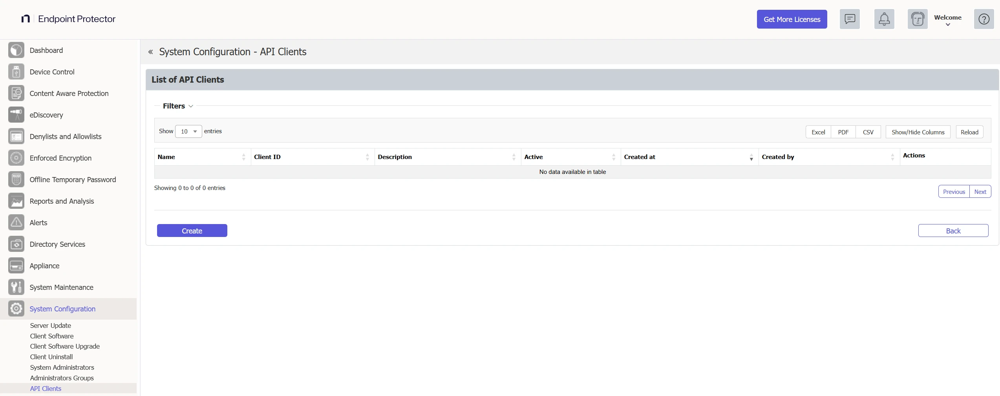
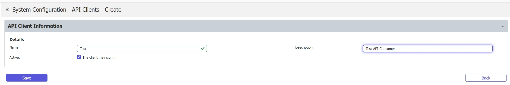
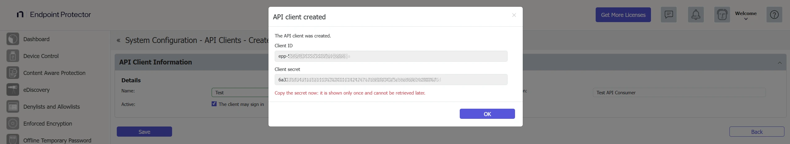
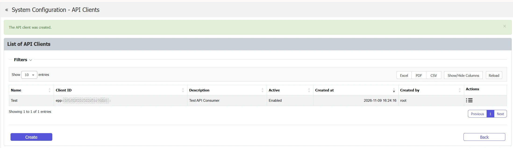

# API Clients

API clients are the identities that your integrations use to call the [EPP REST API](/docs/endpointprotector/admin/epp_rest_api/eppapi.md). Each API client has a client ID and a client secret. Only super administrators can open this page.

To manage API clients, go to **System Configuration** > **API Clients**. The **List of API Clients** shows the following columns:

- **Name**
- **Client ID**
- **Description**
- **Active**—**Enabled** or **Disabled**
- **Created at**
- **Created by**
- **Actions**

Use **Filters** to search the list by **Name** or **Client ID**. You can export the list with **Excel**, **PDF**, or **CSV**, and show or hide columns with **Show/Hide Columns**.

## Create an API client

1. Click **Create**.
2. In **API Client Information** > **Details**, enter a **Name**. The name is required, can have up to 128 characters, and must be unique. For example, enter `SIEM export`.
3. Enter a **Description**. The description is optional and can have up to 256 characters.
4. Leave **Active** selected so that the client **may sign in**, or clear it to create the client in a disabled state.
5. Click **Save**.

Endpoint Protector generates the client ID, which starts with `epp-`, and the client secret, and shows both in a dialog. Copy the secret now. Endpoint Protector shows the secret only once and can't show it again.

After you click **OK**, the console shows "The API client was created." and the new client in the list.

Use the client ID and the secret to request a token. See [Authentication](/docs/endpointprotector/admin/epp_rest_api/eppapi.md#authentication).

:::warning
In this release, every API client reaches the whole API with write access, and the console doesn't offer a way to limit it to specific areas. Create a separate API client for each integration, store its secret securely, and deactivate or delete clients that you no longer use.
:::

## Edit an API client

Click **Actions** > **Edit** on the client. You can change the **Name**, the **Description**, and **Active**. The client ID doesn't change. The form also shows **Created at** and **Created by**, which are empty for clients that existed before version 2611.

- **Deactivate a client**—clear **Active**. Endpoint Protector refuses a token to a deactivated client, and the tokens that it already holds stop reaching the API.
- **Rotate the secret**—click **Rotate secret** and confirm. Endpoint Protector generates a new secret, shows it once, and stops accepting the old secret at once. The tokens that Endpoint Protector issued with the old secret stay valid until they expire, which is after 1 hour at most. Update your integration with the new secret.

## Delete an API client

Click **Actions** > **delete** and confirm. The client can no longer get a token, and the tokens that it holds stop working. Endpoint Protector also removes the group memberships and grants of the client.

Endpoint Protector records the creation, change, and deletion of an API client in **Admin Actions**. It records a secret rotation as a change.
