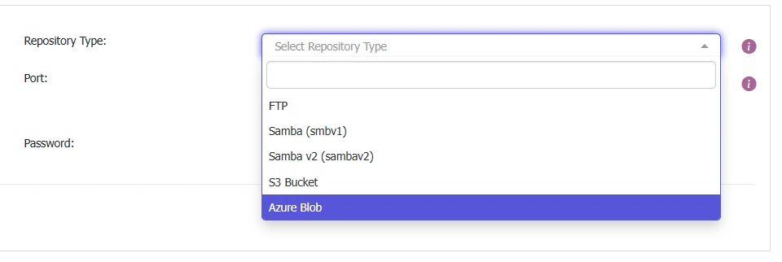
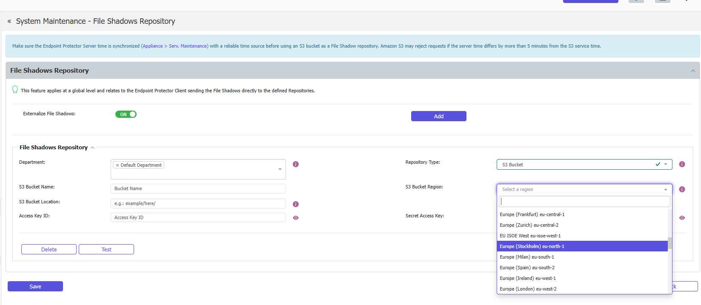
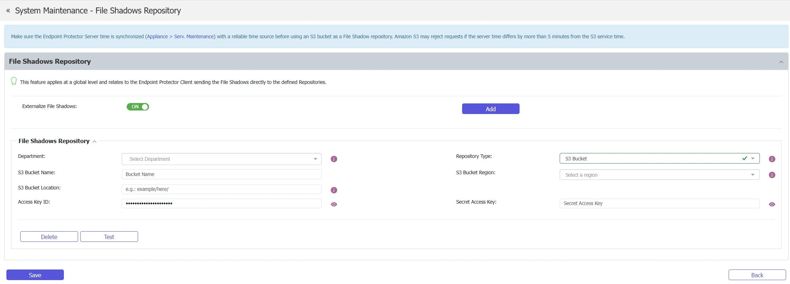
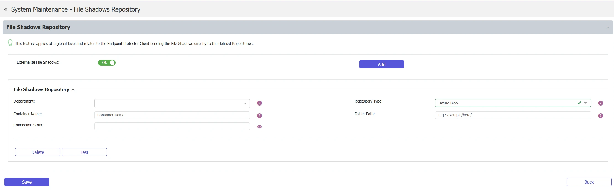

# File Shadow Repository

File Shadowing is an optional feature that extends standard Content Aware Protection and Device
Control event logging with an exact copy of the file involved in a policy event. Where a standard
event log captures metadata about a transfer, a file shadow preserves the file itself, extending
the evidence available for a forensic investigation and simplifying the forensics process.

Because retaining full file copies increases storage volume and can affect data-minimization,
access-control, and legal obligations, you decide whether to enable File Shadowing — and for which
departments, applications, or file types — based on your organization's compliance requirements and
the data protection regulations that apply in your country.

From this section, you can enable the Endpoint Protector Client to send File Shadows directly and at
a global level to an externalized location, the File Shadows Repositories.

You can create multiple File Shadow Repositories and define how each endpoint manages the File
Shadows based on department and repository type.

:::note
In Endpoint Protector, the Department defines a collection of entities with the same
attributes. It shouldn't be confused with the department from an organizational chart.
:::

## Storage options

Endpoint Protector can store File Shadows in these places:

- **Local storage on the Endpoint Protector Server**—the original option. Endpoint Protector uses it when you don't configure an external repository. The File Shadow traffic loads the server, and the File Shadows use its disk space.
- **FTP and Samba shares**—classic external repositories. The repository types are FTP, Samba (smbv1), and Samba v2 (sambav2).
- **Amazon Web Services (AWS) S3 Bucket and Azure Blob**—cloud repositories. They suit large loads and file rotation, and they use the security measures of the cloud service.

Netwrix recommends that you use external storage, especially in medium and large deployments. AWS S3 Bucket and Azure Blob suit the largest loads.

To create a File Shadow Repository, click **Add** and then provide the following information:

- Department – assign one or more departments to the File Shadow Repository
- Repository Type – select the type of repository, FTP, Samba (smbv1), Samba v2 (sambav2), S3 Bucket, or
  Azure Blob



:::note
If you select the S3 Bucket or Azure Blob type, you provide different information to create the File Shadow Repository. See [S3 Bucket File Shadow Repository](#s3-bucket-file-shadow-repository) and [Azure Blob File Shadow Repository](#azure-blob-file-shadow-repository) for details.
:::

:::note
The minimum permissions required for Samba shares is 750 (the owner has full access and
the Group has only Read and Execute).
:::

- Repository IP Address – add the File Shadow Repository IP address
- Port – add the port used by the File Shadow Repository

:::note
You aren't required to define the port for Samba (smbv1) or Samba v2 (sambav2) repositories.
:::

- Folder Path – add the folder path where Endpoint Protector saves File Shadows
- Username and Password – add the repository credentials

:::note
If you are using the Samba V1 protocol for File Shadows on Mac, set NTLMv1
authorization on the Samba server.
:::



## Test Connection

The **Test** button verifies FTP, S3 Bucket, and Azure Blob repositories. This functionality authenticates and
executes a dummy file upload using the provided credentials.

- FTP Repository – the **Test** button verifies authentication and file upload.
- S3 Bucket Repository – the **Test** button checks the access key and secret access key, and
  validates the bucket region and name if the authentication response was successful.

:::note
Endpoint Protector doesn't support Test Connection for Samba v1 and Samba v2 repositories, because of third-party requirements such as IP allowlisting and
smbclient.
:::

## S3 Bucket File Shadow Repository

The Amazon S3 bucket is a public cloud object storage resource available from Amazon Web Services
(AWS) Simple Storage Service (S3).

S3 Bucket type File Shadow Repository supports large files up to 5TB (AWS specification).

:::note
Endpoint Protector Server version 5.9.6.0 upgrades the AWS SDK. As a
result, an S3 Bucket repository now supports all AWS S3 regions, and the
separate Direct and Indirect artifact retrieval methods are no longer necessary. The Endpoint
Protector Server retrieves shadows using the SDK, and S3 bucket IP whitelisting and bucket policy
configuration aren't necessary.
:::

To create an S3 Bucket type File Shadow Repository on Endpoint Protector, click **Add** and provide the following
information:

- Repository Type – select S3 Bucket as the type of repository
- Department – assign one or more departments to the File Shadow Repository
- S3 Bucket Name – add the name of the bucket. The name must have 3 to 63 characters and can contain only
  lowercase letters, numbers, hyphens, and periods. It must start and end with a letter or a number, and
  can't contain consecutive periods, a hyphen next to a period, or the format of an IP address. It can't
  begin with the prefixes `sthree-`, `sthree-configurator`, or `xn--`, or end with the suffixes `-s3alias`
  or `--ol-s3`.
- S3 Bucket Region – select the region where you created the bucket, for example `us-east-1`. All AWS S3
  regions are supported, including `eu-central-1`.
- S3 Bucket Location – add an optional folder or sub-folder path in the bucket, in the format
  `folder/sub-folder/`, for example `example/here/`
- Access Key ID – add the access key ID of the AWS user. It must have 16 to 128 characters, and can contain
  only uppercase letters and digits. Click the eye icon to show or hide the value.
- Secret Access Key – add the secret access key that AWS generated for the user. It must have at least 40
  characters, and can contain letters, digits, and the characters `+`, `/`, and `=`. Click the eye icon to
  show or hide the value.



Endpoint Protector saves File Shadows in this structure:
`<bucket-name>/<folder>/<sub-folder>/<current-date>/<computer-name>/<object-name>`. The folder and
sub-folder come from **S3 Bucket Location**.

When you select the S3 Bucket repository type, the console shows this message at the top of the page:
"ensure the Endpoint Protector Server time is synchronized (Appliance > Serv. Maintenance) with a reliable
time source before using an S3 bucket as a File Shadow repository. Amazon S3 may reject requests if the
server time differs by more than 5 minutes from the S3 service time."

Click **Test** to check the settings before you save the repository. The test authenticates with the access
key and the secret access key, and then validates the bucket region and name. It shows "Connection established
successfully.", "Connection error. Invalid configuration.", or "Connection error: " followed by the reason that AWS returns.

When a shadow is downloaded, Endpoint Protector sends a request to AWS to verify that the file is
present in the bucket. If the file isn't found, the server responds with the message "The object
object_name doesn't exist in the S3 Bucket Repository." If the file exists, the Endpoint Protector
Server retrieves the shadow using the SDK.

You can download or delete file shadows from the Reports and Analysis section, the Logs Report page,
and the Content Aware Report page using the Actions column. After a file upload, Endpoint Protector
displays an External Repository Upload log, which also provides the Download and Delete actions for
the associated shadow.

For Content Aware Protection Remediation Session events, Endpoint Protector downloads the shadow
from the first block event associated with the remediated file.

:::note
When you copy a file to a USB device, Endpoint Protector generates both a File Copy and a File
Write event, and each may display the Download action. Endpoint Protector stores the shadow once
and retrieves it from the File Copy event; the Download action on the File Write event doesn't
return a shadow.
:::

:::note
To set up the S3 bucket repository, specify the bucket name and generate the Access Key ID
and Secret Access Key through AWS administration.
:::

:::warning
The Audit doesn't include file shadows stored in the S3 Bucket (File Shadow Repository).
:::


:::note
On an unreliable network, the Client will attempt to
upload the artifact 10 times before the guard-rail stops upload attempts. This will delete the
File Shadow from the queue to ensure endpoint performance, disk space utilization, and mobile
transfer limits aren't affected.
:::

## Azure Blob File Shadow Repository

Azure Blob Storage is an object storage service in Microsoft Azure. You can also store File Shadows in an Azure Blob container. Azure Blob is a different repository type from Samba v2 (sambav2).

Azure Blob File Shadow Repositories require Endpoint Protector Client version 2611 or later. The Client uploads File Shadows to Azure Blob on Windows, macOS, and Linux. The Client uploads the files, so it uses the Client proxy settings when the endpoint needs a proxy to reach the internet.

To create an Azure Blob File Shadow Repository, click **Add** and provide the following information:

- Repository Type – select Azure Blob
- Department – assign one or more departments to the File Shadow Repository
- Container Name – add the name of the Azure Blob container that stores the File Shadows. The name must have 3 to 63 characters and can contain only lowercase letters, numbers, and non-consecutive hyphens.
- Connection String – add the connection string of the Azure storage account. It must contain an `AccountName` (3 to 24 lowercase letters and numbers) and a base64 `AccountKey`. Endpoint Protector doesn't accept a shared access signature (SAS) in the connection string. Click the eye icon to show or hide the value.
- Folder Path – add an optional folder path inside the container, for example `example/here/`



The Folder Path can have up to 1,024 characters. It must end with a forward slash and must not start with one. Its segments can't be empty, can't end with a dot, and can't start or end with a space. The path can't contain backslashes or control characters.

Endpoint Protector stores File Shadows with this structure: `<container-name>/<folder>/<sub-folder>/<current-date>/<computer-name>/<object-name>`.

Click **Test** to check the settings before you save the repository. The test checks the syntax of the connection string and the authentication, and it checks that the container exists and that the credentials can access it. It doesn't upload a file and doesn't check the Folder Path. The test shows one of these results:

- "Connection established successfully."
- "Connection error. Invalid configuration."
- "Connection error: " followed by a reason, such as "The container does not exist in this storage account", "The credentials do not grant access to this container", "The storage account is disabled", or "Unable to connect to storage"

If authentication fails, the message asks you to check the connection string and to synchronize the server clock.

You can assign each department to one File Shadow Repository. A repository without a department isn't active. You can create several File Shadow Repositories, each with its own type, and assign each one to different departments.

If the endpoint can't reach Azure because of a network error, the Client keeps the File Shadow and retries the upload later. If Azure returns another error, the Client reports the failure to the server and doesn't keep the File Shadow.

You can download or delete Azure Blob File Shadows from the Reports and Analysis section, the Logs Report page, and the Content Aware Report page, the same way as for S3 Bucket repositories. If a File Shadow isn't in the container, Endpoint Protector shows an error message. The Content Aware Protection log records the name of the external File Shadow file for both Azure Blob and S3 Bucket repositories, so you can find the File Shadow that belongs to an event.

The **Admin Actions** filters include the Azure Blob activities.

Endpoint Protector records each Azure Blob action in **Admin Actions**: downloading a File Shadow, deleting a File Shadow, and saving, enabling, or removing an Azure Blob repository. The repository entries show the values before and after the change. The Content Aware Protection and Device Control logs pages record the same download and delete entries.

### Azure Blob connectivity requirements

- **Endpoints**—the Client uploads File Shadows, so each endpoint needs outbound HTTPS (port 443) access to the Azure Blob host, `<storage-account>.blob.core.windows.net`.
- **Administrator browser**—when you download a File Shadow, your browser retrieves the file directly from Azure over HTTPS. The browser needs access to the same host, or to your private endpoint host. The Server doesn't relay the file.
- **Server**—the Server connects to Azure over HTTPS (port 443) when you delete a File Shadow or click **Test**. It needs outbound access only and no inbound access from Azure.
- **Custom endpoints**—if you use a sovereign cloud or a private endpoint, set `EndpointSuffix` or `BlobEndpoint` in the connection string.
- **Content Security Policy**—the standard web security policy of the Server allows `https://*.blob.core.windows.net` in the `child-src` list. The offline patch adds it on existing servers, and it doesn't change a customized policy. If you customized the policy, add `https://*.blob.core.windows.net`, or your private endpoint host, to `child-src` yourself. Otherwise, the browser blocks the File Shadow download and the **Download** button does nothing.
- **Proxy**—the Server doesn't use its proxy settings for Azure Blob. **Delete** and **Test** connect directly to Azure, so they don't work on networks that allow internet access only through a proxy. Downloads don't depend on a Server proxy.
- **Server time**—synchronize the Server time with a reliable time source. Azure rejects requests with authentication errors when the Server time is wrong.
## Internet Connectivity Requirements

When using S3 Bucket as the File Shadows Repository type, you will need a direct internet connection
in the following situations:

- For the Endpoint Protector Client to deliver File Shadows to the AWS S3 Bucket repository
- For the Endpoint Protector Server to retrieve File Shadows from the AWS S3 Bucket repository

### File naming and structure

**File name convention**

Endpoint Protector uploads file names to the S3 Bucket with URLs encoded to avoid issues with
special characters. The Endpoint Protector Server then decodes them to display the original name.

Example:

**File name**

```
canada_&$@=;/+ ,?{^}%`]>[~<#|_山人é口ŏ刀ā木ù日ì月è女ǚ子ĭ馬/马鳥/鸟niǎ目ù水 .txt
```

**File name displayed in AWS S3 Bucket**

```
ln4w7yuqax-dev-client-bucket/2022-11-23/ComputerName/canada_%26%24%40%3D%3B%3A%2B%20%2C%3F%5C%7B%5E%7D%25%60%5D%3E%5B~%3C%23%7C_%E5%B1%B1%E4%BA%BA...%20.txt
```

Endpoint Protector also encodes the file name and special characters from the computer name and
location.

**File name structure**

Default file name structure:

**bucketName/CurrentDate/ComputerName**

- bucket name (ln4w7yuqax-dev-client-bucket)
- current date in YYYY-MM-DD format (2022-11-23)
- computer name URL encoded

File name structure with S3 Bucket location field specified:

**bucketName/location/CurrentDate/ComputerName**
