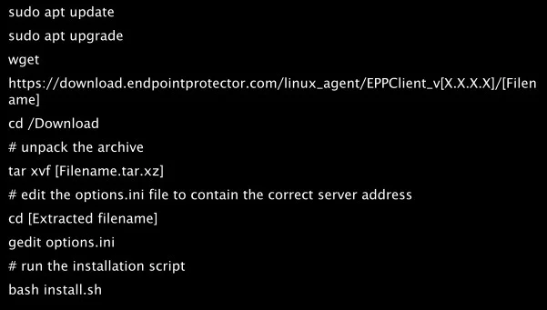
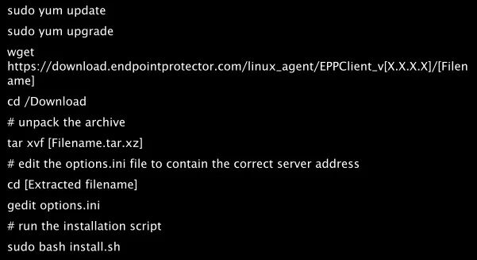
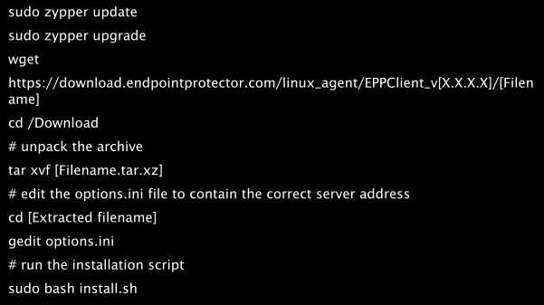
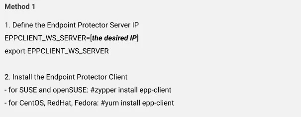
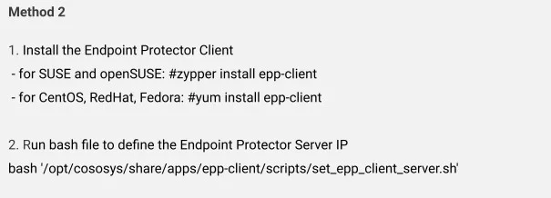

# Install the EPP Client on Linux and WSL

## Debian Based Distributions

While the installation process is similar, each distribution and version have their own
particularities.

The following are several examples of supported distributions:

- Ubuntu
- Debian

:::note
Ubuntu-based distributions like Mint Linux generally work without additional configuration when you use the EPP Client installer built for the corresponding Ubuntu base version. For example, Mint Linux 22.3 might work with the EPP installer for Ubuntu 24.04 LTS. In some cases, the Linux administrator might need to manually adjust dependencies to match the base distribution.
:::

## RedHat based distributions

While the installation process is similar, each distribution and version have their own
particularities.

The following are several examples of supported distributions:
- RedHat
- Fedora
- AWS Linux 2

:::note
RedHat (RHEL)-based distributions like Rocky Linux, Oracle Linux, and CentOS generally work without additional configuration when you use the EPP Client installer built for the corresponding RHEL base version. For example, Oracle Linux 10.1 might work with the EPP installer for RHEL 10.1. In some cases, the Linux administrator might need to manually adjust dependencies to match the base distribution.
:::

- OpenSuse
- SUSE
- SLED Linux Enterprise Server

### Setting the Server IP

For all RedHat-based distributions, after you run these commands, complete one additional step to
set the Endpoint Protector Server IP.

Based on each distribution, follow the corresponding method:

## WSL - Windows Subsystem for Linux

With the Windows Subsystem for Linux (WSL), you can run native Linux distributions directly within your Windows environment. 

### WSL1

You can't install the Endpoint Protector Client directly as an application within WSL.

While direct installation isn't possible, you can still manage and control the usage of WSL
applications through the Application Denylist feature in Endpoint Protector. With this feature, you can
define specific applications or processes associated with WSL that you want to restrict and monitor.

To use Denylists to control WSL applications, complete the following steps:

**Step 1 –** Navigate to the [Denylists and Allowlists](/docs/endpointprotector/configuration/denylistsallowlists/overview.md)
section within the Endpoint Protector Console.

**Step 2 –** Create a new **Denylist entry**.

**Step 3 –** In the **Application Name field**, specify the WSL application you want to control.
This could be:

- `wsl *` – This wildcard entry will match all WSL applications.
- `wsl.exe` – This entry will specifically target the `wsl.exe` executable.
- `wsl.exe --help` – This entry will target the specific command `wsl.exe --help`.
- `wsl --list`– This entry will target the `wsl --list` command.

:::note
Endpoint Protector Client can't directly control the usage of WSL Bash command-line tools
on Windows.
:::

### WSL2

WSL2 lets you start a lightweight virtual machine with a specific Linux distribution, and offers two options for controlling it:

- Configure an Application Denylist, as with [WSL1](#wsl1), to block WSL2 usage entirely.
- Deploy a dedicated Linux EPP Client inside the WSL2 Linux machine to gain EPP visibility into it.
  The EPP Server treats the installed instance as a separate machine, which lets you apply
  more granular policies.

:::note
Netwrix has only tested Ubuntu 26.04 (ARM and x64) and RHEL 10 (x64) in its lab.
:::
