# Install the EPP Client on macOS with DPI and VPN

To install on macOS with Deep Packet Inspection and VPN Traffic Intercept active, complete the following steps:

**Step 1 –** Open the Endpoint Protector Server.

**Step 2 –** Go to the **System configuration** section, select **Client Software** and then download
the macOS EPP Client.

**Step 3 –** Decompress the downloaded file.

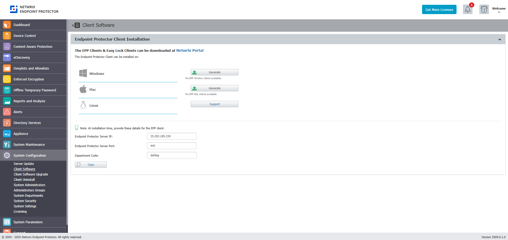

**Step 4 –** Open the **.pkg** file, follow the installation steps, and grant the requested
permissions.

**Step 5 –** After the installation is complete, go to **System Preferences** > **Security &
Privacy** > **Privacy tab** > **Full Disk Access**. Search for Endpoint Protector Client, select the
checkbox, and then **save** the changes.

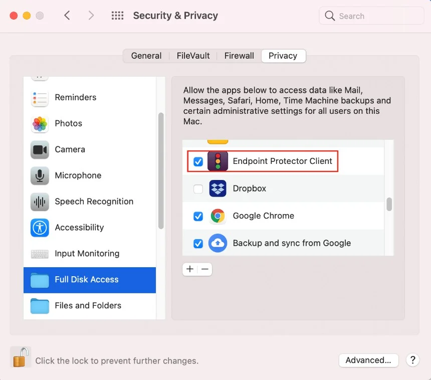

**Step 6 –** Open the Endpoint Protector Server and activate Deep Packet Inspection by navigating to
**Device Control** > **Users/Computer/Group/Global Settings** > **Manage Settings** > **Endpoint
Protector Client** > **Deep Packet Inspection**.

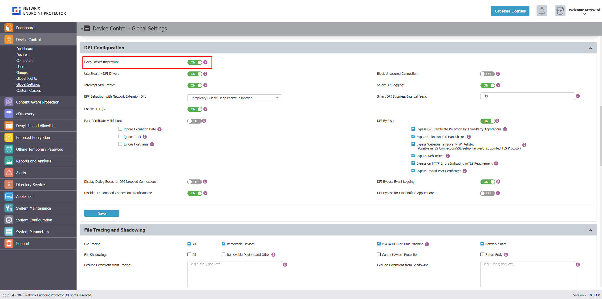

:::note
To learn about Deep Packet Inspection and its configurable options, see the [documentation section for DPI](/docs/endpointprotector/configuration/cap_module/deeppacket.md).
:::

**Step 7 –** Go to the **System Configuration** section, then **System Settings** > **Deep Packet
Inspection Certificate**, and download the **CA Certificate**.

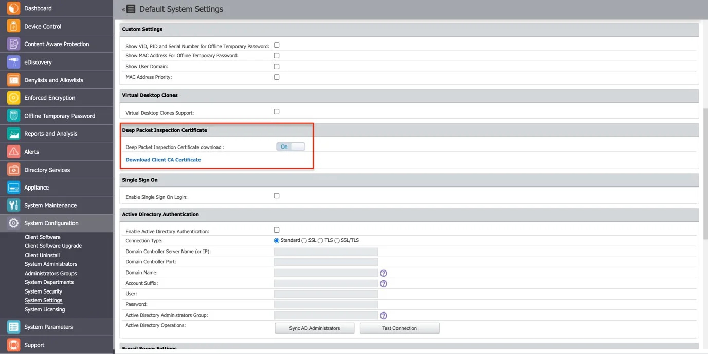

**Step 8 –** Open the **Keychain Access** application from your macOS and select **System**.

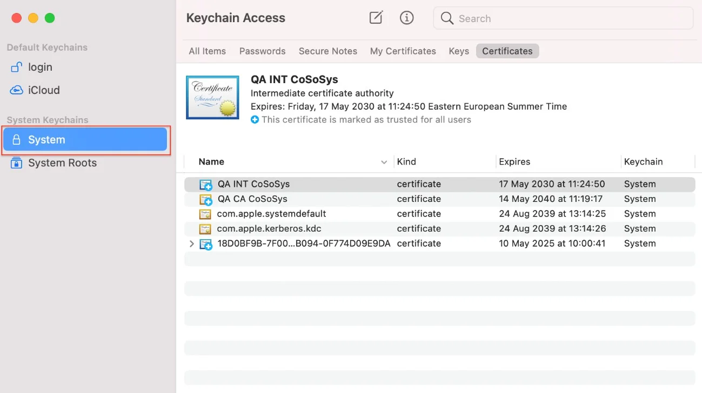

**Step 9 –** Decompress the downloaded **ClientCerts** file.

**Step 10 –** Select **cacert.pem** file and drag and drop it on **System > Keychain Access**.

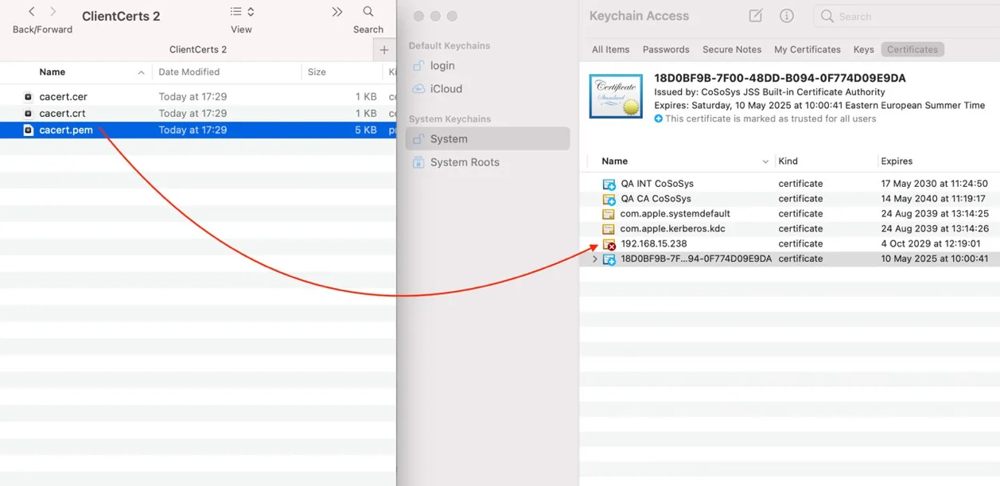

**Step 11 –** Double-click the **X** on the newly added certificate and on the Trust section, select
**Always Trust**.

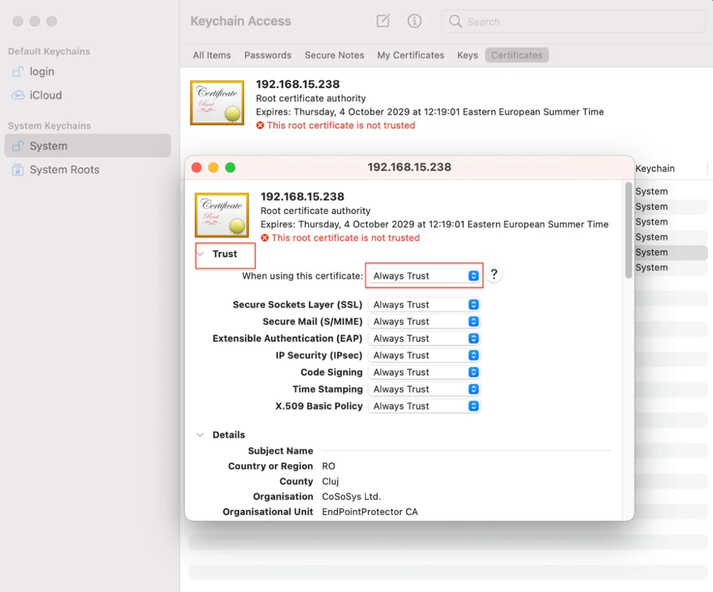

**Step 12 –** **Save** the changes.

**Step 13 –** Activate **Intercept VPN Traffic**.

**Step 14 –** Select one option for **EPP behavior when network extension is disabled**.

- Temporarily Disable Deep Packet Inspection – this option temporarily disables Deep Packet
  Inspection
- Block Internet Access – this option ends the Internet connection until the end user approves
  the Endpoint Protector Proxy Configuration after restarting the computer.

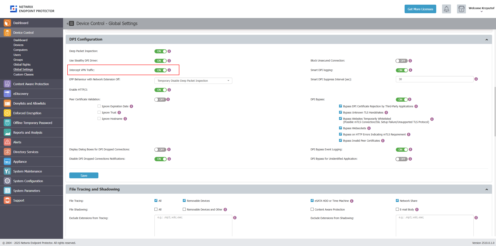

**Step 15 –** **Save** the changes.

**Step 16 –** The following pop-up displays, informing the end user that macOS blocked a System
Extension and that the user must allow it.

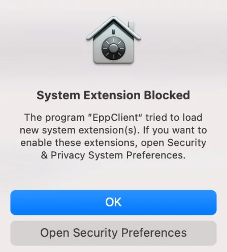

**Step 17 –** Go to **System Preferences** > **Security and Privacy** > select the **General tab**
and **allow** the Endpoint Protector Client Extension.

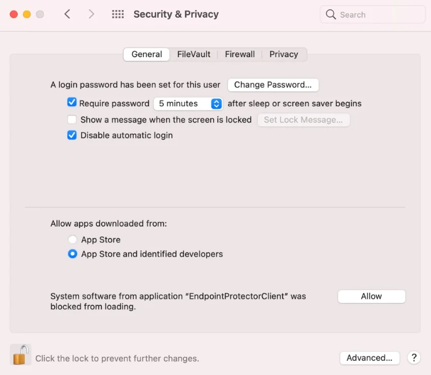

**Step 18 –** **Allow** the Endpoint Protector Proxy Configuration from the pop-up window.

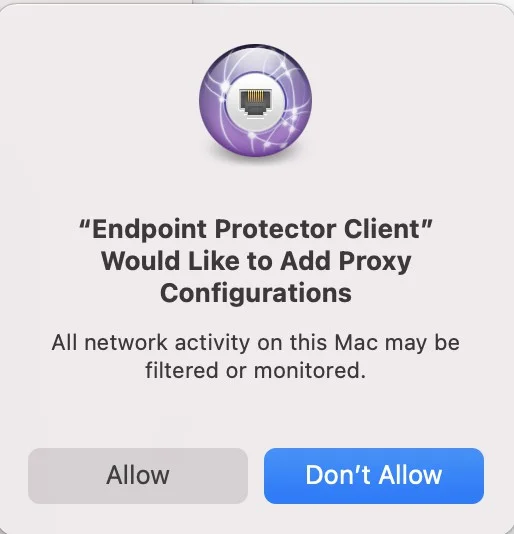

The macOS Endpoint Protector Client installation is now complete.

:::note
If EPPNotifier isn't visible or notifications don't display after you install or
upgrade the Endpoint Protector Client on macOS, restart your machine. If you install and then uninstall the Endpoint Protector Client on
macOS, you may still see EPPNotifier in the Notification settings. To remove it from the list,
right-click and select "Reset notifications."
:::
