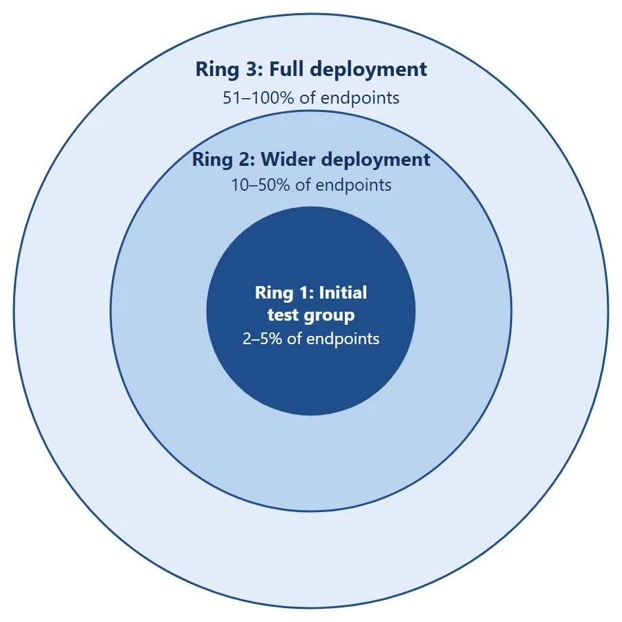

# Test and Roll Out EPP Client Updates

When you are ready to deploy EPP Client updates to your estate, Netwrix recommends a specific method to minimize disruption and maximize confidence in your deployment.

Netwrix strongly recommends using a phased rollout strategy—commonly known as the “ring deployment model”—for EPP Client updates. With this approach, you can identify potential issues early and isolate them before full-scale deployment.

**Recommended Phased Rollout Model (Ring-Based):**

This staged process helps reduce risk, allows validation across diverse environments, and limits the scope of impact if unexpected behavior occurs.

1. **Initial Test Group (2–5%)**
    Begin by deploying the new EPP Client version to a small, controlled group of endpoints (e.g., IT staff or low-risk devices). Use this group to evaluate basic functionality, check for regressions, and validate compatibility in your environment.
2. **Wider Deployment (10–50%)**
    If you find no significant issues in the test group, expand the rollout to a larger segment of your organization. This middle ring can include a broader cross-section of users and departments to ensure confidence across varied use cases and endpoint types.
3. **Full Deployment (51–100%)**
    After you verify the EPP Client in real-world conditions and it meets your internal validation criteria, proceed with full deployment to the remaining environment.

The following diagram shows the ring model for EPP Client deployment.

You may define your own rings using **EPP Smartgroups**, **MDM**, **SCCM**, or any other deployment method that supports targeted rollouts. The exact percentages and ring boundaries are flexible—adapt them based on your organization's risk tolerance, endpoint diversity, and operational goals.
