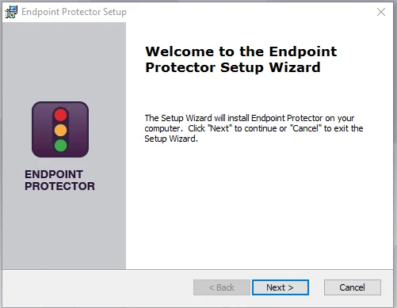
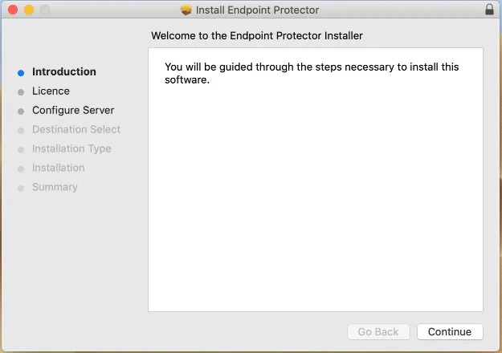

# Install the EPP Client

The EPP Client enforces the Rights and Settings it receives from the EPP Server on the protected endpoints (Windows, macOS, and Linux).

You can download the EPP Client directly from the Endpoint Protector UI. For detailed
information about downloading the EPP Client, refer to the
[Client Software](/docs/endpointprotector/configuration/eppclients/clientsoftware.md) topic.

:::note
You can use tools like Active Directory or JAMF to deploy the EPP Client in
large networks.
:::

:::note
When enabling Debug logging, deploying a fresh installation, or during upgrade processes that require a reload of critical drivers/services (such as Deep Packet Inspection (DPI), browser plugins, or Outlook add-ins), restart the operating system. This mandatory first step in troubleshooting ensures that all dependencies initialize properly.
:::

To see which distributions EPP supports, check the [supportability article](/docs/endpointprotector/supportability/client-supportability.md).

For Windows and Mac, installing the EPP Client requires minimal input. The
installation folder and server information come pre-configured, and you can download the EPP Client from
the Endpoint Protector Server.

:::note
For Linux installation instructions, read the readmeLinux.txt file available under the Read this before installing link.
:::

The main supported Linux distributions include:
- Ubuntu
- RedHat

:::note
For Ubuntu-based distributions outside the officially tested and certified list, such as Mint Linux, and RHEL-based distributions such as Rocky Linux, Oracle Linux, or CentOS, the EPP Client installer built for the corresponding base version generally works without additional configuration. In some cases, the Linux administrator might need to manually adjust dependencies to match the base distribution. For installation steps, see [Linux](#linux) install guide under Agent install parameters, and [Install the EPP Client on Linux and WSL](/docs/endpointprotector/install/eppclient/eppclientlinuxwsl.md).
:::

Netwrix provides optional distributions on the product portal upon request, after the Netwrix Product Team validates them. The following are examples of on-demand distributions:
- Debian
- Fedora
- Pardus OS
- AWS Linux
- OpenSUSE
- SUSE
- SLED Linux Enterprise Server

Beyond this list, Netwrix can also build a Client for the latest version of other custom Linux distributions on request, as a **Feature Request (FR)** through Netwrix Support. Netwrix Product Management reviews and prioritizes these requests, which may involve a billable service. For details, see [Linux Clients](/docs/endpointprotector/supportability/client-supportability.md#linux-clients) in the Netwrix Endpoint Protector Agent Support Policy.





## Agent install parameters

To improve the Endpoint Protector installation process, use the Endpoint Protector tool to run
installation-related actions, identify your current Linux distribution, and view Endpoint
Protector Release Notes.

Use the following commands:

- i - install
- u - uninstall
- rn - release notes
- l - distribution list
 
**Optional CLI commands for installers**


### Windows
You can also apply manual proxy settings using CLI commands:

Example:

```
msiexec.exe /i "C:\Work\Tools\EPPClientSetup.5.7.1.5_x86_64.msi" /q REBOOT=ReallySuppress RUNNOTIFIER=0 /log "C:\Windows\TEMP\epp-upgrade.log" WSIP="epp.example.com" WSPORT="8080" DEPT_CODE="defdep" PROXYIP="127.0.0.1" PROXYPORT="80" AUTHUSR="user_name" AUTHPASS="password"
```

Where:

- PROXYIP – IP of the proxy
- PROXYPORT – Port of the proxy
- AUTHUSR – Username (if the proxy requires authentication)
- AUTHPASS – Password (if the proxy requires authentication)

You can also use the following CLI commands to install Endpoint Protector Client in a specific working mode.

- WSIP – server address (use the server's fully qualified domain name (FQDN) instead of an IP address)
- WSPORT – server port number
- DEPT_CODE – department code
- IPV6MAPPING – IPV6 Mapping IPv4 addresses
- SUPPRESSRD – suppress FileRead/FileDelete events for NS and Removable devices
- DISABLECAP – disabling loading of CAP drivers (CAP will not work)

:::note
Starting with the 2511 Clients release, the install parameters "IPV6MAPPING," "SUPPRESSRD," and "DISABLECAP" will persist during the EPP Client upgrade process.
:::

### macOS
:::note
For macOS, contact the Netwrix Support team to obtain the latest version of the
installer script, which lets you customize installation parameters.
:::


### Linux

For Linux, you can use CLI arguments only in the options.sh file to bypass proxy settings. To do so,
follow these steps:

**Step 1 –** Access the installation folder, open a Terminal, and run the following command:

`cd pathToLinuxClientFolder`

**Step 2 –** To run commands as root, run the following command and enter your password.

`sudo su`

**Step 3 –** Open the options.sh configuration file with the following command:

`gedit options.sh`

**Step 4 –** In the configuration file, you see the following fields for the proxy setup:

#EPPCLIENT_HTTPS_PROXY=

#export EPPCLIENT_HTTPS_PROXY

**Step 5 –** Remove the # before each entry to apply the proxy setups.

**Step 6 –** For the first proxy setup, EPPCLIENT_HTTPS_PROXY, add the proxy server information in
the address:port:user:password format.

**Example: EPPCLIENT_HTTPS_PROXY=address:port:user:password**

**Step 7 –** Save the changes, and then run the installation without a VPN connection:

`bash install.sh`

Additional CLI commands for Linux in specific mode:

- #EPPCLIENT_SUPRESSRW - suppress FileRead/FileDelete events for NS and Removable devices
- #EPPCLIENT_DISABLECAP - disabling loading of CAP drivers (CAP will not work)

## Bypass Proxy Settings

You can bypass proxy settings for all operating systems.

### Windows and macOS

**Endpoint Protector Wizard Installer**

Select the option to **Use Manual Proxy Settings** from the Endpoint Protector Wizard installer and
then provide the following information:

- Proxy IP – IP of the proxy server
- Proxy Port – Port of the proxy
- Select the Use authentication checkbox
- Username – add proxy server username
- Password – add proxy server password

## Increased Communication Security

During interactive installation, the installer wizard includes an **Increased Communication Security** checkbox. When you enable it, the EPP Client uses certificate-based authentication during the registration process and for all subsequent communication with the EPP Server.
This option corresponds to the **Client Registration Certificate** feature configured on the server side. Before enabling it, ensure that you deployed a cryptographic identity signed by the EPP Root CA to the endpoint and that it appears in **Certificate Manager** under *Local Computer → Certificates → Personal*.


:::note
This option requires you to enable and configure the **Client Registration Certificate** feature on the EPP Server ([**Appliance → Server Maintenance → Client Registration Certificate**](/docs/endpointprotector/admin/appliance.md)) before you install the client. Enabling it without the corresponding server-side configuration prevents the client from registering.
:::
