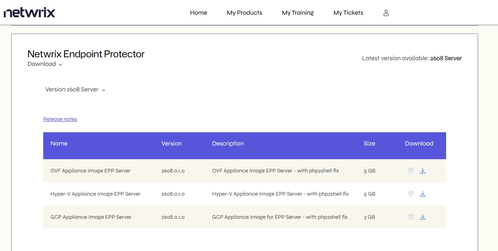
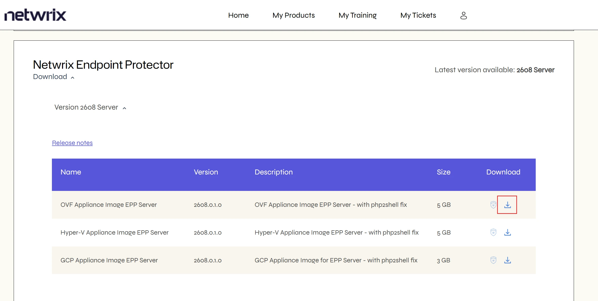
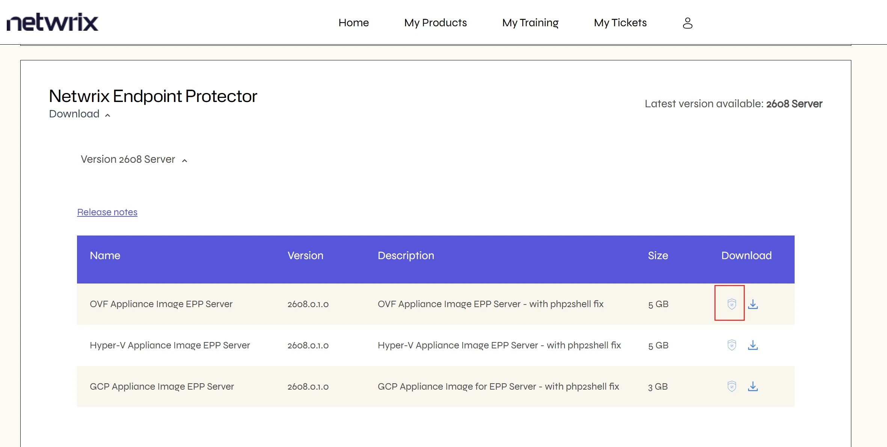
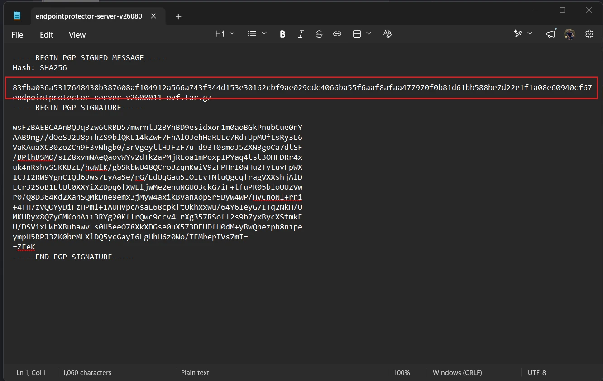

# Deployments

This documentation describes how to deploy Endpoint Protector on physical hardware, virtual
appliances, and cloud-based infrastructure, and how to integrate it with existing management
systems.

This section covers a range of deployment methods, including:

- Physical and Virtual Appliances: Detailed instructions for configuration, deployment, and
  management.
- Cloud Platforms: Deployment strategies for Amazon Web Services (AWS), Google Cloud Platform (GCP), and Azure, assuming existing cloud accounts
  and basic platform knowledge.
- Active Directory Integration: Using Group Policy Objects to deploy clients.
- Third-party Management Tools: Using JAMF and Microsoft Intune to deploy clients.

:::warning Important
This section of the documentation provides best-effort guidance on deployment. It is optional and may not always reflect the latest interface or features, as third-party products can change frequently. For the most up-to-date information, refer to the official resources from the product vendor.
:::

## Staging the Server

To start using Endpoint Protector, you need to deploy a server instance. The server hosts all endpoint controls and behavior configuration and delivers the
Endpoint Protector agent to endpoint systems. Server management has two options:
Customer-Managed or Provider-Managed. If you choose Customer-Managed, you can install the server On-Premise or in a Hosted-Cloud Environment.

With the On-Premise option for a Customer-Managed instance, you can set up a virtualized image in your LAN. Virtualization options include, but aren’t limited to: VMware and
Hyper-V. The Hosted-Cloud deployment method uses a customer’s AWS, Azure, or GCP instance. See [Virtual Appliance Formats](/docs/endpointprotector/install/virtualappliance/formats/formats.md) for supported VM formats including VMware and Hyper-V, and [Cloud Services](/docs/endpointprotector/install/configuration/overview.md) for AWS, Azure, and GCP deployment details.

Alternatively, if you require a Provider-Managed setup, Netwrix can deploy an instance of Endpoint Protector in an isolated cloud environment. For details on the Provider-Managed option, speak with your Netwrix Account Manager.

:::note
To use the Endpoint Protector Server in a production environment, you need a License Key. After you purchase Endpoint Protector with the necessary modules, your Account Manager will assign a license that you can install in the Endpoint Protector Management Console (the configuration interface available on the Endpoint Protector Server).
:::

The following sections describe the different methods for deploying Endpoint Protector, with step-by-step instructions and best practices.

## Use an FQDN Instead of an IP Address

Always address the Endpoint Protector Server by a fully qualified domain name (FQDN), such as `epp.example.com`, instead of a static IP address. Use the FQDN everywhere the server address appears:

- **EPP Clients** – configure each client to reach the server through the FQDN.
- **Single sign-on (SSO) integrations** – register the SSO response (callback) URL with the FQDN. An SSO configuration bound to an IP address stops working when the server address changes, for example after a migration.
- **Other integrations** – use the FQDN in any other configuration that stores the server address.

With an FQDN, you can move the server to a new IP address, for example during a migration, by updating a single DNS record. You don't need to reconfigure every client and integration.

:::tip Netwrix-hosted (SaaS) deployments
Netwrix assigns an FQDN to every SaaS deployment by default. Bind your clients and integrations to that FQDN so that service migrations don't require changes on your side.
:::

## Communication Between Endpoint Protector Server and Netwrix Servers

Your Endpoint Protector Server can communicate with Netwrix servers only when you connect it to the internet.

When the server has an internet connection, Netwrix may access the following metadata:

- **Server metrics:**  
  - RAM  
  - Database version  
  - Web server version  
  - CPU type / number / frequency  
  - HDD size / partition / free space  
  - Operating system version  
  - Purchased product version  
  - Server serial number  
  - IP address  
  - MAC address of the server

- **Admin details:** 
  - Name  
  - Email address  
  - Phone number

- **Licensing information:**  
  - Number of licenses  
  - Validity  
  - Operating system platforms  
  - License utilization
  - Module Activation Status

Netwrix collects this metadata strictly for licensing and statistical purposes. It doesn't include any customer-sensitive information or content stored or processed by your company.

Additionally, internet connectivity allows your company to:

- Download product updates
- Activate modules by communicating with Netwrix servers

:::note 
The applicable privacy and security policies govern all communication with Netwrix servers.
:::


## Unified EPP Clients and Server Versioning

Starting with version 2509, Netwrix standardizes EPP product versioning. The versioning format follows a structured scheme that encodes the release year, month, target platform, and build metadata.

**Key aspects of the new versioning system**

**Structured format:** Version numbers follow the format:

`YYMM.O.C.B`

**`YYMM`** — Release year and month (e.g., `2603` = March 2026)

**`O`** — Target platform or component:
- `0` = Server
- `1` = Windows Client
- `2` = Mac Client
- `3` = Linux Client
- `4` = Combined Win-Mac Environments (EE)

**`C`** — Custom/fork/build increment:
- `0` = internal
- `1` = standard releases
- `2+` = customer-specific builds or hotfixes

**`B`** — Optional build number for internal tracking

**Consistency across interfaces:** Endpoint Protector uses this versioning format across all UI pages where version numbers appear, including dashboards, reports, maintenance tools, and the EPP Client Notifier.


**Examples of the New Versioning**
| Description | Version |
|---|---|
| February 2026 server, standard build | 2602.0.1.0 |
| February 2026 Windows client, standard | 2602.1.1.0 |
| RHEL client, May 2026, custom #3 | 2605.4.3.0 |
| Server, April 2026, internal build #7 | 2604.0.0.7 |

## Downloading and verifying installation files

Download Endpoint Protector installation files, such as server appliance images and client packages, from the Netwrix My Products portal. Each download has an associated SHA512 file that you use to confirm the download is authentic and uncorrupted.

**Step 1 –** Sign in to the [Netwrix My Products portal](https://customer.netwrix.com/sign_in.html?rf=my_products.html) with your netwrix.com account. The account must have a valid license assigned. If you can't sign in or can't see your products, contact the Netwrix Support portal or your distributor.

**Step 2 –** Choose the component to download. The portal groups products by release version and by server or client component.



Click the download icon to download the file.



Then download the associated SHA512 file by clicking the shield icon. In some browsers, you can also right-click the icon and select a save-link option.



**Step 3 –** After both files download, calculate the SHA512 hash of the installation file. The following commands are examples for each operating system, and you can use any preferred tool or method. Replace the placeholder with the path or name of your file, for example `endpointprotector-server-v2608011-ovf.tar.gz`.

- **Windows (PowerShell):** open PowerShell and run `Get-FileHash -Path "<path-to-file>" -Algorithm SHA512`
- **Linux:** open a terminal in the folder that contains the file and run `sha512sum <file-name>`
- **macOS:** open a terminal in the folder that contains the file and run `shasum -a 512 <file-name>`

**Step 4 –** Open the downloaded SHA512 text file and compare the hash it lists with the hash you calculated. Ignore letter case, because PowerShell prints uppercase letters. If the hashes match, the file is the genuine Netwrix Endpoint Protector file and it isn't corrupted, so you can use it safely.



:::note
The SHA512 file is a PGP-signed message, so it starts with the following header:

```text
-----BEGIN PGP SIGNED MESSAGE-----
Hash: SHA256
```

This header describes only the digest algorithm of the PGP signature. The file hash that follows the header is a SHA512 hash (128 characters).
:::
