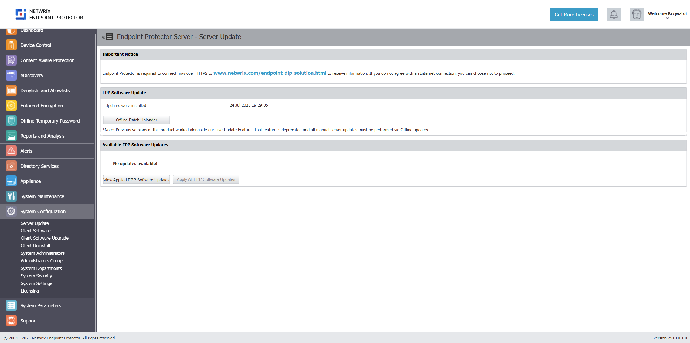
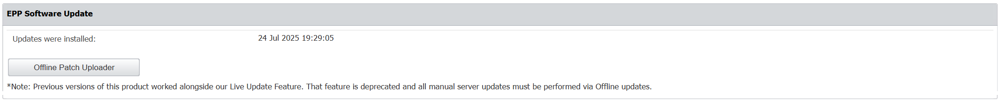
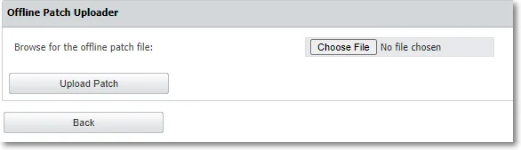
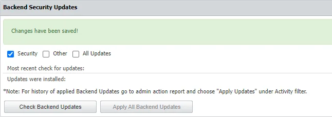

# Update the EPP Server

The same options are available in the console under **System Configuration** > **Server Update**. See [System Configuration](/docs/endpointprotector/admin/systemconfiguration/overview.md#server-update).

From this section, you can check and apply the latest security and Endpoint Protector Server
updates.

## Software Update

Starting with the EPP 5.9.4.2 release, Netwrix offers EPP server patches only as Offline Patch files. Use the Offline Patch upload option to select the patch files from your computer and install them to update Endpoint Protector to the latest version.

Beginning with EPP Server version 2509, all patches are cumulative updates that bring your server directly to the latest version regardless of your current patch level.

:::note
Download the latest offline patches from the Netwrix My Products portal:
[Netwrix Customer Portal](https://www.netwrix.com/sign_in.html?rf=my_products.html).
:::
Click the "Offline Patch Upload" button to begin the EPP Server patching procedure, and select the downloaded patch file.

:::note
Customers running EPP Server version 5.9.4.2 or older should review the [EPP Appliance migration guide](/docs/endpointprotector/migrationprocedure/migrationguide) for the current migration path to 2608, and follow [Migrating from a Legacy 5.x Server to 2608](/docs/endpointprotector/migrationprocedure/migration-legacy-5x) for the on-premises migration procedure.
:::

:::note
Starting with EPP Server version 2509, EPP Server no longer offers the Live Update feature. Apply patches only through the Offline Patch upload option in the Software Update section. Customers still running a 5.x legacy appliance can find the legacy Live Update procedure in [Using the Live Update Feature on 5.x Legacy Appliances](/docs/kb/endpointprotector/deployment-and-installation/using-the-live-update-feature-on-5x-legacy-appliances).
:::

## Security Updates

Use this section to check and apply different types of security updates, view information on
recent updates checked or installed, and view a list of available updates.

These updates apply to the backend of the EPP Server: Ubuntu operating system patches and system components. Security fixes for Endpoint Protector itself come with the EPP Offline Patches, which you apply in [Software Update](#software-update). When an Endpoint Protector release includes security fixes, Netwrix publishes the corresponding Security Advisory next to the EPP Release Notes.

:::note
This feature isn't visible in Netwrix SaaS-hosted EPP Servers, because Netwrix fully maintains them.
:::

:::note
The security update options are available only for customer-hosted instances (for example,
Amazon Web Services (AWS), or Google), except for Operating System and Kernel upgrades.
:::

:::warning
Netwrix doesn't allow on-premise (self-hosted) customers to perform backend security updates by any method other than the web UI. Any violation of this rule is outside Netwrix support and may cause EPP Server malfunction.
:::

:::note
Netwrix doesn't test updates beforehand. Endpoint Protector pulls them from the official Linux repository.
:::

### Required network access

Backend security updates for Ubuntu, MySQL, and other backend system components come from official repositories. To receive them, allow the EPP Server outbound access to the repositories for your server version.

Allow ports 80 and 443. The initial connection uses HTTP on port 80 and can switch to HTTPS on port 443.

For EPP Server 2608 (Ubuntu 26.04), allow these URLs:

- `http://archive.ubuntu.com/ubuntu/`
- `http://security.ubuntu.com/ubuntu/`
- `https://cdn.crate.io/downloads/debian/stable/`

For EPP Servers 2509 through 2604 (Ubuntu 22.04), allow these URLs:

- `http://archive.ubuntu.com/ubuntu/`
- `http://security.ubuntu.com/ubuntu/`
- `https://repo.alt.tuxcare.com/alt-common/deb/ubuntu/22.04/stable`
- `http://repo.percona.com/pxb-24/apt`

:::tip
Netwrix recommends applying security updates regularly to keep Ubuntu, MySQL, the PHP runtime, and other backend system components patched against known vulnerabilities, including those listed in [ADV-2026-021 – PHP Runtime Vulnerabilities in Netwrix Endpoint Protector](https://community.netwrix.com/t/adv-2026-021-php-runtime-vulnerabilities-in-netwrix-endpoint-protector/161687).
:::

To ensure the updates don't harm the system, take these steps:

- test the updates in a test environment first
- make a VM snapshot
- make a system backup from the System Maintenance, the System Backup v2 section

Select one of the available security update types and then click **Check Updates**:

- Security – applies all security-related updates for installed packages (Critical and High)
- Other – downloads and applies any available update for third-party libraries, the kernel, OS
  packages, and the MySQL database
- All Updates – downloads and applies Informational and Optional/Unclassified updates

If updates are available, click **Apply Updates**.

:::note
For history of applied Backend Updates go to admin action report and choose **Apply
Updates** under Activity filter.
:::

:::note
Due to patching nature, some updates may automatically restart the Endpoint Protector
server or other sub-services in the background
:::
