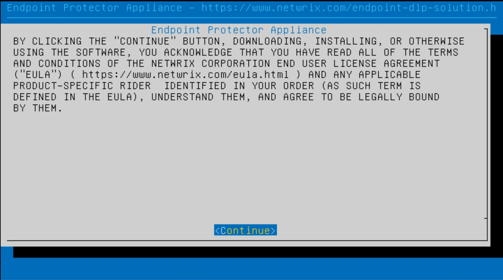
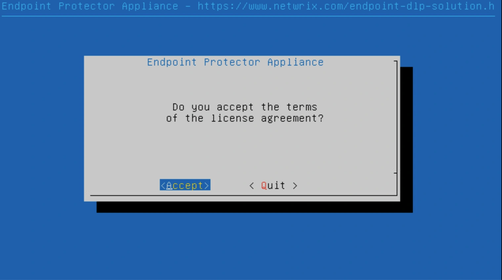
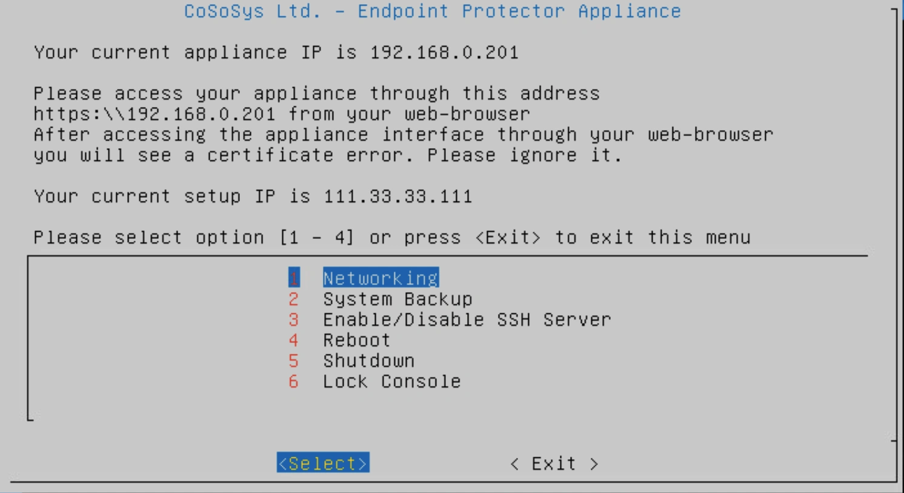
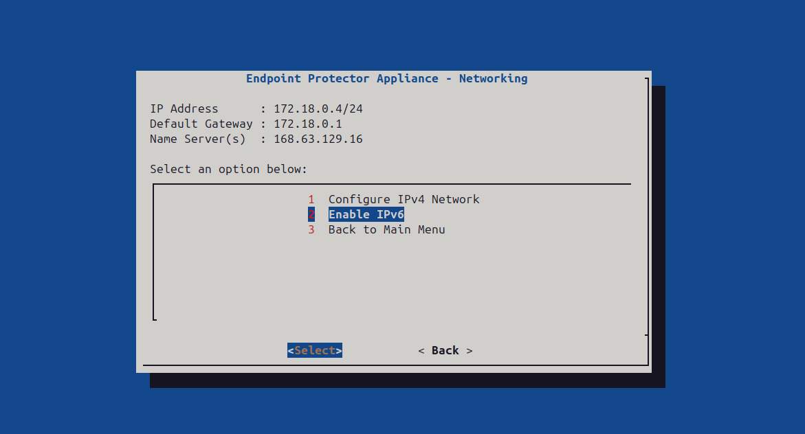
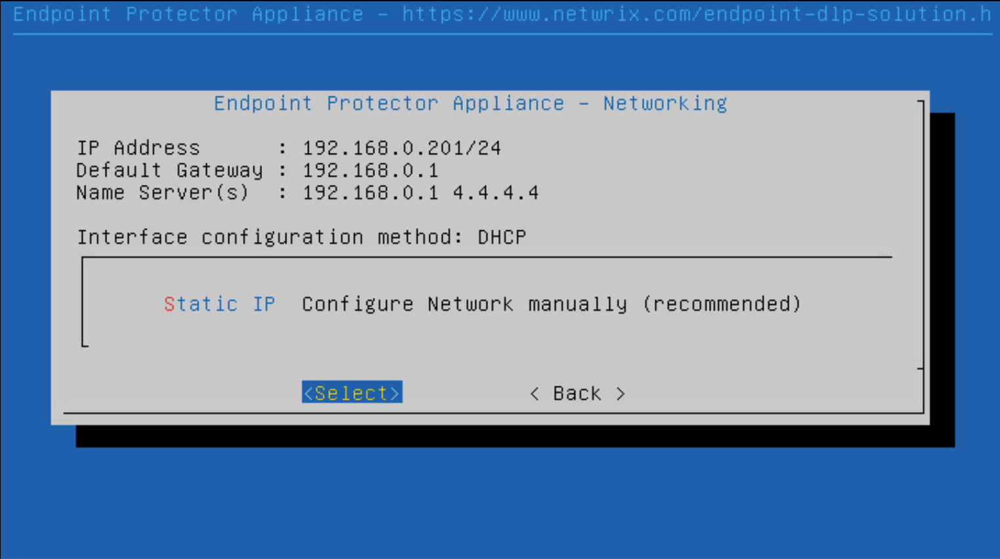
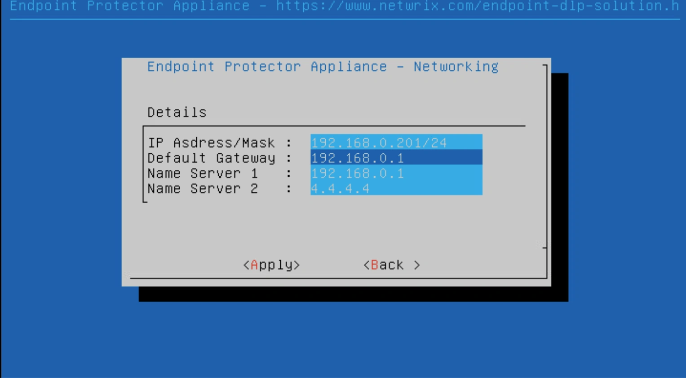
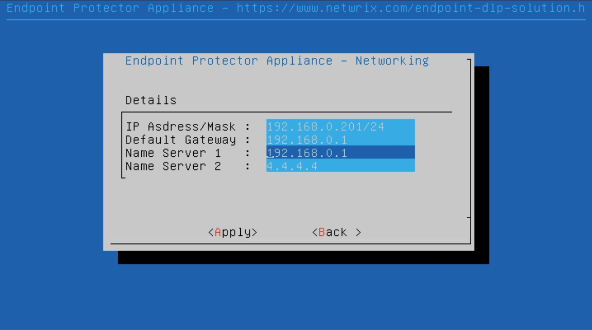

# Setup Wizard

The Endpoint Protector Appliance requires the firewall to allow inbound traffic on port 443. The
appliance uses this port for:

- Endpoint Protector Server and Client communication: 443 inbound

**Step 1 –** Select **Continue** when finished reading the End User License Agreement.

**Step 2 –** Select **Accept**.

**Step 3 –** Select **Networking**.

**Step 4 –** Two configuration methods are available.
Starting with version 2509, only the manual configuration option is available. Also, starting with version 2512, networking configuration includes options for both IPv4 and IPv6. You must select only one option.

:::warning
Modifying network configuration creates certificate a regeneration operation which temporarily stops communication between server and client.
When you change from one IP version to another, always press the Apply button to save and apply the configuration.
:::

## Manual Configuration

Starting with version 2509, only the manual configuration option is available. For older versions, use manual configuration for precise control to set the IP address and default gateway, ensuring the appliance is correctly set up and accessible.

**Step 1 –** Select **Configure Network manually** (IPV4 example).

**Step 2 –** Set the IP Address and Default Gateway. For example, set the IP Address as
192.168.7.94 and the Default Gateway as 192.168.7.1.

**Step 3 –** Press **Tab**.

**Step 4 –** Select **Apply**. The virtual appliance is now accessible from the configured IP
Address. (e.g., https:// 192.168.7.94).

:::tip
Create a DNS record for the appliance's fully qualified domain name (FQDN), for example `epp.example.com`, that points to this IP address. Use the FQDN to access the server and to configure clients and integrations. See [Use an FQDN Instead of an IP Address](/docs/endpointprotector/install/overview#use-an-fqdn-instead-of-an-ip-address).
:::

:::note
The setup wizard no longer includes E-mail Server Settings. To configure email server settings and authentication, go to **System Configuration** > **[Mail Settings](/docs/endpointprotector/admin/systemconfiguration/mailsettings.md)** after completing the initial setup.
:::
