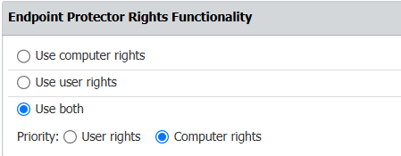

# Understanding the Rights Hierarchy for Devices

## Overview

This article explains the rights hierarchy for devices, which determines how Netwrix Endpoint Protector applies and overrides permissions.

The rights hierarchy for devices, from lowest to highest, is as follows:

1. Global Rights
2. Group Rights
3. Computer or User Rights
4. Devices
5. Custom Classes

Computer Rights and User Rights share one level. To choose which takes precedence, follow the steps in [Instructions](#instructions).

Custom Classes override all other rights. Use Custom Classes to globally set rights for a device or class of devices identified by Vendor ID (VID), Product ID (PID), and Serial Number.

For the full reference, see [Priority order](/docs/endpointprotector/admin/dc_module/devicesandcomputers#priority-order) in the Devices and Computers documentation.

> **NOTE:** If you do not configure device rights, the device uses the default Global Rights set per Device Type (USB Storage Device, Digital Camera, iPod, Thunderbolt, Chip Card Device, etc.). See [Directory Services](/docs/endpointprotector/admin/directoryservices) for more detail on how these defaults interact with directory-synced entities.

## Instructions

To set precedence between Computer Rights and User Rights, go to **System Configuration > System Settings** and select the desired option.

