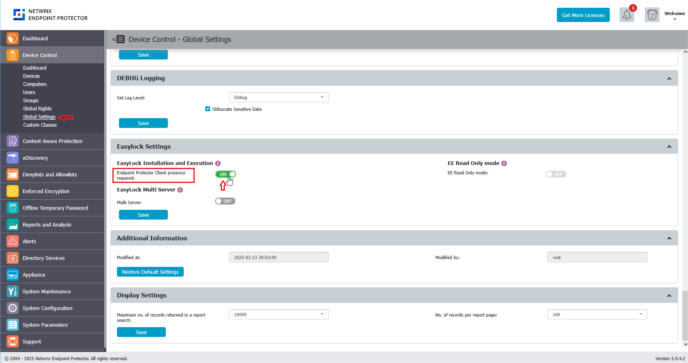

# Can the EasyLock App Be Opened Without the Endpoint Protector Agent Installed?

## Question

Can the EasyLock app be opened on a computer without the Netwrix Endpoint Protector agent installed?

## Answer

Yes. You can choose whether EasyLock opens only on computers where the Netwrix Endpoint Protector agent is present or on any computer.

For the full reference, see [Enforced Encryption](/docs/endpointprotector/admin/ee_module/eemodule).

To configure this option, navigate to **Device Control** > **Global Settings** > **EasyLock Settings** and toggle the switch next to **Endpoint Protector Client presence required**.

The toggle has two states:

- **Enabled (dependency required):** EasyLock only opens on computers where the Endpoint Protector Client is installed and running.
- **Disabled:** EasyLock can be opened freely on any computer, including ones without the Endpoint Protector Client.

Starting with version 2611, you can turn on **Harden Client Presence Value** in the same section to lock this setting on devices that you create afterward. A hardened device keeps the value when its group membership or the global settings change. To remove the lock, use **Reset Client Presence Hardening** in **Enforced Encryption** > **EasyLock**. See [Client Presence Hardening](/docs/endpointprotector/admin/ee_module/eemodule#client-presence-hardening).

For a middle-ground option, consider Enforced Encryption (EE) Read Only mode instead of fully disabling the Client presence requirement. This optional, configurable mode lets you grant read-only access to EE-encrypted drives on unmanaged computers (personal devices, conference room setups, or exhibition areas) without requiring the Endpoint Protector Client, while still preventing writes to the drive. To enable it, switch on the **EE Read Only mode** toggle under **Device Control** > **Global Settings**, in the same EasyLock Settings area as **Endpoint Protector Client presence required**. See [Enforced Encryption in Read Only mode](/docs/endpointprotector/admin/ee_module/eemodule#enforced-encryption-in-read-only-mode) for details.

> **IMPORTANT:**
> EE Read Only mode requires the EE Client to establish policy context with the Endpoint Protector Server at least once. After deploying the EE Client with Read Only mode enabled, launch the EE Client for the first time on a computer managed by the Endpoint Protector Client. This first launch lets the EE Client synchronize with the server so it can apply user-, computer-, and group-specific Enforced Encryption settings instead of only the account-wide Global Settings defaults.
>
> If you skip this step, the EE Client can still configure itself as long as it can reach the Endpoint Protector Server — for example, over the internet from an unmanaged computer. In that case, it applies only the Global Settings defaults, with no user, computer, or group-level granularity.
