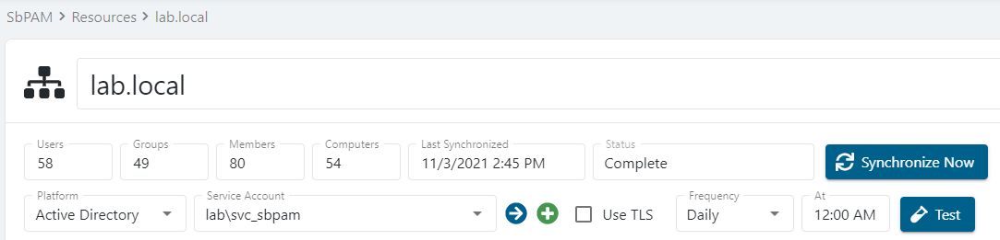

# Active Directory (AD) Users, Groups, or Computers Not Available to Add to SbPAM

## Overview

This article describes how to make recently created Active Directory (AD) users, groups, or computers available to add to the Netwrix Privilege Secure for Access Management console. These objects may not be immediately available, depending on the last time Active Directory was synced with Privilege Secure.

## Instructions

1. Log in to Privilege Secure as an admin user, and go to **Resources**.
2. Confirm the domain that the users and/or groups you want belong to has already been added (synced) to Privilege Secure.
   - If the domain does not appear in the Resources table, add it using the **+ New Domain** button above the Resources table.
3. After confirming the domain is a resource in Privilege Secure, click the domain's name in the Resources table.
4. Confirm the **Last Synchronized** date and time.
   - If it is not recent, click **Synchronize Now** to immediately run a domain sync.

   

After a successful domain sync, the **Last Synchronized** field for the domain updates. All users, groups, and computers in the domain are now available to be onboarded to Privilege Secure.
