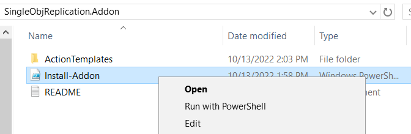
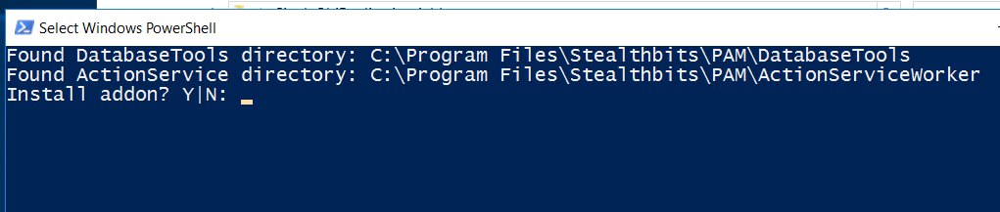
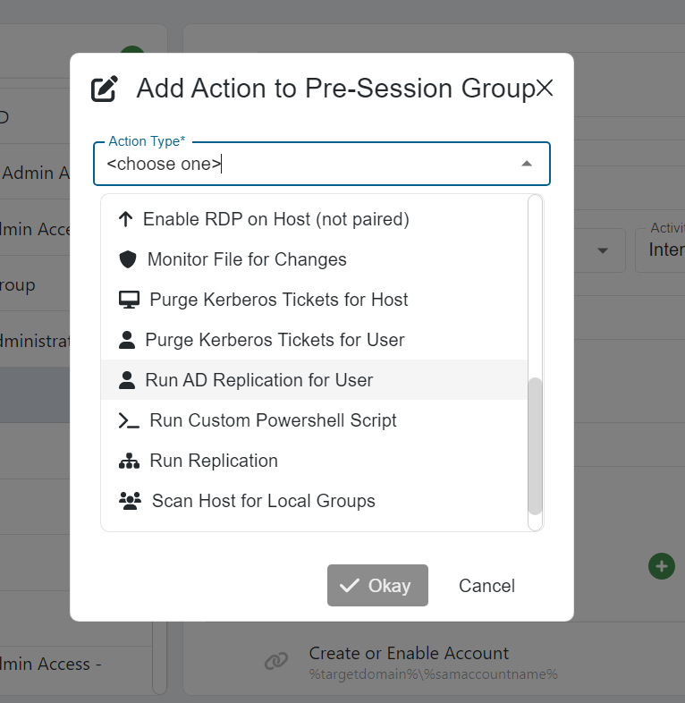

# Importing a Custom Action Step for Single-Object Replication

## Overview

This article describes how to import a custom single-object replication action step into Netwrix Privilege Secure for Access Management.

It can be necessary in certain Active Directory environments to force replication when provisioning sessions. Privilege Secure offers a default "Run Replication" step, but in certain Active Directory environments, often those geographically dispersed across multiple sites, this full replication step can be time consuming. In these instances, you can use a single-object replication step, which runs more quickly.

> **NOTE:** These instructions apply only to releases of Privilege Secure before 3.7CU1 (3.7.1250). In Privilege Secure 3.7.1250 and all subsequent releases, the **Run AD Replication for User** step is included by default.

## Instructions

1. Download the `SingleObjReplication.Addon.zip` zip archive to the Privilege Secure server:

   https://www.netwrix.com/download/SingleObjReplication.Addon.zip

2. Extract the archive, which contains a README file, an ActionTemplates directory, and an `Install-Addon.ps1` script file. Right-click `Install-Addon.ps1` and select **Run with PowerShell**.

   

3. When prompted, select "Y" to proceed.

   

4. The PowerShell window should quickly execute the script and close.

5. Log in to the Privilege Secure console. If Privilege Secure was already open, refresh the console.

6. In Privilege Secure, go to **Activities**, select an Activity, and click the green plus sign in either the **Pre-Session** or **Post-Session**. The **Run AD Replication for User** activity step is now available.

   
