# Adding Active Directory Federation Services (AD FS) as an Authentication Connector (OpenID Connect)

## Overview

This article describes how to add Active Directory Federation Services (AD FS) to Netwrix Privilege Secure for Access Management as an Authentication Connector via OpenID Connect (OIDC). The article is split into two sections, *Steps for AD FS* and *Steps for Privilege Secure*. The AD FS section must be completed first.

## Instructions

### Steps for Active Directory Federation Services (AD FS)

1. Launch **AD FS Management** on the AD FS server:

   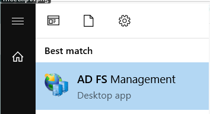

2. Right-click **Application Groups** and select **Add Application Group…**

   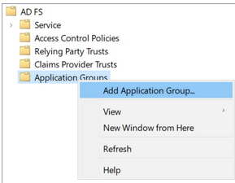

3. Select **Native application accessing a web API** and enter "SbPAM (OIDC)" as the **Name**, then click **Next**.

   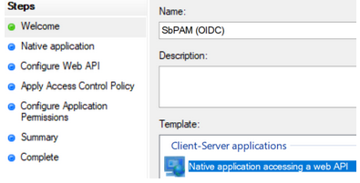

4. Copy the **Client Identifier** value; you need it when configuring Privilege Secure.

   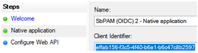

5. For the **Redirect URI**, use the Privilege Secure server's URL followed by `/callback`. For example: `https://<sbpam-server>:6500/callback`. Click **Add**, then **Next**.

   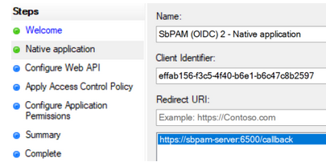

6. For the **Identifier** of the Web API, use the Privilege Secure server's URL. Click **Add**, then click **Next**.

   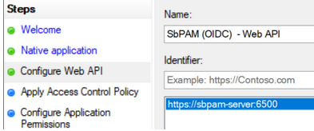

7. For **Apply Access Control Policy**, leave all defaults and then click **Next**.

   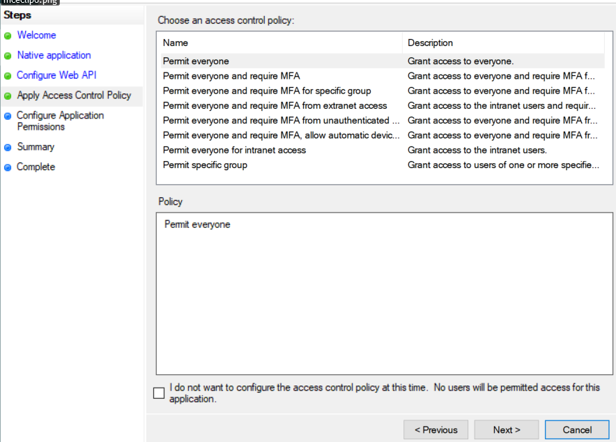

8. For **Configure Application Permissions**, enable the following and then click **Next**:

   - `allatclaims`
   - `openid`
   - `profile`

   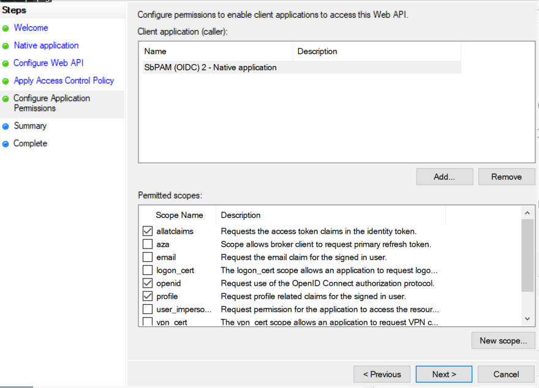

9. Review the Summary, then click **Finish**.

10. Double-click the newly created Application Group, then double-click the Web API application, then go to the **Issuance Transform Rules** tab. Click **Add Rule...**

    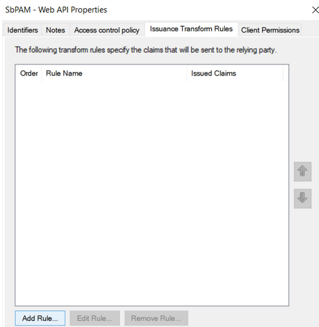

11. From the dropdown, select **Send Claims Using a Custom Rule** and click **Next**.

    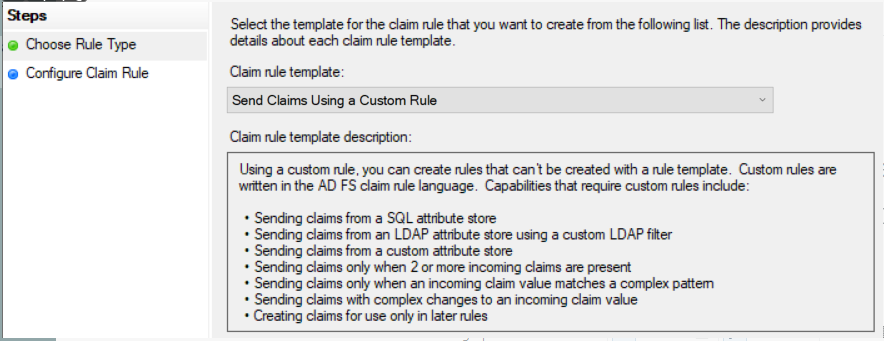

12. Name the rule "Send attributes", and add the following custom rule:

    ```text
    x:[]
      => issue(claim = x);
    ```

    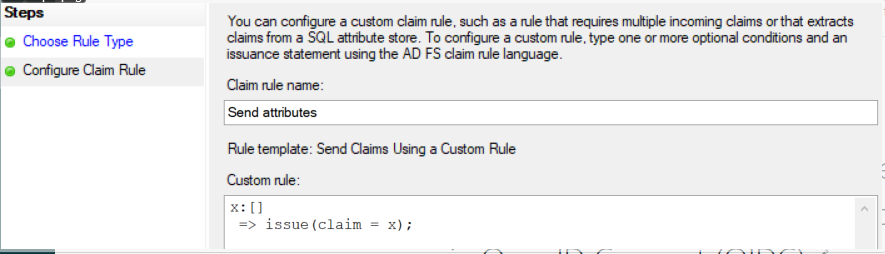

    Click **Finish**, **Apply**, **OK**, then **OK** again. You can now close **AD FS**.

13. Open **PowerShell** as an administrator. Before running the commands, ensure you capture any existing Cross-Origin Resource Sharing (CORS) settings, because the `Set-AdfsResponseHeaders` command replaces the existing values with the provided value. Then run the following commands to enable CORS for communication between the Privilege Secure server and AD FS:

    ```powershell
    Set-AdfsResponseHeaders -EnableCORS $true
    Set-AdfsResponseHeaders -CORSTrustedOrigins https://<sbpam-server>:6500
    ```

This completes the AD FS configuration portion of the guide.

### Steps for Privilege Secure

After the *Steps for AD FS* are complete, take the following steps in Privilege Secure to add AD FS as an Authentication Connector via OIDC.

1. As a Privilege Secure administrator, go to **Configuration > Authentication** and click the green **"+"** button to add a new Authentication Connector.

2. Give the new connector a name, description (optional), and a Connector Type of "OpenID Connect".

   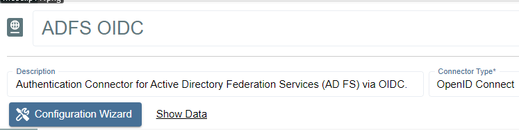

3. Click **Configuration Wizard**.

4. On the wizard's **Configure Client** page, enter the following values:

   - **Issue URI:** `https://<adfs-server>.domain.com/adfs`
   - **Client Id:** The Client ID noted in the previous steps for **AD FS**.
   - **Callback Address:** `https://<sbpam-server>:6500/callback`
   - **CORS:** `https://<sbpam-server>:6500`

   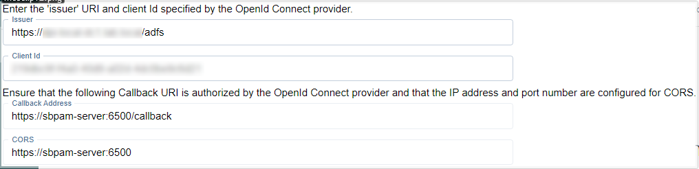

5. Click **Test Connection**. If brought to a log-in page, click **Back** in your web browser and then **Next** in the Privilege Secure wizard. If the page refreshes and brings you back to the Privilege Secure wizard, you should also click **Next** to proceed.

6. On the **Test Login** page, click **Login**. You are brought to an AD FS log-in page. Log in with Active Directory credentials, and you are brought back to the same page of the Privilege Secure wizard. Click **Next**.

7. Click **Get User Data**. Locate a mapping you would like to use when users sign in to Privilege Secure using AD FS, such as an email address or User Principal Name (UPN).

   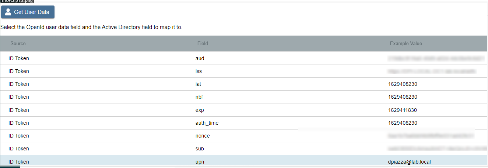

   Click the mapping, click **Select**, select the matching Active Directory mapping from the displayed dropdown, then click **Finish**.

   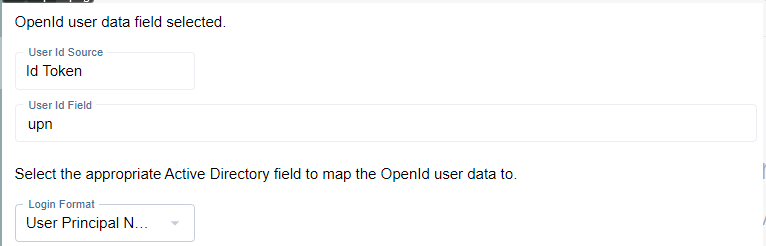

8. In the Privilege Secure **Users & Groups** menu, go to specific users and assign the AD FS OIDC authenticator.

   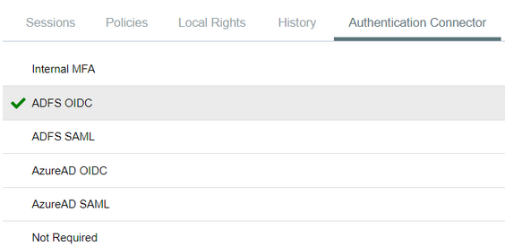

When using the OIDC log-in option, the user is redirected to log in to AD FS. Upon successful authentication, the user is redirected to the Privilege Secure UI as their now logged-in user.
