# Adding Active Directory Federation Services (AD FS) as an Authentication Connector (SAML)

## Overview

This article describes how to add Active Directory Federation Services (AD FS) to Netwrix Privilege Secure for Access Management as an Authentication Connector via SAML. This article covers two sections: *Steps for Active Directory Federation Services (AD FS)* and *Steps for Privilege Secure*. Complete the AD FS section first.

## Instructions

### Steps for Active Directory Federation Services (AD FS)

1. Launch **AD FS Management** on the AD FS server:

   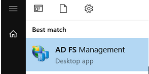

2. Right-click **Application Groups** and select **Add Application Group…**

   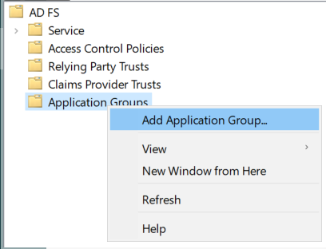

3. Select **Native application accessing a web API** and enter "SbPAM (SAML)" as the **Name**, then click **Next**.

   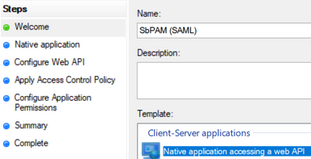

4. Copy the **Client Identifier** value; you need that value when configuring Privilege Secure.

   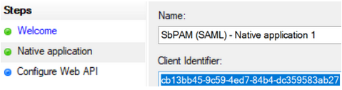

5. For the **Redirect URI**, use the following URI with the hostname of the Privilege Secure server customized to match your environment. For example: `https://<sbpam-server>:6500/samlSigninCallback`. Click **Add**, then **Next**.

   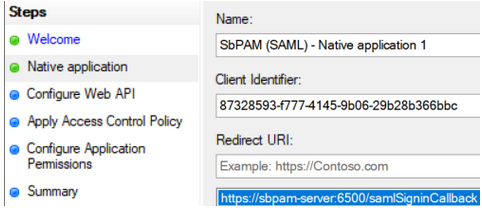

6. For the **Identifier** of the Web API, enter `sbpamsaml.stealthbits.com`, click **Add**, then click **Next**.

   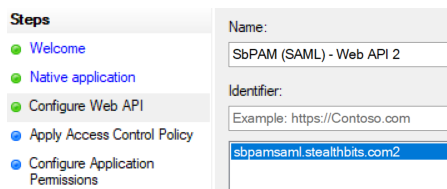

7. For **Apply Access Control Policy**, leave all defaults and then click **Next**.

   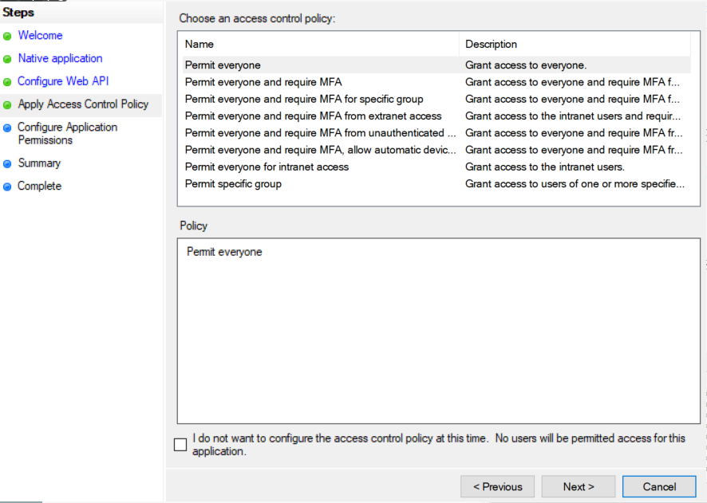

8. For **Configure Application Permissions**, enable the following and then click **Next**:
   - `allatclaims`
   - `email`
   - `openid`
   - `profile`

   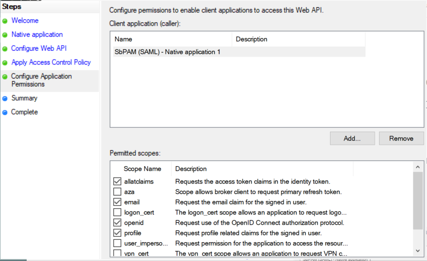

9. Click **Next** on the remaining pages until the wizard completes.

10. In the left sidebar of **AD FS**, click the **Relying Party Trusts** folder. In the right sidebar, click **Add Relying Party Trust...**

    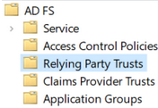

11. Select **Claims aware** and click **Next**.

    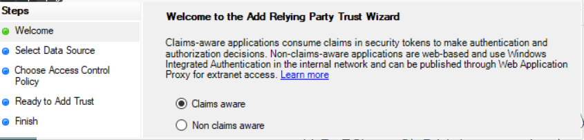

12. For **Select Data Source**, select **Enter data about the relying party manually** and click **Next**.

13. For **Specify Display Name**, enter "SbPAM (SAML)" and click **Next**.

14. For **Configure Certificate**, leave the default values and click **Next**.

15. For **Configure URL**, check **Enable support for the SAML 2.0 WebSSO protocol** and enter your AD FS server's FQDN followed by `/adfs/ls`. For example: `https://adfs-server.domain.com/adfs/ls`. Click **Next**.

    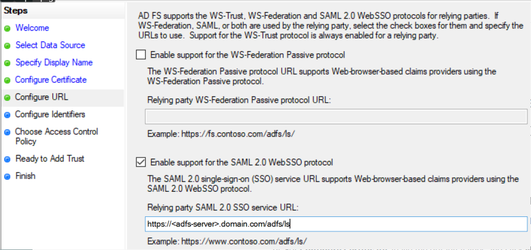

16. For **Configure Identifiers**, use the value `sbpamsaml.stealthbits.com`, click **Add**, then click **Next**.

    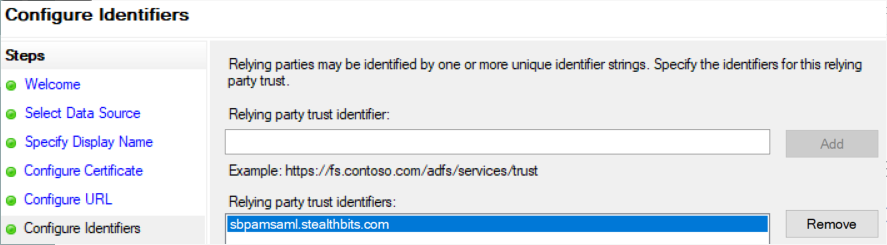

17. Leave **Choose Access Control Policy** as default values and click **Next**, then click **Next** through the remaining pages to finish the wizard.

18. When the wizard closes, a window for **Issuance Transform Rules** automatically opens. Click **Add Rule...**.

19. Select **Send LDAP Attributes as Claims**, and click **Next**.

    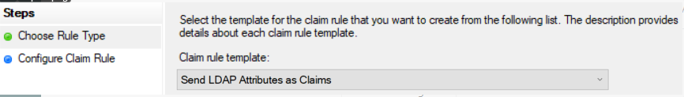

20. Name the rule "Send attributes", select "Active Directory" as the **Attribute store**, map the following **LDAP Attributes** to **Outgoing Claim Types**, click **Finish**, then click **Apply** and **OK**:
    - `SAM-Account-Name` → `Name`
    - `User-Principal-Name` → `UPN`
    - `E-Mail-Addresses` → `E-Mail Address`

    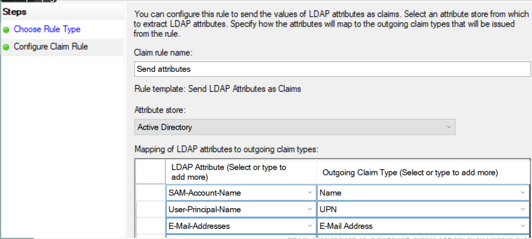

21. Double-click the **Relying Party Trust** created in the previous steps (named "SbPAM (SAML)"), and go to the **Endpoints** tab.

    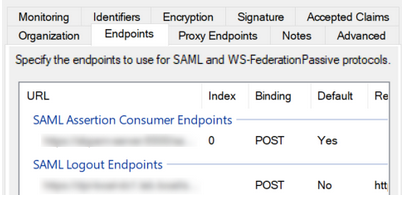

    Add the following endpoints (click **Add SAML...**):

    - Endpoint type: SAML Assertion Consumer
      - Binding: POST
      - Index: 0
      - Trusted URL: `https://<sbpam-server>:6500/samlSigninCallback`

      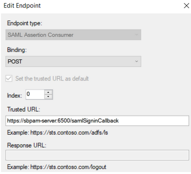

    - Endpoint type: SAML Logout
      - Binding: POST
      - Index: 0
      - Trusted URL: `https://<adfs-server>.domain.com/adfs/ls/?wa=wsignout1.0&wreply=https://<sbpam-server>:6500`
      - Response URL: `https://<sbpam-server>:6500/login`

      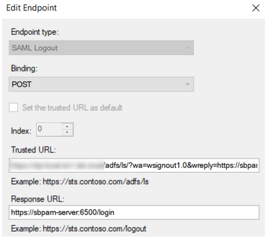

    Click **OK**, **Apply**, then **OK**. This completes the AD FS configuration portion of the guide.

### Steps for Privilege Secure

After completing the *Steps for Active Directory Federation Services (AD FS)*, take the following steps in Privilege Secure to add AD FS as an Authentication Connector via SAML.

1. As a Privilege Secure admin, go to **Configuration > Authentication** in Privilege Secure, and click the green **"+"** button to add a new Authentication Connector.

2. Give the new connector a name, description (optional), and a Connector Type of "SAML".

   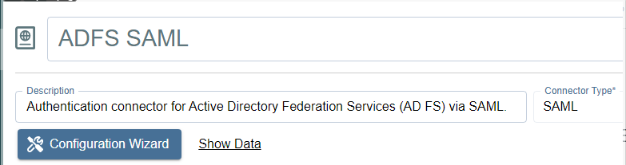

3. Click **Configuration Wizard**.

4. On the wizard's **Configure Client** page, enter the following values:
   - Signin URI: `https://<adfs-server>.domain.com/adfs/ls`
   - Callback Address: `https://<sbpam-server>:6500/samlSigninCallback`
   - CORS (Cross-Origin Resource Sharing): `https://<sbpam-server>:6500`

   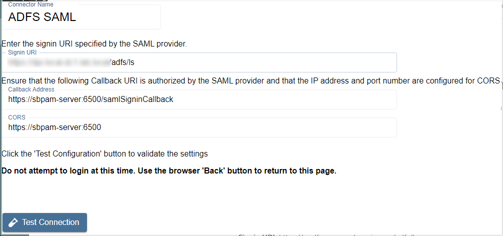

   Click **Test Connection**. If you are redirected to a log-in page, click **Back** in your web browser, then click **Next** in the Privilege Secure wizard. If the page refreshes and brings you back to the Privilege Secure wizard, click **Next** to proceed.

5. Select "Unspecified" for the **Name ID Policy**, and add a certificate if required. Then, click **Login** and sign in to AD FS using Active Directory credentials.

   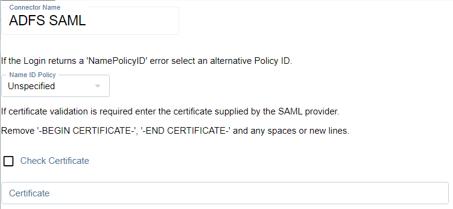

   When AD FS redirects you back to this page after signing in, if the message reads "Login was successful", click **Next**.

6. Locate a mapping you want to use when users sign in to Privilege Secure using AD FS, such as an email address or UPN.

   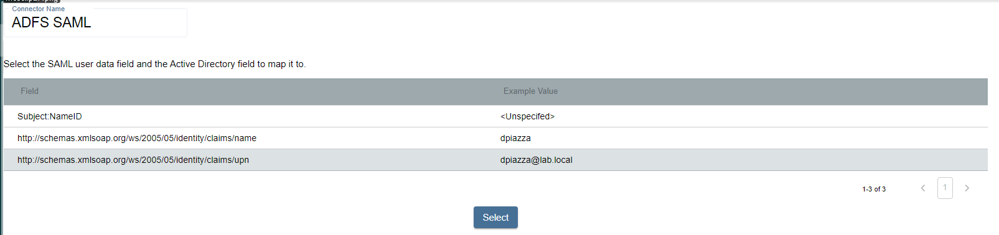

   Click the mapping, click **Select**, select the matching Active Directory mapping from the displayed dropdown, then click **Next**.

   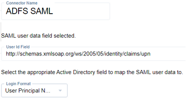

7. For the **Signout URI** and **Signout Callback URI**, use the following values:
   - Signout URI: `https://<adfs-server>.domain.com/adfs/ls/?wa=wsignout1.0&wreply=`
   - Signout Callback URI: `https://<sbpam-server>:6500`

   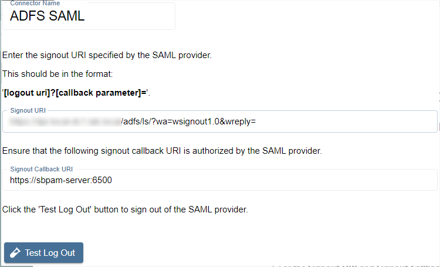

   Click **Test Log Out**, then **Finish** to complete the wizard. Privilege Secure now uses AD FS (via SAML) as an Authentication Connector.

8. In the **Users & Groups** menu in Privilege Secure, go to specific users and assign the AD FS SAML authenticator.

   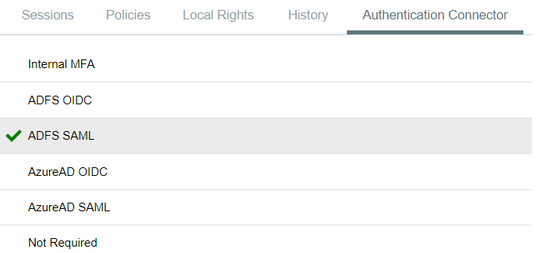

When using the SAML log-in option, the user signs in to AD FS. Upon successful authentication, Privilege Secure redirects the user to the UI as their signed-in account.
