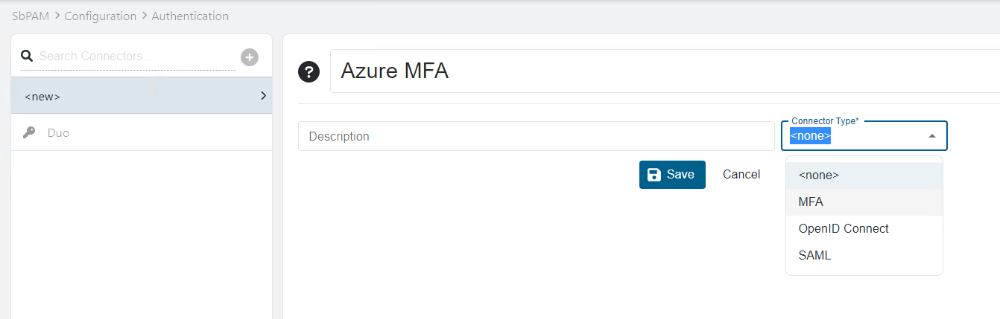
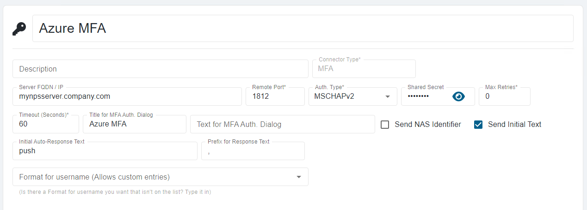

# Configuring a Custom RADIUS Authentication Connector

## Overview

This article describes how to configure an Authentication Connector for any RADIUS server in Netwrix Privilege Secure for Access Management.

> **NOTE:** The screenshots in this article show how to configure an Authentication Connector for Azure MFA, but the same process generally applies.

## Instructions

### Before You Begin

Ensure that you have a RADIUS server installed and configured in your environment. For Azure MFA, see the relevant Microsoft documentation on configuring the NPS extension: https://docs.microsoft.com/en-us/azure/active-directory/authentication/howto-mfa-nps-extension. In general, see the appropriate product-specific documentation for your RADIUS server.

### Configure the Connector

1. In Privilege Secure, go to **Configuration > Authentication**. Select the **green plus sign** to create a new Authentication Connector.
2. Provide a name for the Connector and select the **MFA** Connector Type.

   

3. Click **Save**, and then configure the connector with the appropriate values for your RADIUS server.

   

4. Open the **appsettings.json** file. On a default installation, the file is in the following path:

   ```
   C:\ProgramData\Stealthbits\PAM\WebService\appsettings.json
   ```

5. Add the following line before the **closing }**.

   ```json
   "StrictExternalAuth": "False"
   ```

   > **NOTE:** If there are other properties before the **closing }**, ensure that they are all separated by a single comma.

6. You can now assign the new RADIUS authentication connector to users and groups in Privilege Secure.
