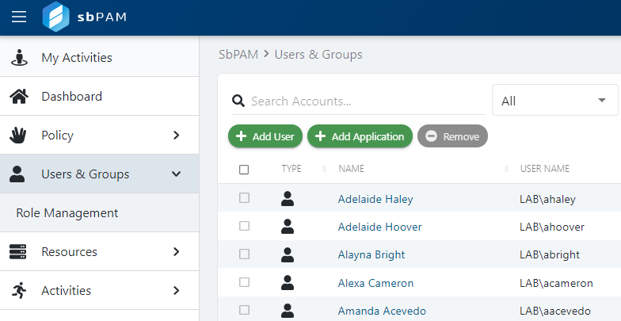
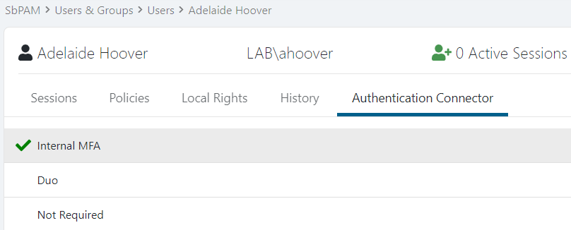

# Disabling MFA for Users or Groups

## Overview

This article describes how to disable Multi-factor Authentication (MFA) for individual users or groups of users in Netwrix Privilege Secure for Access Management.

> **IMPORTANT:** Disabling MFA is not recommended per security best practices.

## Instructions

1. Log in to Privilege Secure as an Administrator, then go to **Users & Groups** in the sidebar navigation.

   

2. Click a user or a group, then go to that principal's **Authentication Connector** tab.

   

3. Click **Not Required**. The MFA requirement is immediately disabled for the user or for all users that are members of the group.
