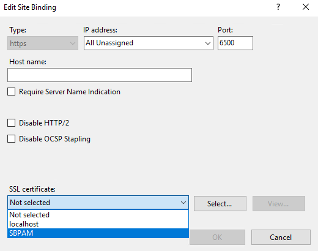
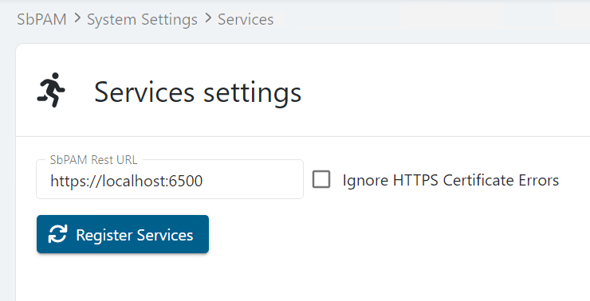

# Installing an IIS Certificate

## Overview

This article describes how to install a valid certificate on the Netwrix Privilege Secure for Access Management Internet Information Services (IIS) website.

## Instructions

### Requirements

- The certificate should be for Client and Server Authentication and be from a trusted Certificate Authority (CA).
- The certificate must be in the Trusted Root on the Privilege Secure server (with the private key), and in the Trusted Root on all clients accessing the Privilege Secure website (without the private key).
- For High Availability (HA) deployments the certificate should have both server fully qualified domain names (FQDNs) in either Common Name (CN) or Subject Alternative Name (SAN) fields.

### Updating the IIS Bindings

After receiving the certificate from a CA, update the bindings for the Privilege Secure website in **Internet Information Services (IIS) Manager** on the Privilege Secure server.

1. Open the **IIS Manager** on the Privilege Secure server.
2. In the left sidebar, go to the **Netwrix Privilege Secure Web Service** website, right-click, and click **Edit Bindings...**

   

3. Double-click **https**.
4. Select the **SSL certificate** for the DNS hostname of your Privilege Secure server (the DNS name used as the SAN in the certificate).

   

After making these changes, restart the Privilege Secure website by running the `iisreset` command in an elevated Command Prompt.

### Updating Service Configuration Files (Privilege Secure 3.6 or Later)

The Privilege Secure service configuration files must be updated to use the same DNS name as the certificate. You can trigger these updates from the Privilege Secure UI.

1. Go to the **System Settings** menu, and then the **Services** node.

   

2. Enter the FQDN that matches the name of your certificate (for example, `https://yourcert.company.com:6500`). Leave **Ignore HTTPS Certificate Errors** unchecked.
3. Click the **Register Services** button. A "Services registered" pop-up appears when the necessary changes have been made.

### Updating Service Configuration Files (Privilege Secure 3.5 or Earlier)

The Privilege Secure service configuration files must be updated to use the same DNS name as the certificate.

1. Edit the following files:

   ```
   C:\ProgramData\Stealthbits\PAM\ActionService\appsettings.user.json
   C:\ProgramData\Stealthbits\PAM\EmailService\appsettings.user.json
   C:\ProgramData\Stealthbits\PAM\ProxyService\appsettings.user.json
   C:\ProgramData\Stealthbits\PAM\SchedulerService\appsettings.user.json
   C:\ProgramData\Stealthbits\PAM\SIEMService\appsettings.user.json
   ```

2. In each file, locate the `Url` key and change its value so it matches the DNS name used in the certificate. In the following example, change `localhost` to match that DNS name (leaving the port specification unchanged):

   ```json
   "Url":"https://localhost:6500"
   ```

3. After updating each config file, verify the Privilege Secure services are running properly by going to the **Service Nodes** page in the Privilege Secure Web UI. The services should be all green:

   

4. If any services are red, register the services: select your **username** in the top right of the Privilege Secure UI, click **Settings**, then click **Register Services**.
