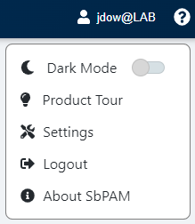
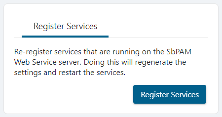

# Renewing the JWT Signing Certificate

## Overview

This article describes how to regenerate the JSON Web Token (JWT) signing certificate for Netwrix Privilege Secure for Access Management. Complete these steps only if instructed by Netwrix Support.

## Instructions

> **IMPORTANT:** While many of these steps use drive letter `C:` in the path, this differs for Program Files paths if Privilege Secure was installed to a different drive letter. All references to `C:\ProgramData\Stealthbits\PAM` use drive letter `C:` in all environments.

1. Stop all Privilege Secure and IIS services by running the following in an elevated PowerShell window:

    ```powershell
    Stop-Service sbpam* -Force
    Stop-Service w3svc -Force
    ```

2. In Windows Explorer, go to the Program Data directory for Privilege Secure (for example, `C:\ProgramData\Stealthbits\PAM\`). From here, open the **WebService** folder, and then open `appsettings.jwt.json` in Notepad. In `appsettings.jwt.json`, locate the `"Jwt"` section (such as the following example) and delete all of it. This is the trigger to generate a new JWT signing certificate:

    ```json
    "Jwt": {
        "CertificateFile":  "C:\ProgramData\Stealthbits\PAM\Web\jwtsign.pfx",
        "CertificatePassword":  "...",
        "CertificateThumbprint":  "...",
        "Encryptionkey":  "..."
    },
    ```

3. Go to `C:\ProgramData\Stealthbits\PAM\Web` and delete the `jwtsign.pfx` file.

4. Go back up one level to the PAM folder, and then to the Webservice folder. Open `appsettings.log.json` in Notepad and repeat step 2 if it also has a `"jwt"` section.

5. Run the following commands in an elevated PowerShell window (changing the path to the PAM folder depending on the install path):

    ```powershell
    cd C:\Program Files\Stealthbits\PAM\KeyGen
    & .\SbPAM.KeyGen.Exe
    ```

6. Open `appsettings.jwt.json` again from step 2, and verify the `"Jwt"` section has been recreated.

7. Start all Privilege Secure and IIS services by running the following in an elevated PowerShell window:

    ```powershell
    Start-Service sbpam*
    Start-Service w3svc
    ```

8. Log in to the Privilege Secure web application as an Admin, and re-register services. Click the logged-in user's name in the upper-right, click **Settings**, and then click **Register Services**.

    

    
