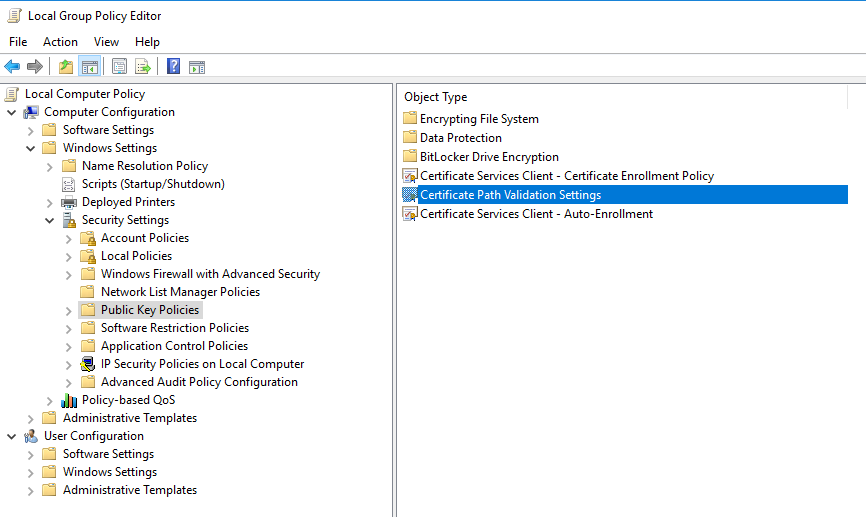
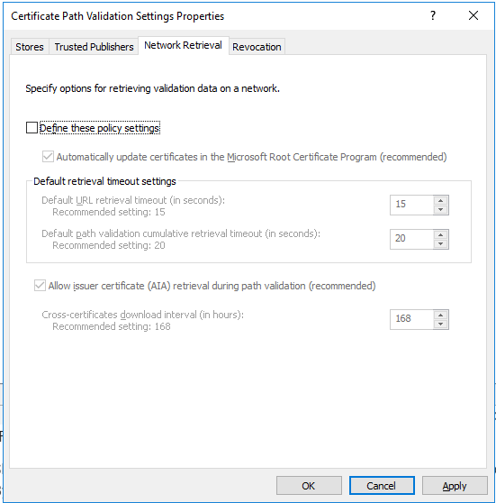
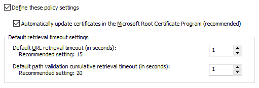

# Speeding Up CRL Checks on Netwrix Privilege Secure Servers without Internet Connectivity

## Overview

This article describes how to reduce the Windows timeout setting that governs certificate revocation list (CRL) checks, using Group Policy.

If Netwrix Privilege Secure for Access Management, or a Privilege Secure proxy service, is installed on a server without internet connectivity, the proxy may be unable to initiate SSL handshakes. The following error message when you register a proxy service indicates this problem:

```text
TLS Authentication error One or more errors occurred. (Unable to read data from the transport connection: An established connection was aborted by the software in your host machine.)
```

You can resolve this issue by reducing the timeout setting in Windows that governs CRL checks. Because these CRL checks require internet access, set the timeout to the minimum possible value when internet connectivity is not present.

## Instructions

This timeout setting is governed by a Group Policy. Complete the following steps to configure it:

1. Open Group Policy Editor: `gpedit.msc`
2. Go to `Computer Configuration > Windows Settings > Security Settings > Public Key Policies`

   

3. Double-click **Certificate Path Validation Settings** and go to the **Network Retrieval** tab.

   

4. Check the **Define these policy settings** box, and reduce both **Default retrieval timeout settings** to `1`.

   

5. Click **Apply** to save the configuration.
