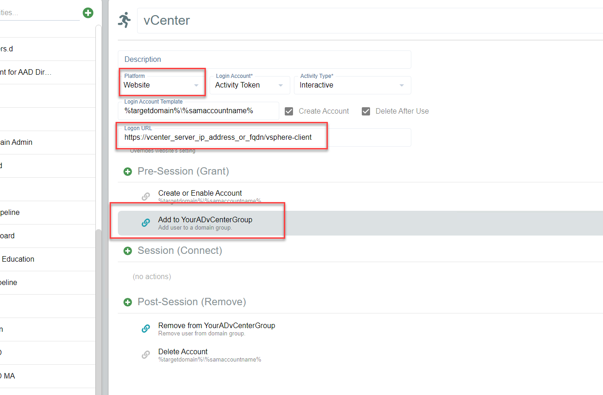
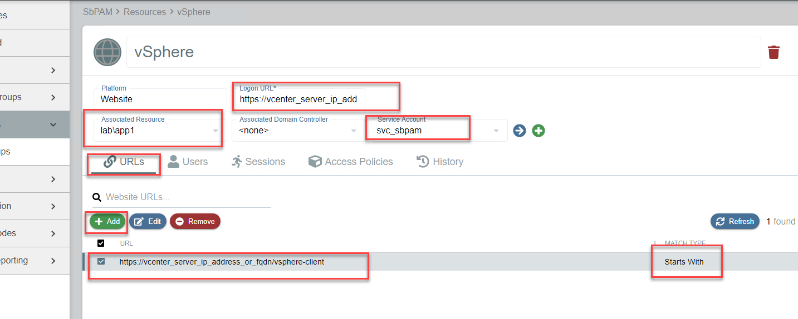
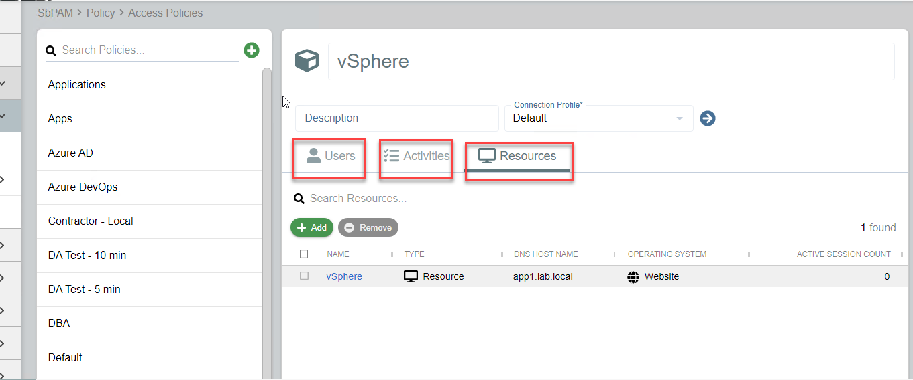

# Adding a VMware vCenter Website to Browser Extension

## Overview

This article describes how to add a VMware vCenter web application (website) to the Netwrix Privilege Secure for Access Management Browser Extension for quick and easy session provisioning.

## Instructions

1. **Create a VMware vCenter website Activity**. Enter the URL normally used to log in to vCenter and any Active Directory (AD) group that gives the account permission to log in.

   > **NOTE:** This example is for an **Activity Token**. **Managed Account** and **Requester** workflows are also supported.

   

2. **Create a Website Resource**. Enter the URL for vCenter and, if possible, choose a resource that is in the same AD domain as the vSphere host. This ensures that when an account is created and group permissions are granted to it, this happens on a Domain Controller (DC) close to where vSphere would normally authenticate to. This prevents needing to wait for permissions to replicate when logging in to vSphere.

   

3. **Create an Access Policy** that links a user to the vSphere Activity and the Website Resource. There should now be a vSphere activity in the Privilege Secure Browser Extension, with the ability to select it to create a session (click once) and then launch vSphere (click again).

   
