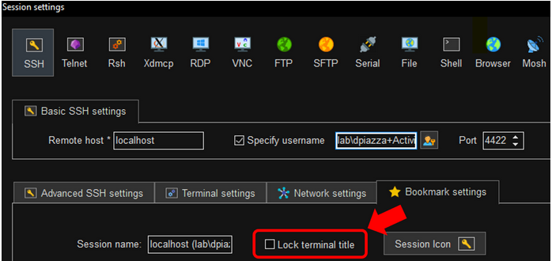
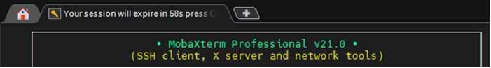

# Enabling Session Extension Countdown Tab Display for Netwrix Privilege Secure SSH Sessions in MobaXTerm

## Overview

This article describes how to display the Netwrix Privilege Secure for Access Management SSH Session Extension countdown in the MobaXTerm tab bar. The countdown does not display unless the **"Lock terminal title"** setting is disabled in the MobaXTerm session’s **Bookmark Settings**.

## Instructions

Disable the SSH session’s **"Lock terminal title"** setting in the session’s **Bookmark Settings** within MobaXTerm, as shown in the following screenshot.

1. In MobaXTerm, right-click the session in the **Sessions** sidebar.
2. Click **Edit Settings**.
3. Go to **Bookmark Settings**.
4. Disable the **"Lock terminal title"** setting.

   

If configured correctly, the session tab displays session expiration countdown messages per the settings in the Privilege Secure Connection Profile assigned to the Access Profile granting the user the right to use the SSH Activity.

