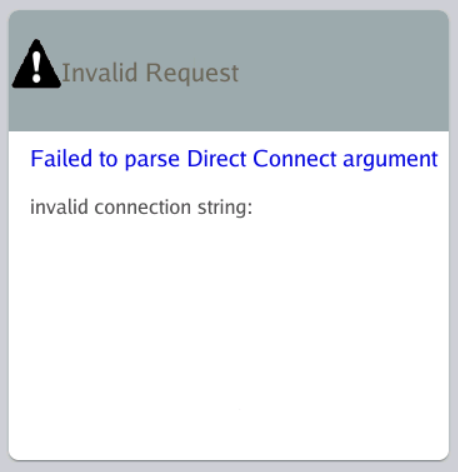
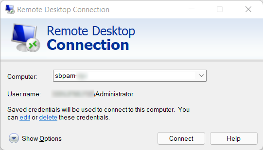

# Resolving "Invalid Connection String" for DirectConnect in mRemoteNG

## Symptom

In a specific scenario, valid Netwrix Privilege Secure for Access Management `DirectConnect` strings used in mRemoteNG result in an invalid connection string error, stating the connection string is empty.

## Cause

This error is caused by having credentials saved for the Privilege Secure server (for example, the Privilege Secure Proxy Server) in the Windows built-in Remote Desktop Protocol (RDP) client, **Remote Desktop Connection**, on the same host that is running mRemoteNG.

## Resolution

To resolve the issue, choose one of the following two options:

- Delete the credential saved in **Remote Desktop Connection**. After you delete that credential, the valid `DirectConnect` string works as expected in mRemoteNG.
- Fill in a password for each `DirectConnect` connection saved in mRemoteNG. This resolves the issue without deleting any credentials from **Remote Desktop Connection**.
