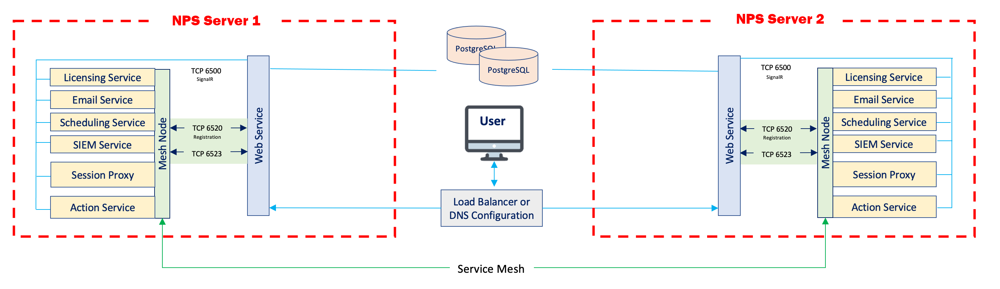

# Configuring a Multi-Server NPS Environment with a Shared Database Server

## Overview

This article describes how to set up a deployment with multiple Netwrix Privilege Secure for Access Management servers communicating with a single Postgres server. Instructions are included for configuring TLS for all network traffic to the Postgres server. Optional migration steps are included for users who want to use a Postgres database from an existing Privilege Secure deployment.

This diagram illustrates the target network architecture.



## Instructions

### Configuring the Postgres Server

1. On the Postgres server, open the `NPS_Setup.exe` installer, and install Postgres 12. Next, use the `NPS_Setup.exe` installer to install Privilege Secure. (This is necessary for the Postgres database to be properly configured. There is no need to launch Privilege Secure on the Postgres server at any point in this process, and the Postgres database can be entirely administered from the remote Privilege Secure servers.)
2. (Recommended) Now that the Postgres database is properly configured, you can uninstall Privilege Secure on the Postgres server. This conserves disk space and computing resources.
3. Open the `sbpam_node.json` file. On a default installation to the C: drive, the file is located here:

   ```text
   C:\ProgramData\Stealthbits\PAM\ProxyService\sbpam_node.json
   ```

4. Ensure that both `localhost` and the FQDN of your Postgres server are populated under `advertise`:

   ```json
   {
   		"advertise": ["testlab-pg01.sbpamtestlab.com", "localhost"],
   		"tags": []
   }
   ```

5. Go to the TLS certificate directory. On a default installation to the C: drive, the directory is located here:

   ```text
   C:\ProgramData\Stealthbits\PAM\tls\certs\
   ```

6. Copy the `\ProgramData\Stealthbits\PAM\tls\certs\sbpam-node.crt` and `\ProgramData\Stealthbits\PAM\tls\keys\sbpam-node.pem` files into the root of the Postgres data directory. On a default installation to the C: drive, the Postgres data directory is located here:

   ```text
   C:\ProgramData\Stealthbits\Postgres12
   ```

   (If you want to copy the `.crt` and `.pem` files to a subdirectory of the data directory, you must specify their relative subpaths later in these instructions, when configuring the `postgresql.conf` file.)

7. Open the **Certificate Manager**. Import the `\ProgramData\Stealthbits\PAM\tls\cacerts\sbpam-region.crt` certificate into the **Trusted Root**.
8. Open the `pg_hba.conf` file. On a default installation to the C: drive, the file is located here:

   ```text
   C:\ProgramData\Stealthbits\Postgres12\pg_hba.conf
   ```

   Edit the file to contain one or more entries that allow connections from your Privilege Secure application servers. For instance, to allow all IP addresses in the `10.2.0.x` range, add an entry ending in `/24`:

   ```text
   host  all  all  10.2.0.0/24  md5
   ```

   Or, for granular access on a per-IP basis, add a line for each IP address ending in `/32`:

   ```text
   host  all  all  10.2.0.1/32  md5
   host  all  all  10.2.0.2/32  md5
   ```

9. Open the `pg_hba.conf` file. On a default installation to the C: drive, the file is located here:

   ```text
   C:\ProgramData\Stealthbits\Postgres12\postgresql.conf
   ```

10. Under `# - SSL -`, edit the SSL settings as follows:

    ```text
    # - SSL -

    ssl = on
    #ssl_ca_file = ''
    ssl_cert_file = 'sbpam-node.crt'
    #ssl_crl_file = ''
    ssl_key_file = 'sbpam-node.pem'
    ```

11. Restart the Postgres service. Your Postgres server should now be ready to accept TLS-encrypted traffic.

### Configuring the NPS Servers

1. On each Privilege Secure server, open the `SB_Setup.exe` installer, and install Postgres 12. Next, use the `SB_Setup.exe` installer to install Privilege Secure.
2. After Privilege Secure is installed, open the `appsettings.json` file. On a default installation to the C: drive, the file is located here:

   ```text
   C:\Program Files\Stealthbits\PAM\Web
   ```

   Edit this file so that the `Database` key references the hostname of the Postgres server:

   ```json
   "Database": {
   	"Host": "testlab-pg01.sbpamtestlab.com",
   	"Port": 5432
   	}
   ```

3. Obtain a copy of the `\ProgramData\Stealthbits\PAM\tls\cacerts\sbpam-region.crt` certificate from the Postgres server. Open the **Certificate Manager**. Import the `sbpam-region.crt` certificate into the **Trusted Root** of the local machine.

You should now be able to access the Privilege Secure console at `https://[yourNPSServerIP]:6500`, and all traffic should be TLS encrypted.

> **NOTE:** If you receive an IIS certificate warning from your browser, install an IIS certificate using [Installing an IIS Certificate](https://docs.netwrix.com/docs/kb/privilegesecure/installing-an-iis-certificate)

### Key Export/Import

To ensure that encryption keys are in agreement between Privilege Secure servers, follow the instructions outlined in [Configuring Encryption Keys in Multiple NPS Server Environments](/docs/kb/privilegesecure/high-availability-and-clustering/how-to-configure-encryption-keys-in-multiple-nps-server-environments.md).
