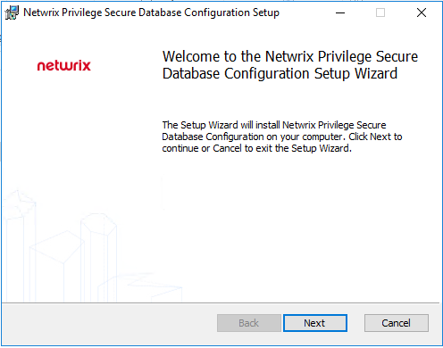
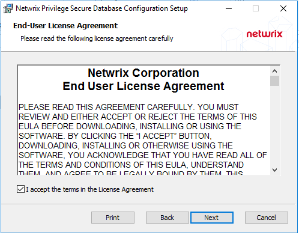
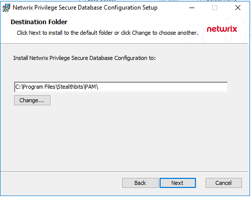
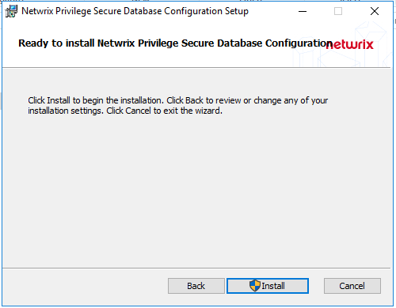
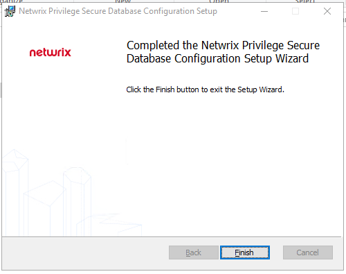
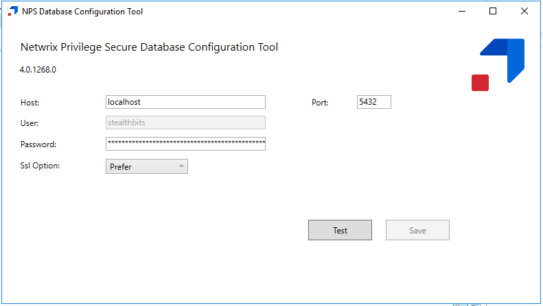
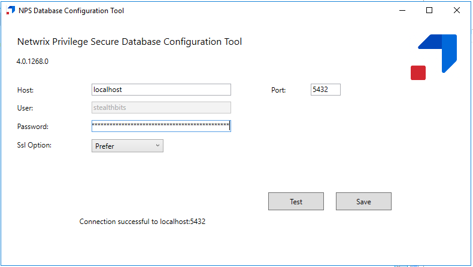
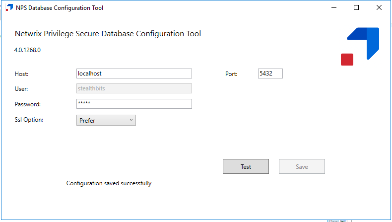

# Using the Database Configuration Tool to Change the Postgres DB Password

## Overview

This article describes how to use the Database Configuration tool (`DbCfg.msi`) to change the privileged Postgres service account password used by Netwrix Privilege Secure for Access Management. While it is essential that remote access to the Privilege Secure server be locked down, as an additional layer of security, you may want to further harden your server by periodically changing the password to the Privilege Secure Postgres database.

**_The changed password should be securely vaulted, and local Administrator access to the DbCfg tool should be tightly controlled._**

## Instructions

1. On the Privilege Secure server, go to the "Extras" folder in the Privilege Secure installer download directory. The Database Configuration tool installer (`DbCfg.msi`) is included in this directory. Launch the installer, and select **Next**.
   

2. Review and accept the end user license agreement (EULA). Select **Next**.
   

3. Choose an installation path. The default installation path is `C:\Program Files\Stealthbits\PAM\`. Select **Next**.
   

4. Select **Install**, and confirm any UAC prompt that occurs. The installation completes shortly.
   
   

5. Go to the installation directory and launch `DbCfg.exe` from your chosen installation directory.
   

6. You can select **Test** to confirm your connection to the Postgres DB.
   

7. Set a new password in the Password field and select **Save** to change the Postgres password. If your Test connection from step 6 was successful, you should receive a "Configuration saved successfully" response, which indicates a successful password change. This change propagates to any Privilege Secure service that needs to use the database password.
   
