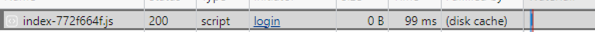

# Adding Cache Settings for JavaScript Files to Improve NPS Page Load Performance

## Overview

This article describes how to create an IIS configuration setting that updates the `Cache-Control` header for all JavaScript files that are downloaded from the Netwrix Privilege Secure for Access Management web service. This setting improves the performance of the website and lowers the burden on the webservice.

The main ReactJS bundle for the Privilege Secure website is 6.5MB. This is sent with the HTTP header `Cache-Control: no-cache, no-store`. This causes SAML Logins to sometimes fail, as downloading the ReactJS module during each login can cause the SAML token cache to expire.

## Instructions

1. On all Privilege Secure servers, download and install the Url Rewrite module.

   https://www.iis.net/downloads/microsoft/url-rewrite

2. Go to your Privilege Secure Web directory (by default, `C:\Program Files\Stealthbits\PAM\Web\)` and make a copy of the `web.config` file.

3. Open the file `C:\Program Files\Stealthbits\PAM\Web\web.config` in a text editor. Find this line:

   `<system.webServer>`

4. Add the following XML after that line:

   ```xml
   <rewrite>
     <outboundRules>
       <rule name="Set cache for JS">
         <match serverVariable="RESPONSE_Cache_Control" pattern=".*" />
         <conditions>
           <add input="{REQUEST_URI}" pattern="\.js$" />
         </conditions>
         <action type="Rewrite" value="max-age=604800"/>
       </rule>
     </outboundRules>
   </rewrite>
   ```

5. Save the file.

6. Launch a PowerShell window and restart IIS using the command:

   ```
   iisreset
   ```

7. To verify the file is now cached, open Chrome or Edge and then open the developer tools.

8. Open your Privilege Secure web page and look at the `Network` tab in the developer tools window.

9. See the page download:

   

10. Reload the page, see it is loaded from the cache:

    

11. Copy the updated `web.config` to `C:\Program Files\Stealthbits\PAM\Web\web.config.rewrite`; you need this copy for future upgrades.

### Restoring the Cache Settings After an Upgrade

After an upgrade of Privilege Secure, copy the `C:\Program Files\Stealthbits\PAM\Web\web.config.rewrite` file to `C:\Program Files\Stealthbits\PAM\Web\web.config` to restore the cache settings.
