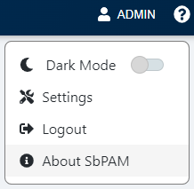
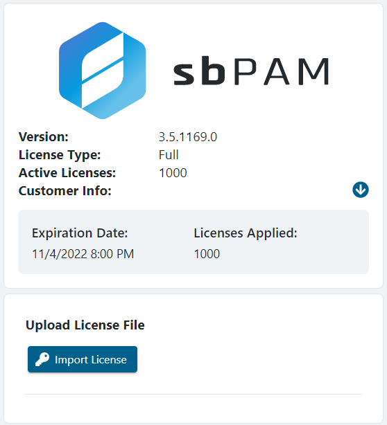

# Applying a New License

## Overview

This article describes how to apply a new license to the Netwrix Privilege Secure for Access Management server.

## Instructions

Privilege Secure comes with a 30-day trial license. After this trial expires, a new license key file must be imported.

1. Log in to the Privilege Secure web application as an account with the Administrator role.
   - In Privilege Secure 3.5 or earlier, you can use the built-in Admin account.

     > **IMPORTANT:** The `Domain` field must be set to `<none>` to log in with the built-in Admin account.

   - In Privilege Secure 3.7 or later, you can use a local user with the Administrator role.

2. Click your account name in the upper-right corner of the page, and then click **About SbPAM** to open the page to update the product's license.

   > **IMPORTANT:** If you need a new license key file, contact your Netwrix Account Manager.

   

3. Click **Import License**. A Windows file dialog opens. Go to the location of the new license key file, select it, and click **Open**. The license is imported, and the displayed license information is updated.

   

### Alternate Instructions (PowerShell)

1. Open a PowerShell window as an administrator.
2. Modify the following PowerShell script so that the second line contains the correct local path for your license file:

   ```powershell
   Add-Type -AssemblyName System.Web
   $licenseFilePath = "path to license file" ## Change to match the local path to the license file
   $license = Get-Content $licenseFilePath
   $encoded = [System.Web.HttpUtility]::UrlEncode($license)
   $sbpamURI = "http://localhost:6501"
   Invoke-RestMethod -Method POST -URI "$($sbpamURI)/api/v1/LicenseInfo?License=$encoded"
   ```

3. Copy and paste the modified script into PowerShell and execute it. Your license should now be imported into Privilege Secure.
