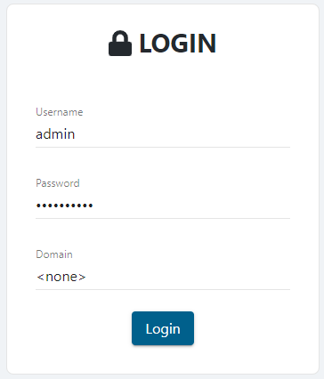
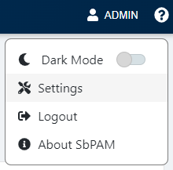
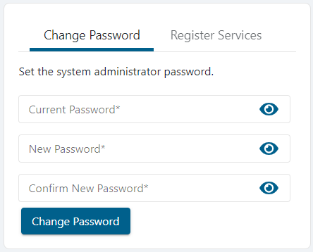

# Changing the Built-In Admin Password

## Overview

This article describes how to change the password of the built-in Admin account in Netwrix Privilege Secure for Access Management.

## Instructions

1. Sign in to Privilege Secure using the Admin account.

   

   > **IMPORTANT:** The `Domain` field must be set to `"<none>"` to log in with the built-in Admin account.

2. In the upper-right of the page, click **Admin** and then **Settings**.

   

3. Use the **Change Password** menu that appears on the page to set a new password for the built-in Admin account.

   

   If the password change is successful, you are immediately logged out of Privilege Secure and presented with the log-in page.

   > **IMPORTANT:** Previously used passwords cannot be used and result in an error when you attempt to change the password.
