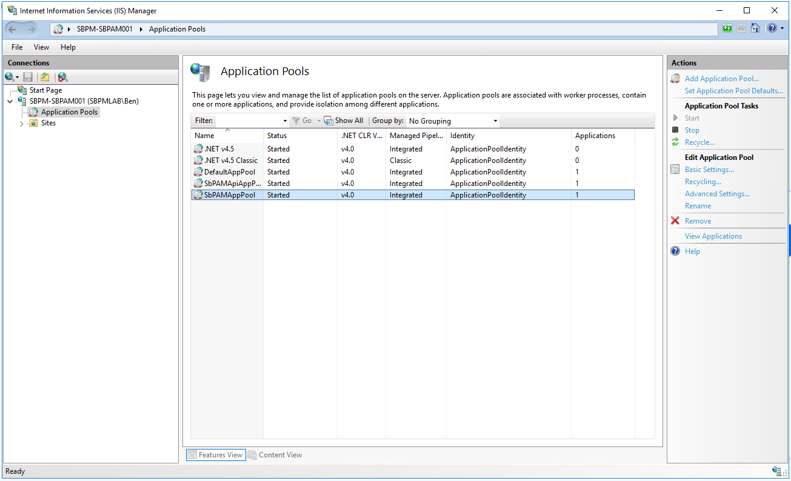
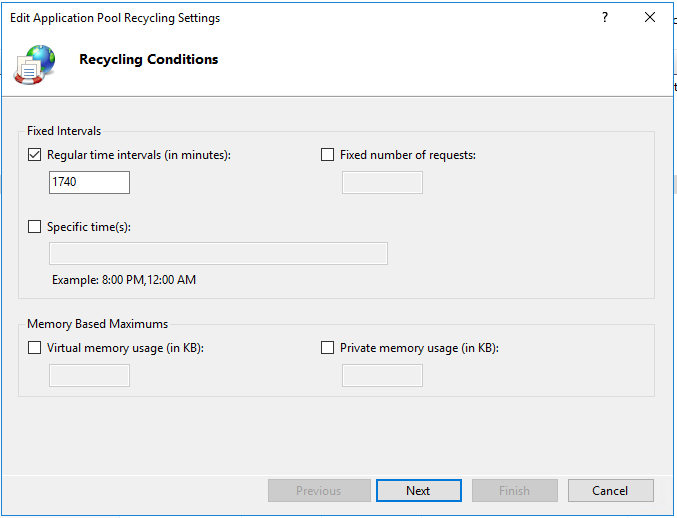
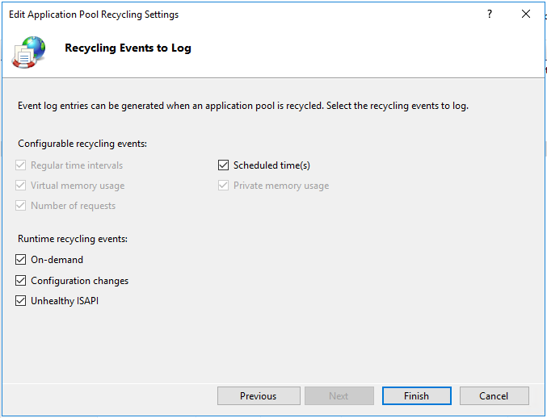

# Rescheduling IIS App Pool Recycling

## Overview

This article describes how to reschedule IIS app pool recycling for the Netwrix Privilege Secure for Access Management web service so that recycling occurs at specified times of off-peak usage.

Periodic app pool recycling is a necessary IIS process, and as such the Privilege Secure web service deploys with the default IIS app pool recycling settings (every 29 hours) enabled. In some Privilege Secure environments, especially those with periods of high peak usage, you might want to schedule IIS app pool recycling to occur at specified times of off-peak usage. This reduces the likelihood of recycling interacting with Privilege Secure services.

## Instructions

1. On the server hosting Privilege Secure, launch IIS Manager (`inetmgr.exe`).
2. In the left-hand menu, select **Application Pools**, and in the main window, select **SbPAMAppPool**.

   
3. In the right-hand menu, select **Recycling** to open the Recycling settings.

   
4. You can change the default value of `1740 minutes (29 hours)` to **Specific time(s)** to recycle the application pool less frequently, during off-peak hours, or both. Click **Next**.
5. Click **Finish** to save your new app pool recycling schedule.

   
