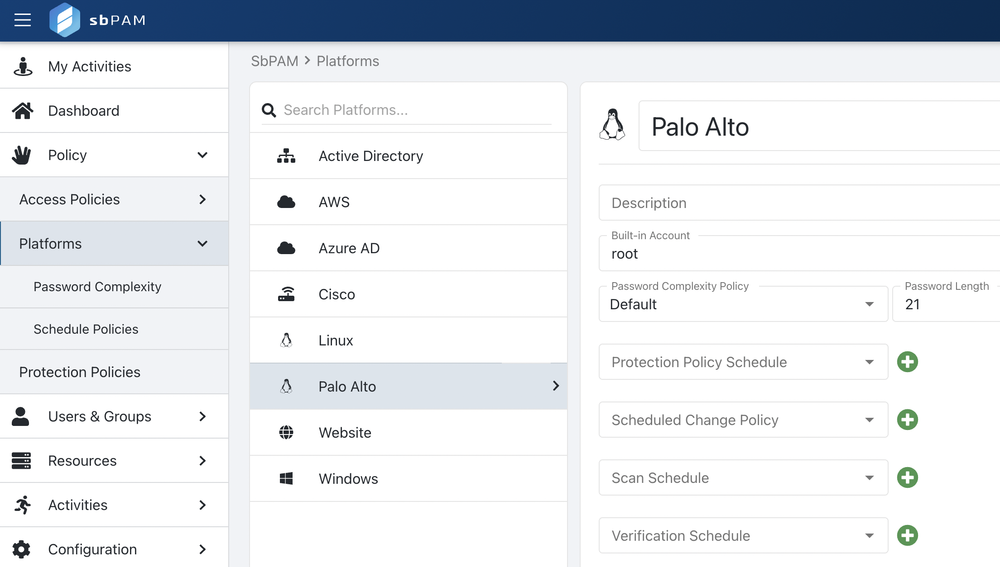
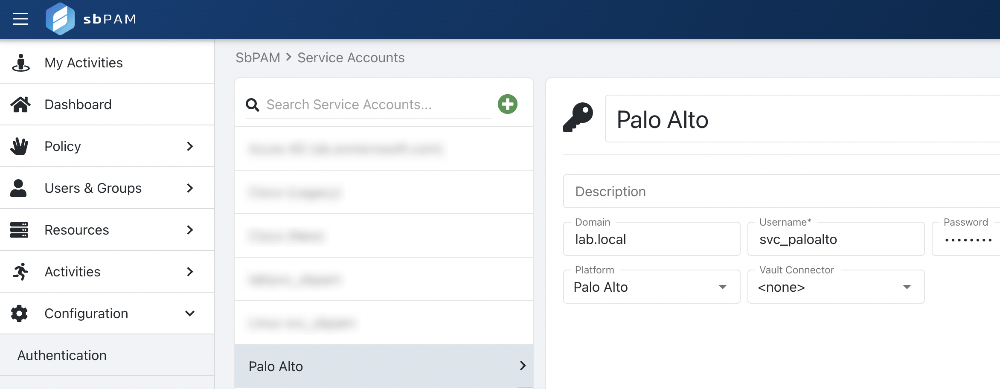
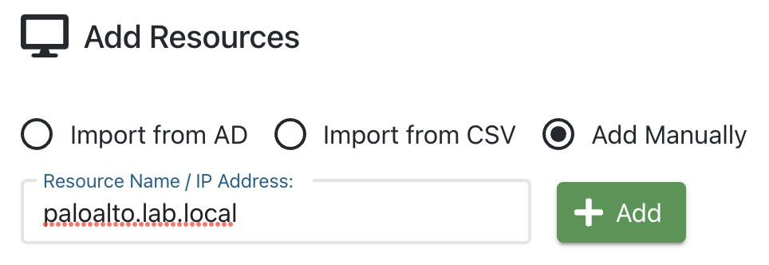
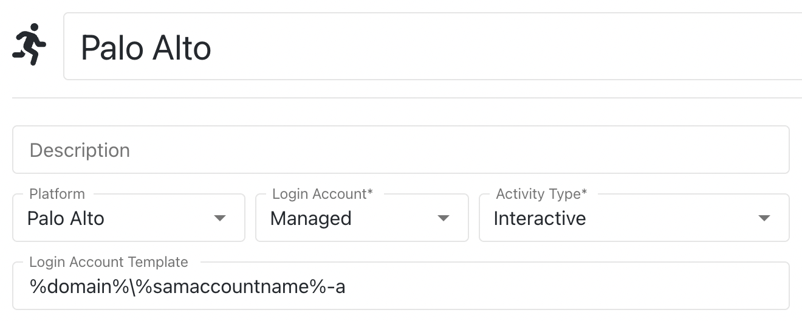

# Creating a Custom Platform for SSH Activity Sessio

## Overview

This article describes how to duplicate the built-in Linux Platform to create a Platform for Palo Alto (PAN-OS) in Netwrix Privilege Secure for Access Management. Platforms can be customized to meet specific SSH Activity Session workflow needs.

## Instructions

1. As a Privilege Secure admin user, go to the **Policy > Platforms** page. Locate the Linux Platform, duplicate it, and name it as desired. In this example, name the new Platform "Palo Alto".

   

2. Go to the **Configuration > Service Accounts** page and add a domain-level account as the Palo Alto service account.

   

3. Go to the **Resources** page and manually add the Palo Alto resource by IP or DNS name (using the service account added in step 2). In this step, it is expected for the Host Scan to fail. Close the Host Scan window and proceed to the next step.

   

4. Go to the **Activities** page and create a new Activity. For **Login Account**, you can use "Activity Token", "Managed Account", or "Requester". For the Login Account Template, remove the domain element (for example, ` %targetdomain%`) or use ` %domain%` instead of ` %targetdomain%`.

   

5. Go to the **Access Policy** page, create a new resource-based Access Policy that includes Privilege Secure users, the activity created in step 4, and the resource added in step 3.
6. Go to **My Activities** as a Privilege Secure user in the Access Policy, and launch an SSH Activity Session for the Palo Alto resource.
