# Onboarding Mac Devices for VNC via RDS (Remote Desktop Services)

## Overview

This article describes how to onboard macOS devices into Netwrix Privilege Secure for Access Management so that Virtual Network Computing (VNC) connections can be established by way of a Remote Desktop Services (RDS) server. The VNC session uses RealVNC and runs as a RemoteApp. The target resource is selected automatically, and the user enters credential information as part of the login process.

> **NOTE:** This article applies only to Privilege Secure 4.2 or higher, as it requires the `%token%` variable for the **Application to Launch** activity setting.

> **NOTE:** The `nps_realvnc` file used in these instructions must be obtained from [Netwrix Support](https://www.netwrix.com/support.html).

## Instructions

### Before You Begin

Ensure that VNC access to the target host works. [Apple's Remote Desktop documentation](https://support.apple.com/en-au/guide/remote-desktop/apdbed09830/mac) offers some general instructions.

### Step 1 — Creating the macOS Platform

1. In Privilege Secure, go to **Policy > Platforms**.
2. Select the **Windows** platform, and click the **Copy** icon.

   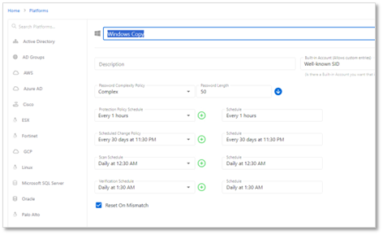

3. Change the name of the new platform to **macOS**. Ensure that the schedules are all set to `<none>`. Then click **Save**.

   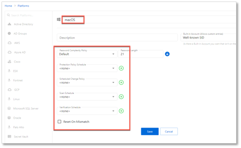

### Step 2 — Creating Service Accounts

1. On the **Configuration > Service Accounts** page, click the **+** icon and create a **macOS** service account.

   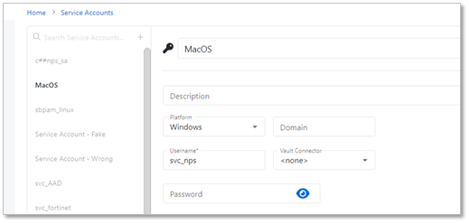

   > **NOTE:** The username and password do not matter. The macOS devices cannot be scanned, but a service account must be supplied to onboard the macOS resources.

### Step 3 — Onboarding macOS Resources

1. Go to **Resources**. Click the **Add** button, and click **New Server**. On the **Add Resources** page, click the **Import from CSV** radio button, and click the **Download CSV Template** button. This downloads a CSV template, which you can then populate with macOS resources, as in this example:

   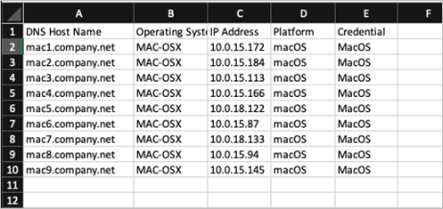

   > **NOTE:** It is crucial that the **Platform** exactly matches the Platform configured earlier, and that the **Credential** exactly matches the Service Account name configured earlier. The **Operating System** value is for informational purposes only, and is not matched to any other values.

2. Return to the **Add Resources** page in step 1 of this section. Click the **Import CSV** button and upload the CSV file that was just configured. The resources are displayed on the Add Resources page.

   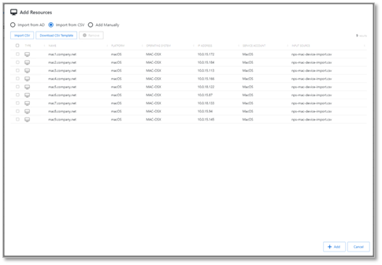

3. Select the resources you want to onboard (the **Select All** checkbox may be used) and click **Add**.
4. The dialog shows that a scan is **Pending** on all of the resources. This scan ends in an **Error**. This is expected, as Privilege Secure cannot scan macOS, and this error occurs during initial onboarding.

   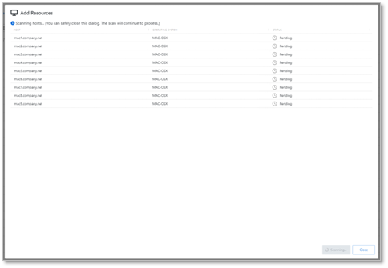

5. Go to the **Resources** page and confirm that the onboarded macOS resources are present.

   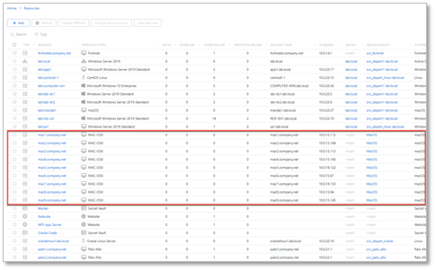

### Step 4 — Registering the nps_realvnc RemoteApp

1. Copy the `nps_realvnc.zip` file to the desktop of the RDS host where the RemoteApp is published. Copy the contents to a folder where they can be accessed, for example `C:\npslaunchers`.

   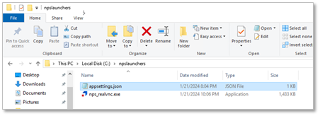

2. Edit the `appsettings.json` file and specify the address of each of your Privilege Secure App Servers.

   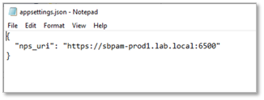

3. Open **Server Manager** on the RDS host where the RemoteApp is published and select the **Publish RemoteApp Programs** option as indicated.

   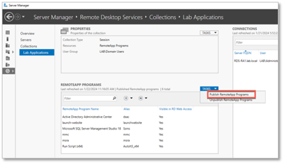

4. Select the indicated option to **Add a RemoteApp program**.

   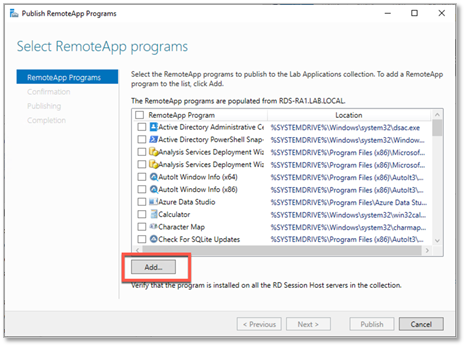

5. Go to the location where the `nps_realvnc` launcher was installed, and publish the RemoteApp.

   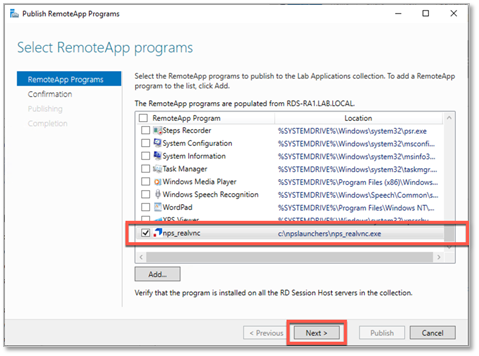

6. In Server Manager, right-click the published RemoteApp and select **Edit Properties**.

   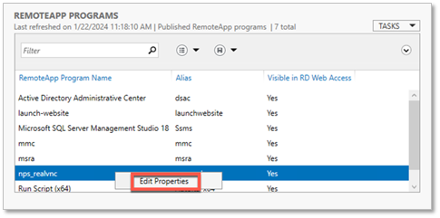

7. Select **Parameters** and choose **Allow any command-line parameters**. The RemoteApp is published.

   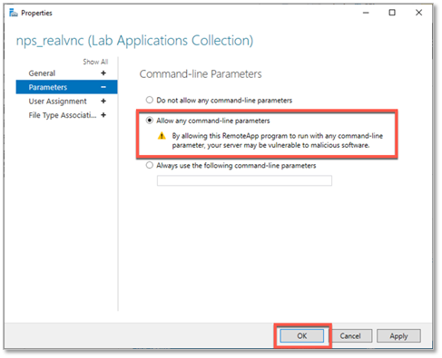

### Step 5 — Creating an Activity for VNC Access

1. Go to the **Activities** page and click the **+** icon to create a new Activity. The **Activity Type** of this activity must be set to **Interactive App Launch**, as this allows VNC sessions to be launched through the `realvnc.exe` launcher configured in RDS.
2. Ensure that the following values are configured:
   - **Activity Type** - Interactive App Launch
   - **Login Account Template** – the account used to connect to the RDS host, not the target macOS resource. Be sure to specify a domain, as `%targetdomain%` will not always work. (For example, `mydomain\managedaccountname`)
   - **Application to Launch** – Specify the same path and filename you used to publish the RemoteApp, and append the `%token%` and `%sessionid%` parameters. For example:

     ```
     C:\npslaunchers\nps_realvnc.exe %token% %sessionid%
     ```

3. If the preceding steps have been followed, your activity configuration should resemble the following:

   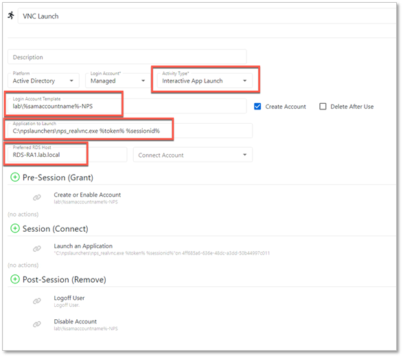

### Step 6 — Running the Activity

1. After your Activity is created and added to an access policy containing your onboarded macOS resources, you can provision a session as normal.

   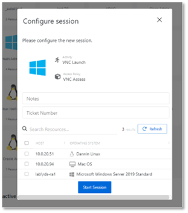

   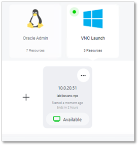

2. Depending on whether you have installed VNC Connect on the MAC device, you may get a warning similar to the following:

   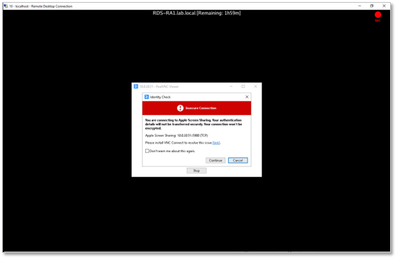

3. Enter your credentials when prompted.

   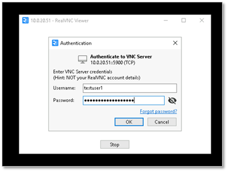

4. A VNC connection is established to the resource, and the session is recorded by the Privilege Secure proxy service.

   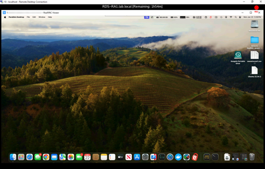
