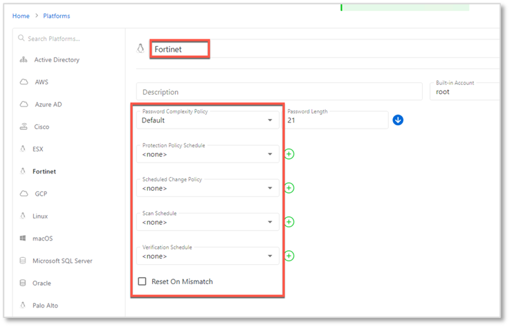
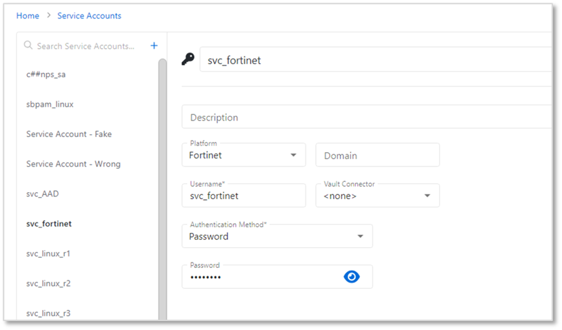
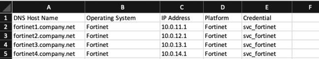
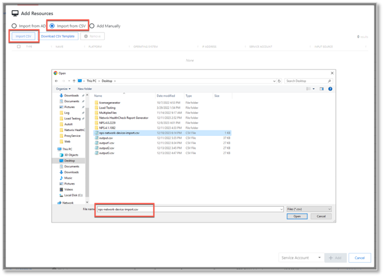
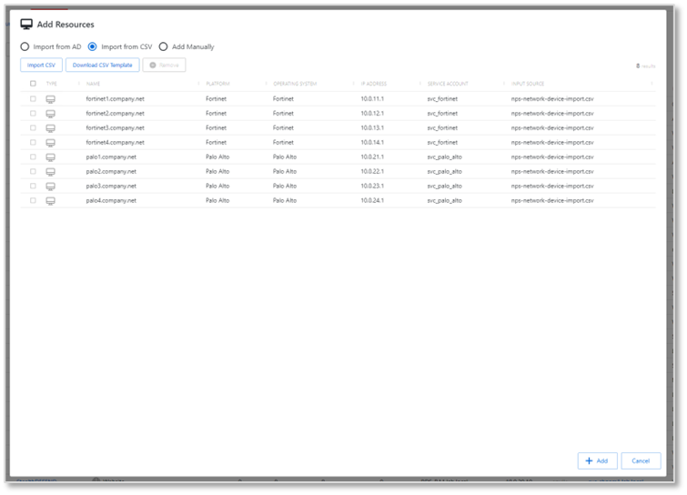
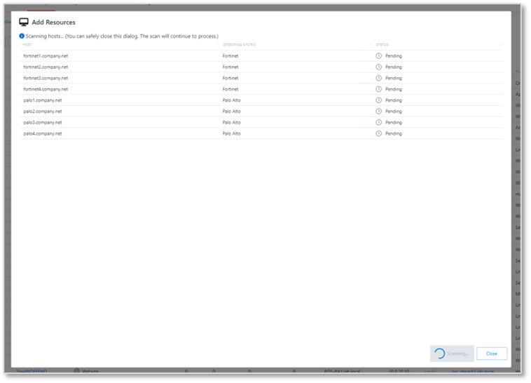
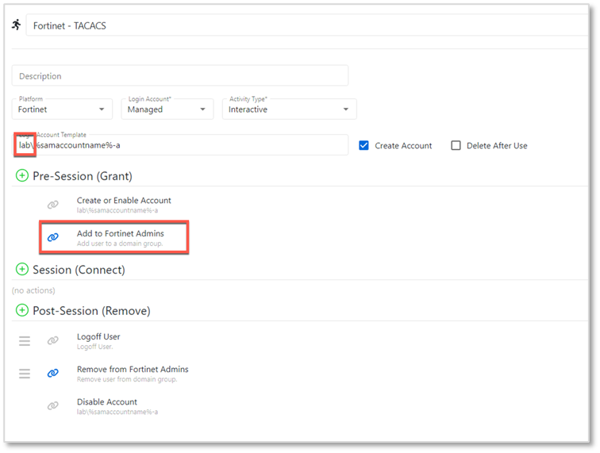
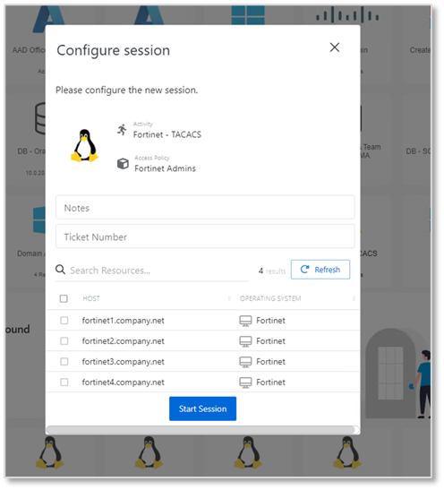
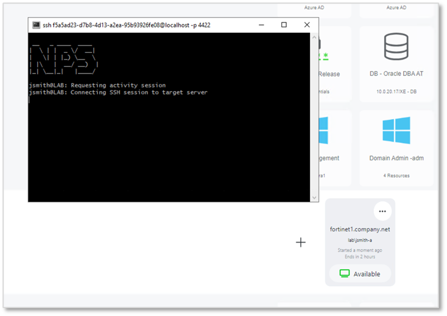

# Onboarding Network Devices Using TACACS Access Control

## Overview

This article describes how to onboard TACACS-enabled network devices as Netwrix Privilege Secure for Access Management resources. You need to create a custom Platform for the device, and a corresponding service account. If multiple types of devices are to be onboarded, multiple sets of custom Platforms and service accounts can be used.

## Instructions

### Step 1 — Creating a Platform

1. Go to **Policy > Platforms**. Select the **Linux** platform, and click the **Copy** icon.

    

2. Rename the `Linux Copy` platform that was just created. The name should reflect the device you intend to onboard, in this case `Fortinet`. Set the **Password Complexity Policy** to `Default` and all change policies to `<none>`.

### Step 2 — Creating a Service Account

1. Go to **Configuration > Service Accounts**.
2. Click the **+** icon and create a new Service Account whose name corresponds to the device you intend to onboard (again, `Fortinet` in this example).

    

    > **NOTE:** This service account is not used to scan the target device since it is not a supported Platform, so any username/password can be provided.

### Step 3 — Onboarding the Network Devices

1. Create a CSV file with the following columns: `DNS Host Name`, `Operating System`, `IP Address`, `Platform`, `Credential`.
2. Populate the CSV file with information for all devices that are to be onboarded.

    > **NOTE:** Ensure that the `Platform` exactly matches the custom Platform you have configured in Privilege Secure. Ensure that the `Credential` exactly matches the service account you have configured in Privilege Secure.

    

3. Go to the **Resources** page. Click **+Add**, and select **New Server**. On the **Add Resources** page, select **Import from CSV**, and select the CSV file you have created. Your resources should be displayed.

    > **NOTE:** There is a 50-resource batch size limit for CSV import.

    

4. Click **Add**. The resources are added and a host scan is attempted for each one. This host scan fails, which is expected for unsupported platforms during initial onboarding.

    

    

Your resources should now be visible on the **Resources** page.

### Notes for Creating an Activity

When creating an Activity that uses domain credentials, do not use the `%targetdomain%` variable in the **Login Account Template**. Use the name of the domain, as indicated.

> **NOTE:** Group membership add/remove operations are needed if access control groups are used for the target devices.

After the activity is configured, it can be added to an access policy in the usual manner, and used to run an activity.

