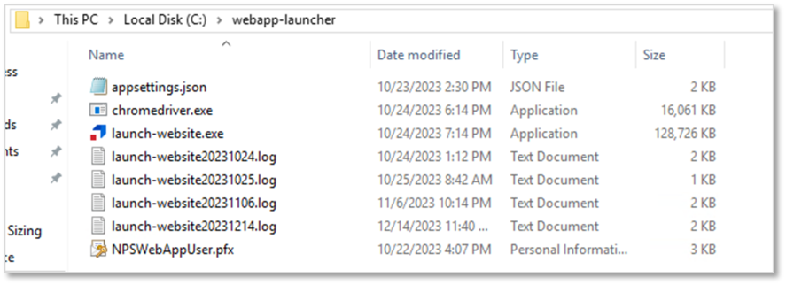
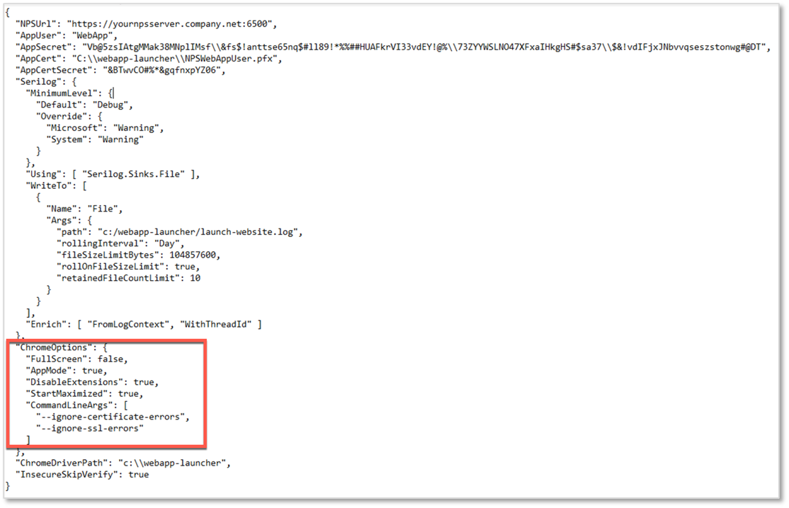
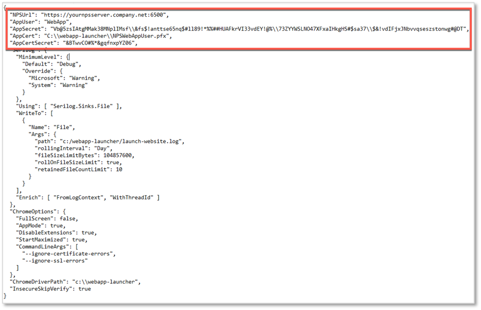
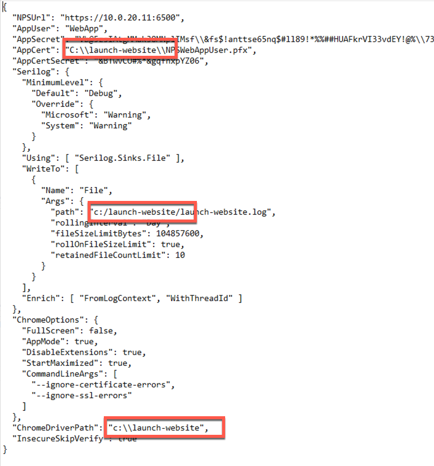
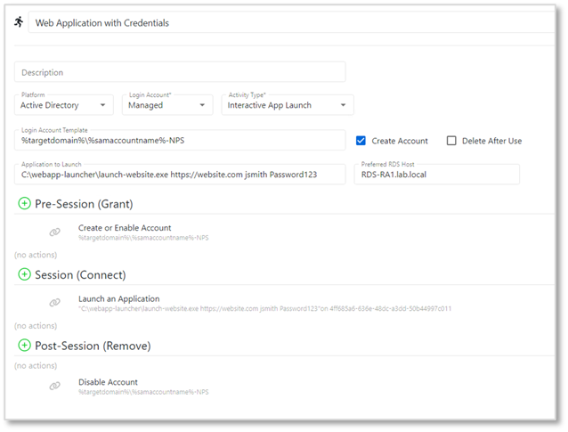
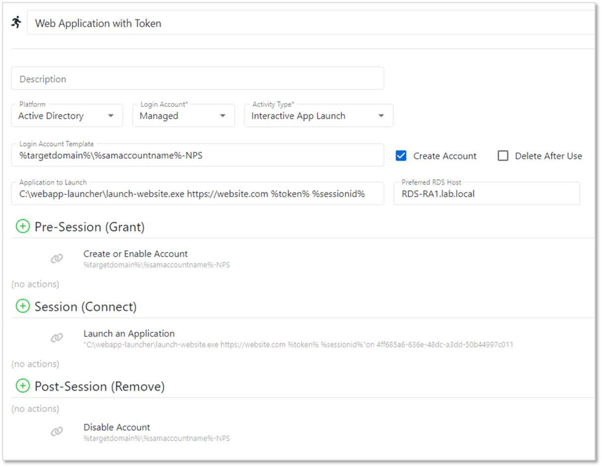
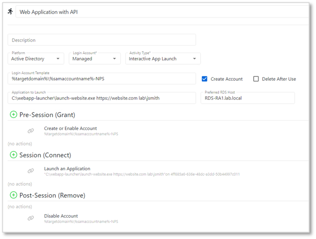

# Configuring the Netwrix Privilege Secure RDS Web App Launcher

## Overview

This article describes how to deploy and configure the Web App Launcher for Netwrix Privilege Secure for Access Management, an application used to launch websites as RemoteApps using Microsoft Remote Desktop Services (RDS).

See [Integrating Activities with Remote Desktop Services (RDS)](https://docs.netwrix.com/docs/kb/privilegesecure/remote-desktop-and-rds/how-to-integrate-activities-with-remote-desktop-services-rds) for information about publishing RemoteApps.

## Instructions

### Deployment

1. Download the [Web App Launcher](https://dl.netwrix.com/additional/WebAppLauncher.zip).
2. On the RDS server, extract the files to a directory of your choosing. The examples in this article use `C:\webapp-launcher\`.

   

### Configuration

#### Runtime Settings

The following runtime settings can be configured for the Web App Launcher:

- **Full Screen**: runs the website in full screen mode
- **App Mode**: runs the browser with no tabs or menu controls
- **Disable Extensions**: prevents the browser from running extensions
- **Start Maximized**: runs the browser maximized
- **Command Line Arguments**: allows certificate and SSL errors to be ignored when using the Web Launcher

To configure these settings:

1. Open `appsettings.json` in your Web App Launcher directory. The `ChromeOptions` section contains the preceding settings.
2. Change the values as required, and save the file.

   

> **NOTE:** These settings affect all websites launched from this Web App Launcher. If you need multiple sets of settings, create another Web App Launcher directory with a different `appsettings.json` configuration, and use the appropriate one in Privilege Secure.

#### API Settings

To use the Web App Launcher:

1. Create an Application User in Privilege Secure.
2. Supply the username and API Key into the `AppUser` and `AppSecret` fields, respectively.
3. Place the certificate in the Web App Launcher directory, with the directory indicated in the `AppCert` field as indicated:

   > **IMPORTANT:** Any backslashes (\\) in the app secret must be escaped with a preceding backslash (\\\\)

   

#### Web App Launcher Directories

Ensure that the indicated paths correspond to the chosen Web App Launcher directory.



### Launch Options and Examples

#### 1. Launching Websites and Passing in Username and Password via Command Line

In this mode, the username and password are passed as parameters on the command line. In a production setting, any command line parameters can be viewed by other users of the RDS host with access to Task Manager. Netwrix recommends using this launch option for testing or non-production use.

Usage:

```
launch-website.exe [url] [username] [password]
```

Example:

```
launch-website.exe https://website.com jsmith Password123
```



> **NOTE:** The login account in this example connects to the RDS session running the Web App Launcher as a remote app. The Web App Launcher launches the website under the context of the user and password supplied as command line arguments.

#### 2. Launching Websites by Passing in a Privilege Secure Token and Session ID (Privilege Secure 4.1 and Above)

In this mode, the token and session ID are passed to the launcher. The launcher uses this information to dynamically pull the username and password from the Privilege Secure Proxy and pass them to the website.

Usage:

```
launch-website.exe [url] [token] [sessionid]
```

Example:

```
launch-website.exe https://website.com %token% %sessionid%
```



> **NOTE:** The login account in this example both connects to the RDS session running the Web App Launcher as a remote app, and is used as the credential to be passed to the website.

#### 3. Launching Websites by Specifying a Username, with the Password Pulled via the Privilege Secure API

In this mode, a username is passed on the command line to the launcher. The launcher calls the Privilege Secure API to get the password stored in the Privilege Secure vault and passes it to the website.

The username value can be in the following formats:

- `Domain\username` – if the website account is a managed account in the domain
- `Resource\username` – if the website account is a managed account on a Resource
- `Website Name\username` – if the website account is stored in the Users tab of a website Resource

Usage:

```
launch-website.exe [url] [username]
```

Example:

```
launch-website.exe https://website.com lab\jsmith
```



> **NOTE:** The login account in this example connects to the RDS session running the Web App Launcher as a remote app. The Web App Launcher launches the website under the context of the username provided on the command line. The Web App Launcher calls the API to get the managed password of the user, and enters it into the password field of the website.
