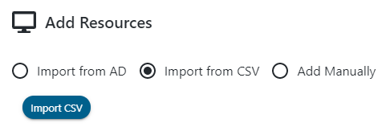
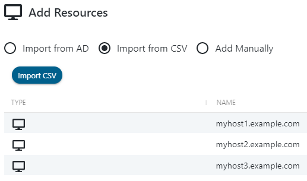

# Adding Resources from a CSV File

## Overview

This article describes how to import resources into Netwrix Privilege Secure for Access Management from a CSV file, where each line of the CSV is a distinct DNS hostname.

## Instructions

1. Create a CSV file that contains the distinct DNS hostname of the resources you want to add to Privilege Secure. For example:

2. In Privilege Secure, go to the **Resources** page. Click **+ Add**, then select the **Import from CSV** radio button at the top of the dialog that appears.

   

3. Click **Import CSV**, then browse to and select the CSV of DNS hostnames you want to import to Privilege Secure.

   

4. On the **Add Resources** page, which lists the resources found in the CSV with a row for each DNS hostname, select a **Service Account** in the bottom-right dropdown. The Service Account must have previously been added to Privilege Secure. This Service Account is used to scan each resource being added.
5. Click **+ Add** to start the resource import. You can wait and view the status of each host scan, or close the window to allow scanning to continue in the background. As resources are imported, they appear on the **Resources** page, along with information gathered by the host scan such as Operation System, DNS Host Name, and IP Address.
