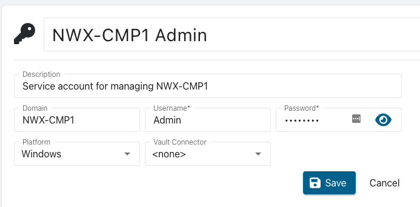
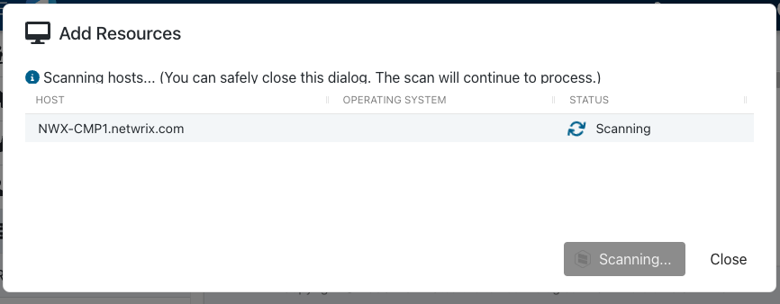
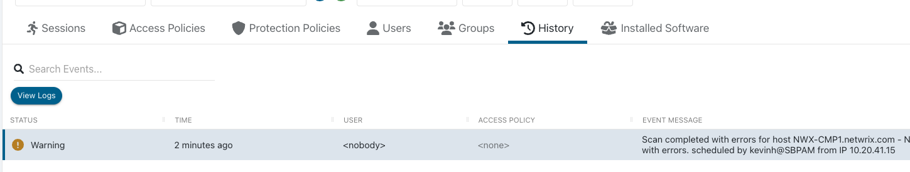
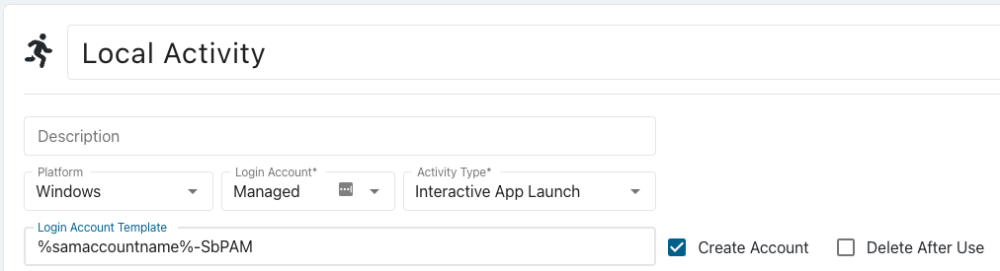

# Managing Non-Domain-Joined Windows Computers with Netwrix Privilege Secure

## Overview

This article describes how to manage a non-domain-joined Windows computer with Netwrix Privilege Secure for Access Management.

## Instructions

### Before You Begin

Ensure that you have the following:

- A local Administrator account on the target computer, for which you know the password
- PowerShell Remoting enabled on the target computer (`Enable-PSRemoting` ⸱ Microsoft) (https://learn.microsoft.com/en-us/powershell/module/microsoft.powershell.core/enable-psremoting?view=powershell-7.2)
- Port 5985 open for connections from the Privilege Secure server (and any hosts running remote action services, if applicable)

### Adding the Netwrix Privilege Secure Service Account

1. As a user with the Administrator role, open Privilege Secure. Go to the **Configuration > Service Accounts** page.
2. Click the green plus button to create a new Service Account.
3. Enter the required information:
   - Name (a friendly name that is displayed in the rest of the UI for this account)
   - Description (additional text for identifying this account)
   - Domain (this MUST be the `NETBIOS` name of the target computer)
   - Username (a local Administrator account on the target computer)
   - Password (the password for the local administrator account)
   - Platform (`Windows`)
   - Vault Connecter (`<none>`)
4. Click **Save**.

   

### Adding the Computer to Netwrix Privilege Secure

1. Go to the **Resources** page.
2. Click the **Add** button.
3. Select **New Server** from the dropdown list.
4. Click the **Add Manually** radio button.
5. Enter the FQDN of the target computer.
6. Click **Add**.
7. In the lower right, select the Service Account created in the previous step.
8. Click **Add**.

The scanning step starts. You can close the dialog or wait for the scan to complete. If there are failures during the scan, you can review the logs on the resource page.

### Troubleshooting a Failed Scan

If the scan fails, you can troubleshoot it by viewing the scan logs on the **Resources** page.

1. Search for the computer you attempted to add.
2. Click the resource name of the computer.
3. Click the **History** tab.
4. Select the last scan event and click **View Logs**.

### Additional Troubleshooting: "Access Denied""

If you see "Access Denied" when investigating the logs, see Netwrix Privilege Secure: Resolving "Access Denied" When Connecting to a Non-domain-joined Windows Resource (https://kb.netwrix.com/8526).

### Using the Computer in Activities

After you complete this process, you can use this computer's resource in Activities. A non-domain joined Windows computer can be used in any activity that does not require Active Directory. You can create local Activity Token users and local managed accounts. Requester and accounts that require Active Directory do not work.

To configure a local Activity Token/Managed Account activity, when creating the activity remove the “%targetdomain%\” portion of the default Login Account Format. Ensure that you also use the **Windows** Platform.

