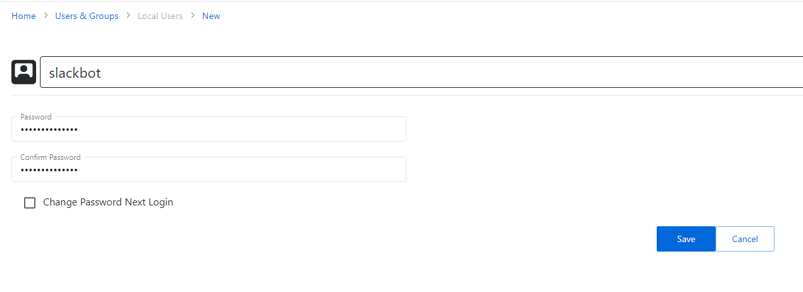
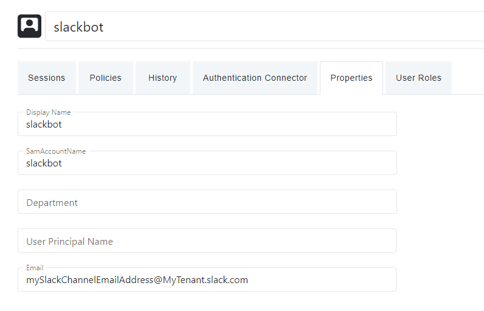

# Sending Approvals to Slack

## Overview

This article describes how to set up an Approval workflow in Netwrix Privilege Secure for Access Management in which a Slack channel receives an approval notification.

## Instructions

1. In Slack, inspect the channel you want to message. The **Integrations** pane has a **Send emails to this channel** setting. Copy the email address.

2. In Privilege Secure, go to the **Users and Groups** page. Click **Add** and create a new **Local user**.

   > **NOTE:** This user does not need to log in to Privilege Secure.

   

3. Set the local user's email address to the Slack channel's email address from step 1:

   

4. You can now add this local account as an additional approver in any approval workflow. It is not used for approvals, but its email address value allows the configured Slack channel to receive approval messages.
