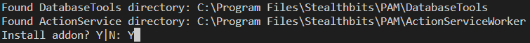
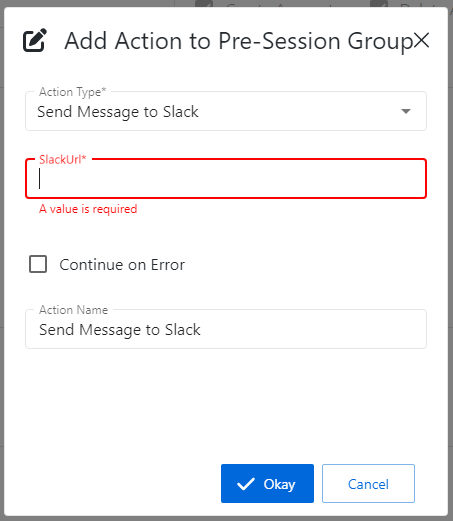

# Integrating Slack to Send Slack Messages

## Overview

This article describes how to set up a custom "Send Slack Message" action step in Netwrix Privilege Secure for Access Management, which you can then add to activities.

## Instructions

### Preparing Your Slack App

Create a custom Slack application for this integration.

1. In Slack, go to the **Your Apps** page: https://api.slack.com/apps/
2. Click **Create New App**.
3. Select **From an app manifest** and paste the following YAML into the provided field:

   ```yaml
   display_information:
     name: NPS App
   settings:
     org_deploy_enabled: false
     socket_mode_enabled: false
     is_hosted: false
     token_rotation_enabled: false
   ```

4. On the **Your Apps** page, select **Incoming Webhooks**.
5. Under **Activate Incoming Webhooks**, click **Add New Webhook to Workspace**.
<a id="URL2"></a>
6. Search for the channel you want Privilege Secure to message. Click **Allow**. Copy the provided URL.

### Importing the Action Step

1. Download the `Send-SlackMessage.zip` archive to the Privilege Secure server: https://dl.netwrix.com/additional/Send-SlackMessage.Addon.zip
2. Extract the archive, which contains a README file, an `ActionTemplates` directory, and an `Install-Addon.ps1` script file. Right-click `Install-Addon.ps1` and select **Run with PowerShell**.
3. When prompted, select `Y` to proceed.

   

4. The PowerShell window should quickly execute the script and close.
5. Log in to the Privilege Secure console. If Privilege Secure was already open, refresh the console.
6. In Privilege Secure, go to **Activities**, select an **Activity**, and click the green plus sign in either the **Pre-Session** or **Post-Session**. The **Send Message to Slack** activity step is now available.
7. Provide the URL from step 6 of Preparing Your Slack App when configuring the action step.

   
