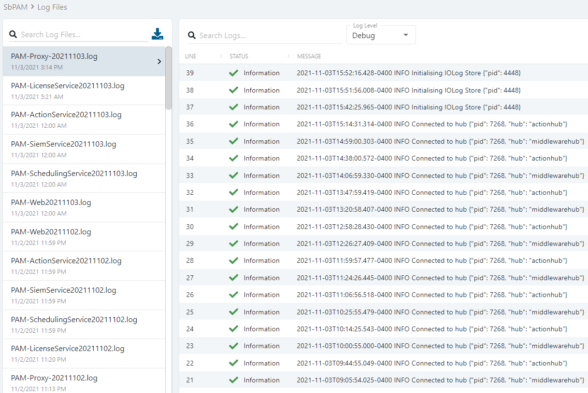

# Locating Logs

## Overview

This article describes where Netwrix Privilege Secure for Access Management stores logs and how to locate and view them. By default, Privilege Secure logs are stored on the Privilege Secure install drive in:

```
\ProgramData\STEALTHbits\PAM\Log
```

## Instructions

### Locate the Log Directory

Privilege Secure uses the `%PROGRAMDATA%` environment variable to determine the location of the log directory. Use Command Prompt to locate this directory by running the following command:

```bat
echo %PROGRAMDATA%
```

### View and Download Logs in the Web Interface

You can also view and download Privilege Secure logs in the web interface. Go to **Audit & Reporting > Log Files**.



## Log Descriptions

- **Action Service -** `PAM-ActionService<date>.log`: The action service is the component that connects Privilege Secure to managed resources. Use cases include Active Directory synchronization, password changes, and account orchestration. If an action experiences an issue, review this log.

- **DbUpdater -** `PAM-DbUpdater<date>.log`: The DbUpdater updates the database with schema changes and updates to built-in activities and new activity steps (actions). If an upgrade fails or an expected activity update is not applied, review this log.

- **Proxy Service -** `PAM-Proxy-<date>.log`: The Privilege Secure proxy service connects users to resources via Remote Desktop Protocol (RDP) and Secure Shell (SSH) protocols; the proxy is also responsible for storage of session recordings via its iolog component. When a user cannot access a resource via RDP or SSH, review this log.

- **Scheduling Service -** `PAM-SchedulingService<date>.log`: The scheduler service is responsible for setting up and maintaining any date/time-specific actions such as password changes and system scans, etc. If a scheduled action fails to execute, review this log in addition to the action service log.

- **Siem Service -** `PAM-SiemService<date>.log`: The Security Information and Event Management (SIEM) service forwards events to configured SIEM endpoints. If there is an issue with event forwarding to a SIEM, review this log.

- **Web Service -** `PAM-Web<date>.log`: The central web service is responsible for database access and communication out to each service component (that is, licensing, email, action, and proxy). If you experience login failures, review this log. Also, if the proxy or action service logs show a failure communicating with the web service, review this log for more information.
