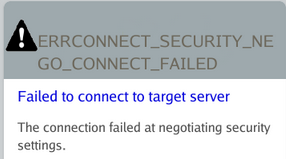
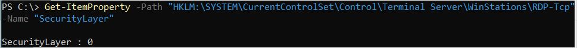
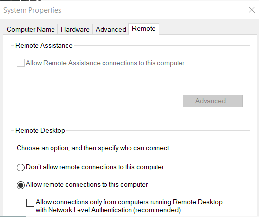
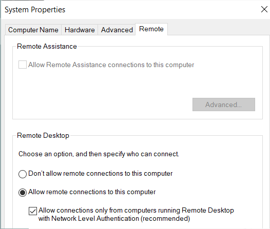

# Error: ERRCONNECT_SECURITY_NEGO_CONNECT_FAILED for Windows RDP Sessions

## Symptom

When connecting via Remote Desktop Protocol (RDP) to a Windows resource, the following error may occur depending on the RDP security settings configured on the target resource:

```
ERRCONNECT_SECURITY_NEGO_CONNECT_FAILED
Failed to connect to target server
The connection failed at negotiating security settings
```



## Cause

This error is caused by the following combination of RDP settings on the target Windows resource:

1. The RDP **SecurityLayer** setting is set to `0` (RDP is used by server and client for authentication). To verify this, run the following in PowerShell and check the resulting **SecurityLayer** on the target Windows resource:

   ```powershell
   Get-ItemProperty -Path "HKLM:\SYSTEM\CurrentControlSet\Control\Terminal Server\WinStations\RDP-Tcp" -Name "SecurityLayer"
   ```

   If the output for **SecurityLayer** is `0`, this condition is met.

   

2. **Network Level Authentication (NLA)** is disabled for RDP.

   To check this setting on the target Windows resource, press Windows+R to open a Run menu or open Command Prompt. In either Run or Command Prompt, run the following:

   ```
   sysdm.cpl
   ```

   In the menu that opens, go to the **Remote** tab. The control **Allow connections only from computers running Remote Desktop with Network Level Authentication** is the correct control.

   If this control is disabled, this condition is met.

   

## Resolution

There are two ways to resolve the error, depending on the security settings you want for your environment:

- Change the RDP **SecurityLayer** value to `1` (server and the client negotiate the method for authentication) or `2` (Transport Layer Security (TLS) protocol is used by the server and the client for authentication), while leaving **Network Level Authentication (NLA)** disabled:

  ```powershell
  Set-ItemProperty -Path "HKLM:\SYSTEM\CurrentControlSet\Control\Terminal Server\WinStations\RDP-Tcp" -Name "SecurityLayer" -Value 2
  ```

- Enable **Network Level Authentication (NLA)** while leaving RDP's **SecurityLayer** value at `0`:

  

> **IMPORTANT:** For optimal security, it is recommended to have RDP's **SecurityLayer** value set to `2` while enabling **Network Level Authentication (NLA)**.

The following links provide additional information about **SecurityLayer** and **Network Level Authentication (NLA)** from Microsoft:

- https://docs.microsoft.com/en-us/windows-hardware/customize/desktop/unattend/microsoft-windows-terminalservices-rdp-winstationextensions-securitylayer
- https://docs.microsoft.com/en-us/windows-server/remote/remote-desktop-services/clients/remote-desktop-allow-access#why-allow-connections-only-with-network-level-authentication

### Additional Troubleshooting

If the preceding configuration on the remote computer does not resolve the issue, apply the following configuration change to Netwrix Privilege Secure for Access Management.

1. Open the `sbpam_rdp.json` proxy configuration file in a text editor: `C:\ProgramData\Stealthbits\PAM\ProxyService\sbpam_rdp.json`
2. Edit the file to ensure that the following setting is configured:

   ```json
   {
      "ClientSettings": [{"key":"RdpSecurity", "Value":true}]
   }
   ```

   > **NOTE:** If the file already exists, ensure that all lines in the file are properly comma-separated after editing the file.

3. If the `sbpam_rdp.json` file does not exist, create the default file by running this command from the Proxy Service installation directory (by default `C:\Program Files\Stealthbits\PAM\ProxyService`):

   ```
   sbpam-proxy.exe cfg -c sbpam_rdp
   ```

> **NOTE:** Preserve file paths and executable names exactly as shown earlier when you edit or run commands.
