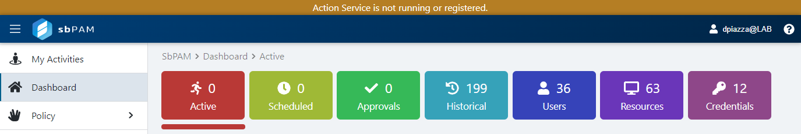
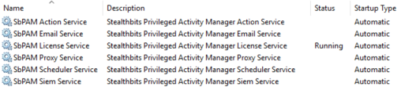
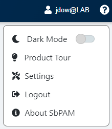
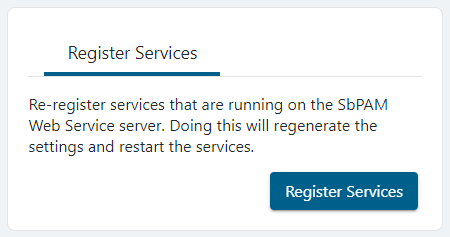

# Services Are Not Running

## Overview

This article describes how to bring Netwrix Privilege Secure for Access Management services back online. If services are down, a warning appears at the top of the user interface.



## Instructions

If a warning appears at the top of the Privilege Secure interface stating a service is offline, complete the following steps to attempt to bring the affected service back online.

1. Check the services on the server.
   - Open **Windows Services** and verify whether any Privilege Secure services are not running.
   - Example screenshot:

     

   - If any services are not running, start them using the **Windows Services** interface or run the following in PowerShell as an administrator:

     ```powershell
     Start-Service sbpam*
     ```

   - In this instance, 1 out of the 5 services is running, so you can manually start the services by opening `services.msc` on the local Privilege Secure server.

2. If services are running but the UI still shows a warning, re-register the services in the web UI.
   - If all Privilege Secure services are running in **Windows Services** yet there is still a services warning in the Privilege Secure web application interface, re-register the services with Privilege Secure.
   - Log in to the Privilege Secure web application as an Admin.
   - In the upper-right, click the current logged-in user's name, then click **Settings**, and then click **Register Services**.

     

     

3. If issues persist:
   - Gather the Privilege Secure logs by following the steps in this article: https://kb.netwrix.com/5874
   - Contact [Netwrix Support](https://www.netwrix.com/support.html).

If issues continue after these steps, provide the gathered logs to Netwrix Support for further assistance.
