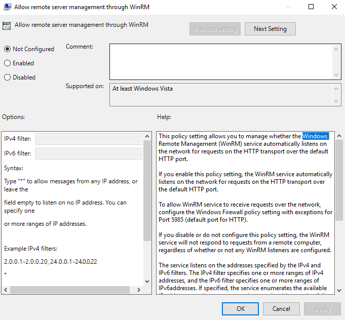

# Troubleshooting Failed Action Service Connections to Windows Resources (PSRemoting/WinRM)

## Overview

This article describes the variables that affect whether the Netwrix Privilege Secure for Access Management Action Service connects to a target Windows resource via PowerShell Remoting (PSRemoting), and the steps to resolve them.

The Action Service handles various workflows, including host scans and pre- and post-session actions. The Action Service must establish a connection via PSRemoting for Windows target resources. PSRemoting is a PowerShell implementation of WinRM (Windows Remote Management).

## Instructions

Before running tests, complete the following steps on the target resource.

### Verify PSRemoting and WinRM Are Enabled

In PowerShell, run the following command:

```powershell
Test-WSMan
```

The following output appears if both PSRemoting and WinRM are enabled:

```
wsmid: http://schemas.dmtf.org/wbem/wsman/identity/1/wsmanidentity.xsd
ProtocolVersion : http://schemas.dmtf.org/wbem/wsman/1/wsman.xsd
ProductVendor   : Microsoft Corporation
ProductVersion  : OS: 0.0.0 SP: 0.0 Stack: 3.0
```

If PSRemoting and/or WinRM are not enabled on the target resource, the following output appears:

```
Test-WSMan : <f:WSManFault xmlns:f="http://schemas.microsoft.com/wbem/wsman/1/wsmanfault" Code="2150858770""
Machine="%machine_name%"><f:Message>The client cannot connect to the destination specified in the request. Verify that
the service on the destination is running and is accepting requests. Consult the logs and documentation for the
WS-Management service running on the destination, most commonly IIS or WinRM. If the destination is the WinRM service,
run the following command on the destination to analyze and configure the WinRM service: "winrm quickconfig".
</f:Message></f:WSManFault>
At line:1 char:1
+ Test-WSMan
+ ~~~~~~~~~~
+ CategoryInfo          : InvalidOperation: (:) [Test-WSMan], InvalidOperationException
+ FullyQualifiedErrorId : WsManError,Microsoft.WSMan.Management.TestWSManCommand
```

**Resolution:** Run the following command in PowerShell with administrator privileges to enable PSRemoting/WinRM:

```powershell
Enable-PSRemoting
```

The following output appears:

```
WinRM has been updated to receive requests.
WinRM service type changed successfully.
WinRM service started.

WinRM has been updated for remote management.
Created a WinRM listener on HTTP://* to accept WS-Man requests to any IP on this machine.
WinRM firewall exception enabled.
```

### Verify Ports

Verify that ports 5985 (HTTP) and/or 5986 (HTTPS) are open in the Windows firewall and any network firewalls. WinRM uses these ports for HTTP and HTTPS communications, respectively.

### Review Group Policy Settings

Group Policy settings filter the origin of WinRM requests via IPv4 and IPv6 filters. If issues with PSRemoting/WinRM communications persist after enabling PSRemoting/WinRM and verifying firewall settings, the IP filter in Group Policy may be affecting the communication.

For details about the **Allow remote server management through WinRM** Group Policy setting, see [Configure Remote Management in Server Manager − Enabling or Disabling Remote Management ⸱ Microsoft 🡥](https://learn.microsoft.com/en-us/windows-server/administration/server-manager/configure-remote-management-in-server-manager#enabling-or-disabling-remote-management).



### Allow Full Control to Remote Management Users

Review the access permissions set up for Remote Management Users by running the following command in PowerShell with administrator privileges:

```powershell
Get-PSSessionConfiguration -Name Microsoft.PowerShell
```

Review the permissions of the **BUILTIN\Remote Management Users** group under the **Permission** section. If the permission is **AccessDenied**, authenticated network users (that is, remote PSRemoting requests) cannot connect, even if credentials and other variables are correct.

**Solution:** Run the following command in PowerShell with administrator privileges to review and change permissions for Remote Management Users:

```powershell
Set-PSSessionConfiguration -Name Microsoft.PowerShell -ShowSecurityDescriptorUI -Force
```

Select **Remote Management Users** and change **Full Control** from **Deny** to **Allow**, then click **Apply** and **OK**.

### Testing the Action Service Connection

Test the ability of the Action Service to connect to a target resource via PowerShell Remoting by running the following PowerShell command on the server running the Action Service:

```powershell
Invoke-Command -ComputerName %target_resource% -Credential (Get-Credential) -ScriptBlock { whoami }
```

> **IMPORTANT:** Replace `%target_resource%` with the target fully qualified domain name (FQDN).

When prompted for credentials, use the credentials of the service account assigned to the target resource in Privilege Secure. If the remote request succeeds, it returns the username used for authentication.

```
PS C:\Users\admin> Invoke-Command -ComputerName TEST-DC -Credential (Get-Credential) -ScriptBlock { whoami }

cmdlet Get-Credential at command pipeline position 1
Supply values for the following parameters:
Credential
test\admin
```

The output indicates that the credentials used can run remote PowerShell commands on the target resource from the Action Service server via WinRM.

## Related Links

[Configure Remote Management in Server Manager − Enabling or Disabling Remote Management ⸱ Microsoft 🡥](https://learn.microsoft.com/en-us/windows-server/administration/server-manager/configure-remote-management-in-server-manager#enabling-or-disabling-remote-management)

