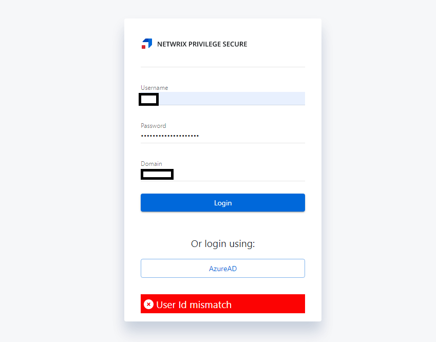

# Troubleshooting a "User Id Mismatch" Error During Login

## Overview

This article describes how to resolve a "User Id Mismatch" response that you may receive when logging in to the Netwrix Privilege Secure for Access Management console, which prevents login. The response is caused by a mismatch between a Privilege Secure user stored in a cookie and the user attempting login. Generally this is caused when multiple sessions are being launched from the same browser using different users.

## Instructions

1. Log out of all active Privilege Secure sessions.
2. Clear your browser's cookies.
3. Reattempt login using your desired account. You should now be able to successfully log in.
